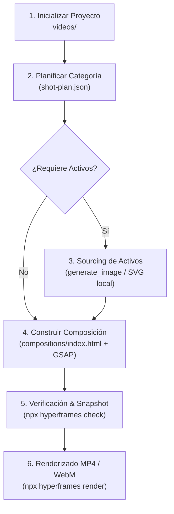

# 🎬 MOTION-GRAPHICS: Creación de Gráficos Animados y Videos Cortos (HyperFrames para Google Antigravity)

Este workflow habilita y adapta el skill **motion-graphics** (HyperFrames) para su ejecución autónoma y de primera clase dentro del entorno **Google Antigravity IDE y CLI** en sistemas Windows / Multiplataforma.

Permite generar gráficos animados de alta calidad visual (de 5 a 30 segundos) sin narración:
- **Kinetic Typography**: Textos y citas con movimiento dinámico.
- **Stat Count-Up**: Contadores numéricos con anillos y gráficos de impacto.
- **Charts / Data-Viz**: Gráficos de barras, líneas y sectores animados.
- **Logo Reveal**: Aperturas y cierres de marca / stingers vectoriales.
- **Lower Thirds**: Zócalos informativos y banners de overlay social.
- **UI / Webpage**: Animaciones de scroll, cursor y llamadas de atención en interfaces.

---

## 0. Adaptaciones Específicas para Google Antigravity

A diferencia de entornos basados en Bash/Linux estándar, este workflow en Antigravity aplica las siguientes optimizaciones de ingeniería:

1. **PowerShell y Windows-Native**:
   - Se prohíbe el uso de subshells de bash tipo `(cd "$DIR" && ...)`.
   - Se utiliza la herramienta nativa `run_command` con el parámetro explícito `Cwd` apuntando al directorio del video.
2. **Generación de Activos con `generate_image`**:
   - Cuando una animación requiera fondos, texturas o ilustraciones, se utiliza la tool nativa `generate_image` de Antigravity en lugar de depender de claves externas de API de terceros.
3. **Previsualización en Navegador**:
   - Para inspeccionar el resultado en tiempo real, se levanta el servidor de previsualización con `npx hyperframes preview` y se puede inspeccionar mediante `browser_subagent`.

---

## 1. Pipeline de Ejecución Paso a Paso



---

### Paso 0: Inicialización del Directorio de Video

1. Determinar el nombre del proyecto en kebab-case (ej. `cine-promo-motion`, `stat-box-office`).
2. Directorio de trabajo: `videos/<project-name>/` dentro del workspace.
3. Inicializar el proyecto ejecutando mediante `run_command`:

```powershell
npx -y hyperframes init "videos/<project-name>" --non-interactive --example=blank --skill=motion-graphics
```

*Restricción:* Nunca inicializar en la raíz del repositorio; siempre dentro de una subcarpeta bajo `videos/`.

---

### Paso 1: Planificación y Categorización (`shot-plan.json`)

Identificar la categoría óptima según el requerimiento:

| Categoría | Propósito | Componentes Reutilizables |
| :--- | :--- | :--- |
| `kinetic-type` | Citas contundentes, títulos animados con tipografía de alto impacto. | Bloques de texto cinético + GSAP timeline |
| `stat` | Cifra récord, contador de ingresos o butacas con efecto count-up. | Contadores dinámicos + barras de progreso |
| `charts` | Comparativas de taquilla, asistencia por complejo o gráficos de barras. | Módulos SVG de datos + Chart timelines |
| `logo-reveal` | Animación del logotipo de Cine Center o de una distribuidora. | SVG Path drawing + fade-in escalonado |
| `lower-thirds` | Presentación de ponentes, títulos de salas o avisos de confitería. | Banners de tercio inferior con salida limpia |
| `webpage` | Demostración de interacción con la PWA o el ERP. | Mockups de ventana con cursor interactivo |

Generar el archivo `videos/<project-name>/shot-plan.json` con la duración (5s a 15s recomendado), paleta de colores y capas.

---

### Paso 2: Sourcing de Activos Visuales (Si aplica)

Si la categoría requiere texturas, pósters o logotipos:
- Utilizar la herramienta nativa `generate_image` de Antigravity para crear el activo visual en `videos/<project-name>/assets/`.
- O bien referenciar activos locales ya existentes (por ejemplo imágenes JPEG o vectores SVG).

---

### Paso 3: Construcción de la Composición (`compositions/index.html`)

Crear el archivo `compositions/index.html` bajo el contrato canónico de HyperFrames:
- Línea de tiempo GSAP pausada registrada en `window.__timelines`.
- Estructura HTML semántica con contenedores `#canvas` de resolución fija (1920x1080 para horizontal o 1080x1920 para vertical).
- Animaciones deterministas dependientes del tiempo relativo (sin `setTimeout` ni `setInterval` flotantes).
- Tipografía importada (Google Fonts como `Inter` o `Montserrat`).

Ejemplo de estructura mínima:
```html
<!DOCTYPE html>
<html lang="es">
<head>
  <meta charset="UTF-8">
  <script src="https://cdnjs.cloudflare.com/ajax/libs/gsap/3.12.2/gsap.min.js"></script>
  <style>
    body, html { margin: 0; padding: 0; width: 100%; height: 100%; overflow: hidden; background: #0A0A0A; }
    #canvas { width: 1920px; height: 1080px; position: relative; display: flex; align-items: center; justify-content: center; font-family: 'Inter', sans-serif; }
    .title { color: #FAFAFA; font-size: 80px; font-weight: 700; opacity: 0; }
  </style>
</head>
<body>
  <div id="canvas">
    <div class="title" id="mainTitle">CINE CENTER PREMIERE</div>
  </div>
  <script>
    const tl = gsap.timeline({ paused: true });
    tl.to("#mainTitle", { opacity: 1, y: -20, duration: 1.5, ease: "power3.out" });
    window.__timelines = [tl];
  </script>
</body>
</html>
```

---

### Paso 4: Verificación y Control de Calidad

Ejecutar las comprobaciones automáticas con `run_command` (con `Cwd="videos/<project-name>"`):

```powershell
npx hyperframes check .
```

Si se requieren snapshots de validación:
```powershell
npx hyperframes snapshot --at 0.5,1.5,3.0
```

---

### Paso 5: Renderizado Final a Video

Una vez verificada la composición:
1. Para video estándar MP4:
   ```powershell
   npx hyperframes render . --skill=motion-graphics -q high -o ./renders/video.mp4
   ```
2. Para overlay transparente (WebM con canal alfa):
   ```powershell
   npx hyperframes render . --skill=motion-graphics --format webm -o ./renders/overlay.webm
   ```
3. Informar al usuario la ruta del archivo generado y reproducir o exhibir el snapshot de prueba.
