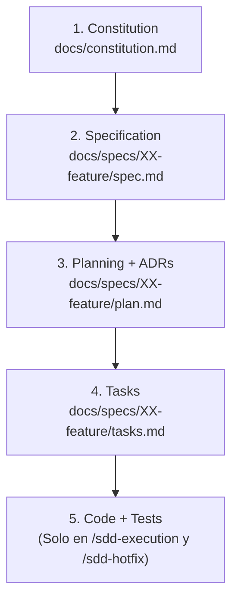
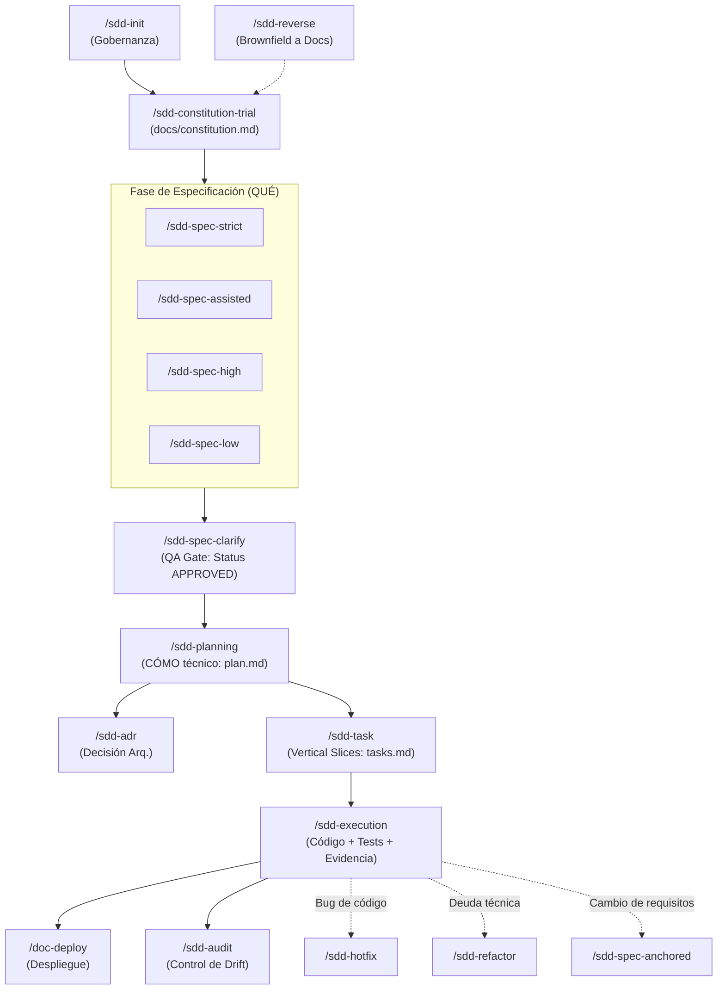

# AGENTS.md — Guía Operativa Maestra y Gobernanza de Agentes IA (Spec-Driven Development)

Este documento es el **contrato operativo permanente** para cualquier agente de Inteligencia Artificial que colabore en este repositorio. Define las reglas innegociables de arquitectura, ejecución, jerarquía documental, límites de autonomía y flujo de desarrollo bajo la metodología **Spec-Driven Development (SDD)**.

---

## 1. Jerarquía de Verdad y Precedencia por Ámbito

Cuando existan dudas, discrepancias o ambigüedades durante el análisis, diseño o implementación, el agente debe respetar estrictamente la siguiente jerarquía de autoridad:

### Regla Fundamental de Precedencia
> **Un nivel inferior jamás puede contradecir, debilitar ni ignorar una decisión explícita de un nivel superior, pero tiene plena autoridad para definir decisiones propias dentro de su ámbito específico.**

* **`docs/constitution.md` (Constitución)**: Fuente suprema de verdad. Define el dominio global, visión, lenguaje ubicuo, actores, matriz de permisos, stack tecnológico oficial, invariantes universales y convenciones no negociables.
* **`docs/specs/XX-feature/spec.md` (Especificación Funcional)**: Define con precisión el **QUÉ** de la feature (historias de usuario, requerimientos funcionales EARS, reglas de negocio, modelo conceptual de datos, máquina de estados y criterios de aceptación Gherkin). No se contamina con detalles internos de implementación.
* **`docs/specs/XX-feature/plan.md` (Plan Técnico)**: Define el **CÓMO** de la feature (arquitectura interna, árbol físico de archivos, contratos tipados, DTOs, diagramas de secuencia/ER, persistencia física, integraciones externas y estrategia de testing).
* **`docs/specs/XX-feature/tasks.md` (Plan de Tareas)**: Define el **TRABAJO EJECUTABLE** desglosado en Vertical Slices atómicas, con dependencias topológicas, criterios de Done y comandos de verificación.
* **`Code + Tests` (Código y Suites de Prueba)**: Materialización física ejecutable. No sustituye la documentación como fuente de verdad. El código mal implementado frente a una especificación aprobada se clasifica como *Spec Drift* y debe corregirse de inmediato.

### Prohibición Absoluta de Rutas Absolutas de Máquina
Queda estrictamente prohibido registrar en la documentación rutas dependientes del entorno local del desarrollador (tales como `file:///...`, `C:\...`, `/home/...`, `/Users/...`).
**Obligatorio:** Utilizar exclusivamente rutas relativas referenciadas a la raíz del repositorio:
* `docs/constitution.md`
* `docs/specs/XX-feature/spec.md`
* `docs/specs/XX-feature/plan.md`
* `docs/specs/XX-feature/tasks.md`

---

## 2. Candado de Inmutabilidad en Disco (Pre-Execution Filesystem Lock)

El repositorio está protegido por un **Candado de Disco de Doble Nivel**:

### Nivel 1 — Bloqueo Total de Código en Fases de Diseño y Gobernanza
Durante la ejecución de `/sdd-init`, `/sdd-constitution-trial`, `/sdd-spec-strict`, `/sdd-spec-assisted`, `/sdd-spec-high`, `/sdd-spec-low`, `/sdd-spec-clarify`, `/sdd-planning`, `/sdd-task`, `/sdd-spec-anchored`, `/sdd-reverse`, `/sdd-audit` y `/sdd-adr`:
* **PROHIBIDO** crear, modificar, renombrar o eliminar archivos de código fuente de producción (`src/`, `app/`, `lib/`, etc.).
* **PROHIBIDO** crear, modificar o eliminar archivos de pruebas (unitarias, integración, E2E/BDD).
* **PROHIBIDO** alterar archivos de configuración del proyecto (`package.json`, `composer.json`, etc.), variables de entorno (`.env`) o infraestructura.
* **PROHIBIDO** ejecutar migraciones destructivas o seeders que alteren bases de datos.

**Ámbitos exclusivos de escritura permitida antes de `/sdd-execution`:**
* `AGENTS.md` (únicamente en `/sdd-init`).
* `docs/constitution.md` (en `/sdd-constitution-trial` o `/sdd-reverse`).
* `docs/specs/XX-feature/spec.md`, `plan.md`, `tasks.md` (según el workflow documental activo).
* `docs/adr/ADR-XX.md` (únicamente en `/sdd-adr`).

### Nivel 2 — Modo 100% Read-Only durante Entrevistas y Clarificación (Tiempo 1)
Mientras existan preguntas abiertas, ambigüedades detectadas o decisiones pendientes de confirmación por el usuario, el agente **NO debe escribir ni modificar ningún archivo en disco** (ni siquiera en `docs/`). Toda propuesta o debate debe ocurrir en el chat. Solo al obtener confirmación se procede a escribir en disco en el Tiempo 2.

---

## 3. Principio de Conservación Total de Contexto (Zero-Loss) e Inteligencia Contextual

### Conservación Total de Contexto (Zero-Loss Structuring)
* **"Limpio y preciso" NO significa "resumido o recortado"**: Un documento SDD riguroso preserva el 100% de la riqueza funcional, reglas de negocio, fórmulas matemáticas, excepciones, validaciones de frontera y casos especiales provistos por el usuario.
* **Prohibición de resúmenes destructivos**: Nunca reemplazar párrafos de reglas complejas con frases genéricas como *"El sistema calculará según las reglas del negocio"*. Se debe desglosar cada regla individualmente (`RB-01`, `RB-02`, etc.) y modelar sus escenarios correspondientes.

### Inteligencia Contextual Activa (Razonamiento Ingenieril)
El agente debe aplicar pensamiento sistémico y razonamiento técnico senior para:
1. **Analizar el contexto profundo**: Entender la raíz del problema de negocio y flujos implícitos requeridos.
2. **Deducir lógicas de implementación y casos borde**: Prever concurrencia, condiciones de carrera (*race conditions*), transacciones atómicas, estados vacíos (*zero-states*), latencia y fallbacks.
3. **Exponer abiertamente las deducciones**: Proponer soluciones técnicas fundamentadas en el Plan Técnico, y someter a consulta del usuario las bifurcaciones de negocio que admitan múltiples caminos válidos.

---

## 4. Clasificación de Decisiones y Límites de Autonomía

El agente debe categorizar las decisiones en tres niveles estrictos:

1. **Decisiones de Negocio (Autoridad Exclusiva del Usuario / Dominio)**:
   * Ejemplos: Políticas de cancelación, reglas de comisiones, obligatoriedad funcional de relaciones, plazos de expiración.
   * **Regla**: La IA nunca las inventa ni las asume en silencio. Si hay vacíos, expone las alternativas lógicas y solicita confirmación.
2. **Decisiones Arquitectónicas y de Alto Nivel Técnico (Co-Diseño IA + Usuario en Planning)**:
   * Ejemplos: Políticas de integridad (`RESTRICT` vs `CASCADE`), procesamiento síncrono vs colas asíncronas, estrategias de transacciones o aislamiento.
   * **Regla**: La IA propone la solución óptima justificándola técnicamente y marcando una opción `(Recomendada)`.
3. **Decisiones Técnicas de Bajo Impacto (Autonomía Plena en Execution)**:
   * Ejemplos: Nombres de variables locales, métodos privados, refactorizaciones internas sin alterar contratos públicos, optimizaciones de algoritmos en memoria.
   * **Regla**: El agente las resuelve de forma autónoma siguiendo principios de *Clean Code* y las directrices de `docs/constitution.md`.

---

## 5. Catálogo Oficial de Comandos SDD

El ciclo de vida del desarrollo se gestiona a través de los 16 workflows especializados:

| Comando | Propósito | Entrada | Salida | Permiso en Disco |
| :--- | :--- | :--- | :--- | :--- |
| **`/sdd-init`** | Inicializar gobernanza y reglas maestras | Repositorio | `AGENTS.md` | Solo `AGENTS.md` |
| **`/sdd-constitution-trial`** | Fundar dominio, actores, stack e invariantes globales | Requisitos globales | `docs/constitution.md` | Solo `docs/constitution.md` |
| **`/sdd-spec-strict`** | Formalizar especificación 1:1 con fidelidad estricta | Enunciado formal | `docs/specs/XX/spec.md` (`IN_REVIEW`) | Solo `spec.md` (Tiempo 2) |
| **`/sdd-spec-assisted`** | Co-diseñar feature con deducción proactiva de casos borde | Idea / Enunciado | `docs/specs/XX/spec.md` (`IN_REVIEW`) | Solo `spec.md` (Tiempo 2) |
| **`/sdd-spec-high`** | Especificación formal estándar con entrevista priorizada (`P0`-`P9`) | Caso de uso | `docs/specs/XX/spec.md` (`IN_REVIEW`) | Solo `spec.md` (Tiempo 2) |
| **`/sdd-spec-low`** | Especificación ágil de alcance acotado y bajo riesgo | Requerimiento menor | `docs/specs/XX/spec.md` (`IN_REVIEW`) | Solo `spec.md` |
| **`/sdd-spec-clarify`** | QA Gate: Auditoría contra ambigüedades y aprobación formal | `spec.md` (`IN_REVIEW`) | `spec.md` (`APPROVED`) | Solo `spec.md` (Tiempo 2) |
| **`/sdd-adr`** | Evaluar alternativas y registrar decisión arquitectónica | Duda estructural | `docs/adr/ADR-XX.md` | Solo `docs/adr/` |
| **`/sdd-planning`** | Diseñar arquitectura física, contratos tipados y secuencias | `spec.md` (`APPROVED`) | `docs/specs/XX/plan.md` (`APPROVED`) | Solo `plan.md` (Tiempo 2) |
| **`/sdd-task`** | Desglosar en Vertical Slices atómicas con orden topológico | `plan.md` (`APPROVED`) | `docs/specs/XX/tasks.md` (`READY`) | Solo `tasks.md` |
| **`/sdd-execution`** | Implementación física, suites de pruebas y cierre de tareas | `tasks.md` (`READY`) | Código + Tests + Evidencias | **Código + Tests + tasks.md** |
| **`/sdd-spec-anchored`** | Evolución sincronizada de la tríada ante cambios | Nuevo requerimiento | `spec.md` + `plan.md` + `tasks.md` | Solo `docs/specs/XX/` |
| **`/sdd-spec-anchored-*`** | Actualización puntual de Spec, Plan o Tasks | Modificación atómica | Archivo respectivo de la tríada | Solo el archivo `.md` |
| **`/sdd-hotfix`** | Corrección inmediata de bug con test de regresión | Bug de código | Código + Test + Tarea `[FIX]` | **Código + Tests + tasks.md** |
| **`/sdd-refactor`** | Reestructuración de diseño técnico preservando comportamiento | Mejora técnica | `plan.md` + Tareas `[REFACTOR]` | Solo `plan.md` y `tasks.md` |
| **`/sdd-reverse`** | Ingeniería inversa de código existente a documentación SDD | Código existente | `constitution.md` / `spec` / `plan` | Solo `docs/` (Código Read-Only) |
| **`/sdd-audit`** | Auditoría integral de trazabilidad y detección de *Spec Drift* | Docs + Código | Reporte analítico en chat | **Cero escritura (100% Read-Only)** |
| **`/doc-deploy`** | Documentación de despliegue en producción e infraestructura | Módulos listos | Guías y artefactos de despliegue | Solo documentación de deploy |

---

## 6. Estándares de Calidad de Ingeniería e Invariantes Operativas

### 6.1 Principios de Construcción y Ejecución
* **Tipado Estricto**: Prohibido el uso de tipos opacos o comodines injustificados (`any`, `dynamic`, `unknown`) cuando el lenguaje ofrezca sistemas de tipos robustos.
* **Manejo Explícito de Excepciones**: No silenciar excepciones ni dejar bloques `catch` vacíos. Cada error observable debe tiparse adecuadamente.
* **Separación de Responsabilidades**: Las capas de presentación, aplicación, dominio e infraestructura deben mantenerse desacopladas de acuerdo al `plan.md`.
* **Testing Basado en Riesgo**: Demostrar cobertura de comportamiento observable con pruebas de caja negra (BDD/E2E) y precisión algorítmica con pruebas unitarias de caja blanca para cálculos críticos o máquinas de estado.
* **Evidencia Física Verificable**: Una tarea solo se marca `[x] COMPLETED` en `tasks.md` cuando el código está implementado, los linters pasan sin advertencias y los tests asociados han sido ejecutados físicamente con resultado exitoso documentado en la tarea.

### 6.2 Las 9 Invariantes Operativas de SDD
1. **Candado de Disco Pre-Execution**: Ninguna fase previa a `/sdd-execution` modifica código, tests ni entornos.
2. **Cero Pérdida de Información (Zero-Loss)**: Los requerimientos y reglas nunca se simplifican ni resumen destructivamente.
3. **Inteligencia Contextual Activa**: El agente deduce implicaciones y casos borde de forma proactiva, sin inventar reglas de negocio a espaldas del usuario.
4. **Subordinación Jerárquica**: Los artefactos inferiores nunca contradicen a los superiores (`Code` $\le$ `Tasks` $\le$ `Plan` $\le$ `Spec` $\le$ `Constitution`).
5. **Respeto a los Gates de Estado**: Ningún flujo toma como entrada definitiva artefactos no aprobados (`IN_REVIEW` debe pasar por `/sdd-spec-clarify`).
6. **Evidencia Física Verificable**: Las tareas se cierran exclusivamente con ejecuciones de pruebas y comprobaciones reales en terminal.
7. **Trazabilidad Bidireccional**: Cada historia y requerimiento se enlaza a sus escenarios, componentes técnicos, tareas y tests (`HU` $\rightarrow$ `RF` $\rightarrow$ `SC` $\rightarrow$ `PLAN` $\rightarrow$ `Task` $\rightarrow$ `Test`).
8. **Corrección en el Nivel de Origen**: Las discrepancias se solucionan en el documento donde radica la decisión, propagando el ajuste en cascada.
9. **Separación QUÉ vs. CÓMO**: La especificación functional es independiente de la implementación; el plan técnico resuelve los detalles concretos del software.

---

## 7. Comandos de Entorno, Construcción y Verificación del Proyecto

> *Nota: Este repositorio ha sido inicializado como un proyecto Greenfield puro. La siguiente tabla registra los comandos estándar que se consolidarán formalmente tras definir el stack tecnológico en `docs/constitution.md`.*

| Acción | Comando | Descripción |
| :--- | :--- | :--- |
| **Contenedores Soberanos por Módulo** | `cd ms/<modulo> && docker compose up -d` | Levantamiento autónomo de contenedores y BDs dentro de cada módulo en `ms/` |
| **ms/cinema-core (Azure)** | `cd ms/cinema-core/backend && npm test` `cd ms/cinema-core/frontend && npm test` | Backend NestJS (GraphQL Apollo, Puerto 3002) y Frontend Angular ERP (Puerto 4200) |
| **ms/ticketing-auth (AWS) [URL Principal]** | `cd ms/ticketing-auth/backend && ./gradlew test` `cd ms/ticketing-auth/frontend && npm test` | Backend Spring Boot (Puerto 8082) y Frontend React Portal de Cliente (Puerto 3000) |
| **ms/media-hub (GCP)** | `cd ms/media-hub && php artisan test` | Monolito Fullstack Laravel 11 + Inertia.js + Vue.js 3 (Puerto 8080) |
| **ms/ai-mcp (GCP)** | `cd ms/ai-mcp/backend && pytest` | Backend FastAPI MCP (Puerto 8001) *(Servicio Headless de IA)* |
| **ms/mobile-app (Flutter)** | `cd ms/mobile-app && flutter test` | Pruebas unitarias de billetera de boletos y validación de QR Llave en App Móvil |
