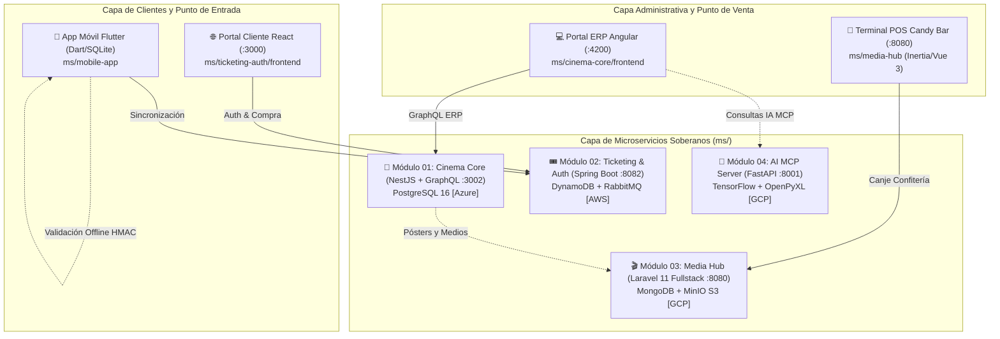

# Plataforma Integral de Gestión Cinematográfica (Cine Center)

> **Metodología:** Spec-Driven Development (SDD) & SDD-Extended  
> **Gobernanza:** Subordinado a [`docs/constitution.md`](./docs/constitution.md) y [`AGENTS.md`](./AGENTS.md)  
> **URL Principal de Cliente:** `http://localhost:3000/` (React en `ms/ticketing-auth`)  
> **Portal de Administración Unificado:** `http://localhost:4200/admin` (Angular en `ms/cinema-core`)

---

## 🌟 1. Visión y Arquitectura Global

Cine Center es una plataforma integral de gestión cinematográfica y venta de entradas inspirada en complejos comerciales modernos. Su arquitectura se estructura estrictamente en **módulos verticales autónomos ubicados al 100% dentro de la carpeta [`ms/`](./ms)**, combinando despliegues Multi-Cloud (Azure, AWS, GCP) y una aplicación móvil independiente Offline-First:



---

## 📦 2. Guías de Levantamiento por Módulo

Cada proyecto en `ms/` es un repositorio autónomo con su propio `README.md` detallado con instrucciones paso a paso:

| # | Módulo | Directorio | Stack Tecnológico | Nube | Puerto(s) | Guía de Levantamiento |
| :-: | :--- | :--- | :--- | :---: | :---: | :--- |
| **01** | **Cinema Core ERP** | [`ms/cinema-core`](./ms/cinema-core) | NestJS 10 + Angular 17 + PostgreSQL 16 | Azure | `4200` / `3002` | [📘 Ver README](./ms/cinema-core/README.md) |
| **02** | **Ticketing & Auth (URL Principal)** | [`ms/ticketing-auth`](./ms/ticketing-auth) | Spring Boot 3.2 + React 18 + DynamoDB + RabbitMQ | AWS | `3000` / `8082` | [📘 Ver README](./ms/ticketing-auth/README.md) |
| **03** | **Media Hub Monolito** | [`ms/media-hub`](./ms/media-hub) | Laravel 11 + Inertia + Vue 3 + MongoDB + MinIO | GCP | `8080` / `9001` | [📘 Ver README](./ms/media-hub/README.md) |
| **04** | **AI MCP Service** | [`ms/ai-mcp`](./ms/ai-mcp) | FastAPI + MCP Server + TensorFlow | GCP | `8001` | [📘 Ver README](./ms/ai-mcp/README.md) |
| **05** | **Mobile App** | [`ms/mobile-app`](./ms/mobile-app) | Flutter 3.x + SQLite + HMAC Offline | On-Device | App Móvil | [📘 Ver README](./ms/mobile-app/README.md) |

---

## 🚀 3. Levantamiento Rápido de Contenedores

La contenerización se ejecuta de forma descentralizada y soberana en cada módulo:

```bash
# Módulo 01: Cinema Core (PostgreSQL, NestJS y Angular)
cd ms/cinema-core && docker compose up -d

# Módulo 02: URL Principal y Taquilla (DynamoDB, RabbitMQ, Spring Boot y React)
cd ms/ticketing-auth && docker compose up -d

# Módulo 03: Media Hub (MongoDB, MinIO y Laravel Monolito Fullstack)
cd ms/media-hub && docker compose up -d

# Módulo 04: AI MCP Server (FastAPI Headless)
cd ms/ai-mcp && docker compose up -d

# Módulo 05: Aplicación Móvil
cd ms/mobile-app && flutter pub get && flutter run
```

---

## 🔑 4. Credenciales de Prueba y Roles

| Rol Canónico | Correo | Contraseña | Destino y Alcance |
| :--- | :--- | :--- | :--- |
| **Cliente (`ROLE_CUSTOMER`)** | `cliente@test.com` | `Password123!` | Compra de entradas y confitería en `http://localhost:3000/`. Billetera en `/mis-tickets`. |
| **Gerente de Complejo (`ROLE_MANAGER`)** | `operador@test.com` | `Password123!` | ERP Administrativo en `http://localhost:4200/admin`: Salas, Películas, Cartelera y Reportes IA. |
| **Cajero de Taquilla / Bar (`ROLE_CASHIER`)** | `cajero@test.com` | `Password123!` | Terminal POS de Canje en `http://localhost:8080/pos/candy-scan`. |
| **Validador de Puerta (`ROLE_GATEKEEPER`)** | `portero@test.com` | `Password123!` | Escáner de cámara con validación HMAC offline en la app móvil. |
| **Superadministrador (`ROLE_SUPERADMIN`)** | `admin@test.com` | `Password123!` | Control global del ecosistema cinematográfico. |

---

## 📚 5. Documentación de Gobernanza y Especificación

- [`AGENTS.md`](./AGENTS.md): Contrato maestro de gobernanza, jerarquía de verdad y reglas innegociables para agentes de IA.
- [`docs/constitution.md`](./docs/constitution.md): Constitución del sistema (Nivel 1 SDD).
- [`docs/operations-guide.md`](./docs/operations-guide.md): Guía de evaluación rápida de 5 minutos para jurado y operadores.
- [`docs/specs/`](./docs/specs/): Especificaciones funcionales (`spec.md`), planes técnicos (`plan.md`) y bitácoras de tareas (`tasks.md`) de cada módulo.
