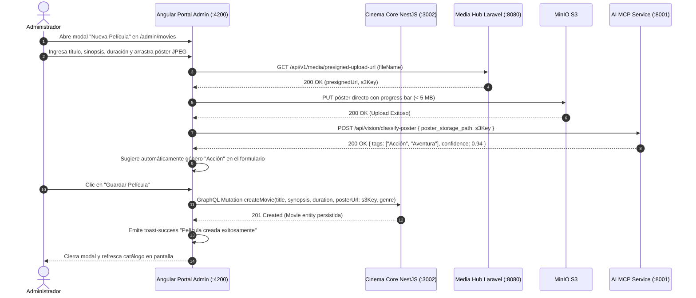

# Plan Técnico: Módulo Vertical 01 — Cinema Core y Portal de Administración Unificado (ms/cinema-core)

> **Estado:** APPROVED  
> **Versión:** 1.4.0  
> **Módulo:** `docs/specs/01-cinema-core/` — *Repositorio Git Autónomo*  
> **Especificación Base:** `docs/specs/01-cinema-core/spec.md`  
> **Constitución Base:** `docs/constitution.md`  
> **Despliegue Asignado:** Microsoft Azure (Levantamiento Estándar con Docker)  
> **Rol en el Ecosistema:** **Portal de Administración Completo del Cine (`http://localhost:4200/admin`)**  
> **Metodología:** SDD-Plan-Extended (Arquitectura Atómica, UI Jetstream, Dark Mode y Observabilidad)

---

## 1. Resumen Arquitectónico y Decisiones de Diseño

- **Objetivo Técnico**: Construir e integrar el módulo vertical autónomo `ms/cinema-core` encapsulando su backend en NestJS 10 (TypeScript, Clean Architecture, PostgreSQL, Apollo Server en puerto `3002`) y su frontend en Angular 17 (Apollo Client, Tailwind CSS Dark Mode First, Web Audio API en puerto `4200`) como la **Interfaz Completa y Unificada de Administración** del complejo cinematográfico.
- **Componentes Técnicos Clave (`PLAN-XX`)**:
  - `PLAN-01` (PostgresSchemaMigration): Tablas relacionales `complexes`, `cinema_halls`, `seats`, `movies` (con `deleted_at` para soft-delete y `poster_url`), `showtimes` y catálogo semilla `candy_bar_items`.
  - `PLAN-02` (DomainShowtimeLogic): Entidades de dominio e invariantes de cálculo de limpieza (+20 min), excepciones tipadas (`ScheduleConflictException`) y rechazo estricto sin reubicación automática.
  - `PLAN-03` (ShowtimeAndHallUseCases): Casos de uso `CreateHallUseCase` (creación atómica de sala y matriz de butacas), `CreateShowtimeUseCase`, `SoftDeleteMovieUseCase` y `CreateMovieWithMediaUseCase`.
  - `PLAN-04` (GraphQLResolversAndDataLoaders): Resolvers Apollo tipados y DataLoaders en memoria para resolver consultas anidadas del panel de administración.
  - `PLAN-05` (AdminLayoutAndSidebar): Layout unificado de administración (`AdminLayoutComponent`) con sidebar lateral permanente: Dashboard, Salas, Películas, Cartelera y Centro de Reportes.
  - `PLAN-06` (ExecutiveDashboardComponent): Vista con tarjetas KPI en tiempo real (recaudación total, butacas vendidas, ocupación promedio).
  - `PLAN-07` (AngularCreateHallModal): Modal interactivo con generador guiado (filas A-Z, columnas 1-N) y cuadrícula reactiva para alternar tipos de butacas y pasillos vacíos.
  - `PLAN-08` (AngularMoviesManagementWithMedia): Tabla cebra, buscador diacrítico y modal `CreateMovieModal` con zona de subida de póster JPEG (< 5 MB) conectada a MinIO/MediaHub y recepción de tags predictivos de `ms/ai-mcp`.
  - `PLAN-09` (ScheduleCalendarWithCollisionCheck): Calendario semanal con cálculo de buffer de 20 min y resaltado visual en rojo ante solapamientos.
  - `PLAN-10` (AiReportsExecutiveCenter): Centro de reportes amigable con tarjetas de reporte rápido (1 clic), asistente conversacional por voz/texto (Web Audio API), confirmación previa amigable y descarga física de Excel `.xlsx` generado por `ms/ai-mcp`.
  - `PLAN-11` (CinemaDatabaseSeeder): Seeder ejecutable que precarga usuarios administradores, complejos, salas con matrices completas, películas y funciones.
  - `PLAN-12` (ModuleDockerCompose): Archivo `docker-compose.yml` en la raíz de `ms/cinema-core` para levantar de manera autónoma PostgreSQL y los contenedores del módulo.

---

## 2. Estructura Física Exacta de Archivos del Módulo

```text
ms/cinema-core/                                       # Repositorio Git Autónomo
├── docker-compose.yml                                # Orquestación local autónoma (PLAN-12)
├── backend/                                          # Backend NestJS 10 (Puerto 3002)
│   ├── src/
│   │   ├── domain/
│   │   │   ├── entities/
│   │   │   │   ├── CinemaComplex.entity.ts           # (PLAN-01)
│   │   │   │   ├── CinemaHall.entity.ts              # (PLAN-01)
│   │   │   │   ├── Seat.entity.ts                    # (PLAN-01)
│   │   │   │   ├── Movie.entity.ts                   # (PLAN-01 con soft-delete y poster_url)
│   │   │   │   └── Showtime.entity.ts                # (PLAN-02)
│   │   │   └── exceptions/
│   │   │       ├── ScheduleConflictException.ts      # (PLAN-02)
│   │   │       └── EntityNotFoundException.ts
│   │   ├── application/
│   │   │   └── use-cases/
│   │   │       ├── CreateHall.usecase.ts             # (PLAN-03)
│   │   │       ├── CreateShowtime.usecase.ts         # (PLAN-03)
│   │   │       ├── SoftDeleteMovie.usecase.ts        # (PLAN-03)
│   │   │       └── CreateMovieWithMedia.usecase.ts   # (PLAN-03/08)
│   │   ├── infrastructure/
│   │   │   ├── database/
│   │   │   │   ├── migrations/
│   │   │   │   │   └── 001_InitialCinemaSchema.ts    # (PLAN-01)
│   │   │   │   └── seeders/
│   │   │   │       └── CinemaDatabaseSeeder.ts       # (PLAN-11: gerentes, salas, películas)
│   │   │   └── messaging/
│   │   │       └── RabbitMqSagaConsumer.ts           # Actualización de butacas ocupadas
│   │   └── presentation/
│   │       ├── controllers/
│   │       │   └── Health.controller.ts              # Endpoint /health para semáforo visual
│   │       └── graphql/
│   │           ├── resolvers/
│   │           │   ├── Hall.resolver.ts              # (PLAN-04)
│   │           │   ├── Showtime.resolver.ts          # (PLAN-04)
│   │           │   └── Movie.resolver.ts             # (PLAN-04)
│   │           └── types/
│   │               ├── Hall.type.ts
│   │               ├── Showtime.type.ts
│   │               └── Movie.type.ts
│   ├── .env.example                                  # Variables de entorno preconfiguradas (INV-ARCH-09)
│   ├── Dockerfile
│   └── package.json
│
├── frontend/                                         # Frontend Angular 17 - PORTAL DE ADMIN (Puerto 4200)
│   ├── src/app/
│   │   ├── core/
│   │   │   ├── services/
│   │   │   │   ├── apollo-cinema.service.ts          # Cliente GraphQL hacia backend NestJS
│   │   │   │   ├── ai-reports-client.service.ts      # Cliente HTTP hacia microservicio ms/ai-mcp (:8001)
│   │   │   │   ├── media-upload.service.ts           # Cliente hacia ms/media-hub para presigned URLs
│   │   │   │   ├── voice-audio.service.ts            # Web Audio API para captura de voz
│   │   │   │   └── toast-notification.service.ts     # Banners Toasts (Éxito, Error, Alerta)
│   │   │   ├── guards/
│   │   │   │   └── auth-token.guard.ts               # Recepción y validación de JWT redirigido desde el puerto 3000
│   │   │   └── pipes/
│   │   │       └── diacritic-filter.pipe.ts          # Filtro de búsqueda insensible a acentos
│   │   ├── shared/
│   │   │   └── components/
│   │   │       ├── health-badge.component.ts         # Chip visual de salud de la API
│   │   │       ├── confirmation-modal.component.ts   # Modal para soft-delete y acciones críticas
│   │   │       └── toast-container.component.ts      # Contenedor de notificaciones
│   │   ├── layouts/
│   │   │   └── admin-layout.component.ts             # Sidebar fijo y navbar con botón "Volver a Cartelera" (:3000) (PLAN-05)
│   │   └── features/
│   │       ├── dashboard/
│   │       │   └── executive-dashboard.component.ts  # Tarjetas KPI y métricas ejecutivas (PLAN-06)
│   │       ├── hall-management/
│   │       │   ├── halls-list.component.ts           # Tabla cebra de salas
│   │       │   └── create-hall-modal.component.ts    # Generador matricial guiado (PLAN-07)
│   │       ├── movies/
│   │       │   ├── movies-table.component.ts         # Catálogo de películas con miniaturas (PLAN-08)
│   │       │   └── create-movie-modal.component.ts   # Modal con subida de póster y tags IA (PLAN-08)
│   │       ├── schedule/
│   │       │   └── schedule-calendar.component.ts    # Calendario semanal con bloqueo de colisión (PLAN-09)
│   │       └── ai-reports/
│   │           ├── reports-center.component.ts       # Centro de reportes con orquestación general (PLAN-10)
│   │           ├── reports-filter-bar.component.ts   # Barra superior de filtros: Complejos y Selector de Fechas
│   │           ├── voice-assistant-card.component.ts # Asistente conversacional amigable por voz/texto
│   │           └── report-results-table.component.ts # Tabla formateada con sugerencias y botón "Descargar Excel"
│   ├── .env.example                                  # Variables frontend preconfiguradas (INV-ARCH-09)
│   ├── Dockerfile
│   └── package.json
│
└── docs/
    └── README.md                                     # Guía técnica interna del módulo
```

---

## 3. Diagrama de Secuencia: Creación de Película con Póster e IA Integrada



---

## 4. Vertical Slices de Implementación

- **Slice 1 (Portal de Admin Base y Dashboard)**: `AdminLayoutComponent` con sidebar permanente, `ExecutiveDashboardComponent` con KPIs y endpoint `/health` (`PLAN-05`, `PLAN-06`).
- **Slice 2 (Diseño Matricial de Salas)**: `CreateHallModalComponent` con cuadrícula reactiva y servicio GraphQL (`PLAN-07`).
- **Slice 3 (Películas con Carga de Póster y Tags IA)**: `CreateMovieModalComponent` con subida a MinIO, clasificación de género por `ai-mcp` y tabla cebra (`PLAN-08`).
- **Slice 4 (Programador de Cartelera sin Solapamiento)**: Algoritmo de bloqueo estricto con buffer de 20 min en NestJS y alerta visual en rojo en calendario (`PLAN-02`, `PLAN-09`).
- **Slice 5 (Centro de Reportes Inteligentes y Descarga Excel)**: Interfaz de reportes amigable, componente de voz/texto conversacional, consumo de `ms/ai-mcp` y descarga de `.xlsx` (`PLAN-10`).
- **Slice 6 (Seeders y Docker Compose)**: `CinemaDatabaseSeeder` (`PLAN-11`) y `docker-compose.yml` (`PLAN-12`).

---

## 5. Estrategia de Testing y Comandos

| Capa | Archivo de Prueba | Comportamiento que Verifica |
| :--- | :--- | :--- |
| **Backend Unit** | `test/unit/ShowtimeConflict.spec.ts` | Rechazo estricto de solapamientos con buffer de 20 min. |
| **Backend Unit** | `test/unit/SoftDeleteMovie.spec.ts` | Marcado lógico de `deleted_at` sin eliminación física en PostgreSQL. |
| **Backend E2E** | `test/e2e/GraphQLAdmin.e2e-spec.ts` | Mutaciones de creación de sala matricial y registro de película. |
| **Frontend Unit** | `src/app/features/ai-reports/reports-center.component.spec.ts` | Renderizado de tarjetas de reporte rápido y botón "Descargar Excel". |
| **Frontend Unit** | `src/app/features/movies/create-movie-modal.component.spec.ts` | Subida de póster con validación y recepción de tags predictivos. |

- **Comandos de Verificación**:
  - `cd ms/cinema-core && docker compose up -d`
  - `cd ms/cinema-core/backend && npm test`
  - `cd ms/cinema-core/frontend && npm test`
