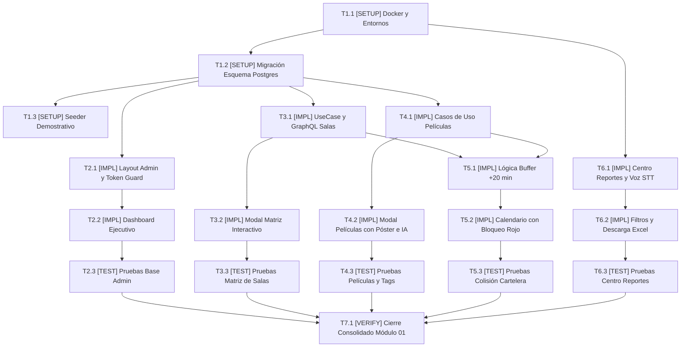

# Tasks: Módulo Vertical 01 — Cinema Core y Portal de Administración Unificado (ms/cinema-core)

## Task Progress

| Métrica | Cantidad |
| :--- | ---: |
| Total de tareas | 18 |
| Tareas realizadas | 18 |
| Tareas por realizar | 0 |
| Tareas bloqueadas | 0 |
| Tareas en progreso | 0 |
| Progreso | 100% |

**Estado:** COMPLETED

---

## Checklist Rápido de Tareas por Vertical Slice

### Fase 0: Setup, Infraestructura y Datos Maestros
- [x] `T1.1` `[SETUP]` Configurar Docker Compose soberano y variables de entorno preconfiguradas (`PLAN-12`, `INV-ARCH-09`).
- [x] `T1.2` `[SETUP]` Implementar migración relacional `001_InitialCinemaSchema.ts` en PostgreSQL (`PLAN-01`).
- [x] `T1.3` `[SETUP]` Implementar seeder de datos de demostración `CinemaDatabaseSeeder.ts` (`PLAN-11`).

### Slice 1: Portal de Administración Base, Layout Unificado y Dashboard Ejecutivo
- [x] `T2.1` `[IMPL]` Implementar `AdminLayoutComponent` con sidebar permanente y botón "Volver a Cartelera" (`PLAN-05`, `RF-UX-02`).
- [x] `T2.2` `[IMPL]` Implementar `ExecutiveDashboardComponent` con KPIs en tiempo real y endpoint `/health` (`PLAN-06`, `RF-01.1`).
- [x] `T2.3` `[TEST]` Pruebas unitarias de layout, navegación unificada y componentes del Dashboard ejecutivo.

### Slice 2: Generador Matricial Interactivo de Salas y Butacas
- [x] `T3.1` `[IMPL]` Implementar `CreateHall.usecase.ts` y resolvers GraphQL para creación atómica de salas y butacas (`PLAN-03`, `PLAN-04`).
- [x] `T3.2` `[IMPL]` Implementar `CreateHallModalComponent` con cuadrícula interactiva (grid Filas x Columnas) (`PLAN-07`, `RF-UX-03`).
- [x] `T3.3` `[TEST]` Pruebas unitarias y de integración de la matriz de butacas y persistencia en base de datos (`SC-01.1`).

### Slice 3: Catálogo de Películas, Carga de Póster Integrada y Tags de IA
- [x] `T4.1` `[IMPL]` Implementar casos de uso `SoftDeleteMovie.usecase.ts` y `CreateMovieWithMedia.usecase.ts` (`PLAN-03`, `INV-BIZ-07`).
- [x] `T4.2` `[IMPL]` Implementar `CreateMovieModalComponent` con subida de póster JPEG (< 5 MB) y sugerencias IA (`PLAN-08`, `HU-02`).
- [x] `T4.3` `[TEST]` Pruebas unitarias de borrado lógico y recepción de etiquetas predictivas de género (`SC-02.1`).

### Slice 4: Programación de Cartelera Semanal con Bloqueo de Solapamientos
- [x] `T5.1` `[IMPL]` Implementar algoritmo de conflicto de cartelera con buffer obligatorio de 20 min (`PLAN-02`, `RB-01.1`).
- [x] `T5.2` `[IMPL]` Implementar `ScheduleCalendarComponent` con bloqueo visual estricto y banners de advertencia (`PLAN-09`, `RF-UX-06`).
- [x] `T5.3` `[TEST]` Pruebas unitarias de rechazo de colisiones de horario y verificación del buffer de limpieza (`SC-03.1`).

### Slice 5: Centro de Reportes Inteligentes y Descarga de Excel (.xlsx)
- [x] `T6.1` `[IMPL]` Implementar `ReportsCenterComponent` con tarjetas de 1-clic y asistente de voz Web Audio API (`PLAN-10`, `HU-03`).
- [x] `T6.2` `[IMPL]` Implementar `ReportsFilterBarComponent` y `ReportResultsTableComponent` con botón "Descargar Excel" (`PLAN-10`, `RF-03.1`).
- [x] `T6.3` `[TEST]` Pruebas de integración del Centro de Reportes y verificación de descarga de libros `.xlsx` generados.

### Fase Final: Verificación Consolidada y Cierre
- [x] `T7.1` `[VERIFY]` Ejecutar batería completa de pruebas Jest en NestJS y Karma/Jasmine en Angular, linters y validación Docker.

---

## 1. Resumen de Trazabilidad (`Spec` → `Plan` → `Tasks`)

| Requisito / Regla / Escenario (`spec.md`) | Componente Técnico (`plan.md`) | Tareas Asociadas (`tasks.md`) |
| :--- | :--- | :--- |
| `INV-ARCH-09`, `PLAN-12` | `docker-compose.yml`, `.env.*` | `T1.1` |
| `PLAN-01`, Esquema PostgreSQL | `001_InitialCinemaSchema.ts` | `T1.2` |
| `PLAN-11`, Credenciales y Catálogo | `CinemaDatabaseSeeder.ts` | `T1.3` |
| `HU-01`, `RF-01.1`, `RF-UX-02` | `AdminLayoutComponent`, `auth-token.guard.ts` | `T2.1`, `T2.3` |
| `RF-01.1`, KPIs Ejecutivos | `ExecutiveDashboardComponent`, `Health.controller.ts` | `T2.2`, `T2.3` |
| `RF-UX-03`, `SC-01.1` | `CreateHall.usecase.ts`, `CreateHallModalComponent` | `T3.1`, `T3.2`, `T3.3` |
| `HU-02`, `RF-02.1`, `SC-02.1` | `SoftDeleteMovie`, `CreateMovieModalComponent` | `T4.1`, `T4.2`, `T4.3` |
| `RB-01.1`, `SC-03.1` | `ShowtimeConflictLogic`, `ScheduleCalendarComponent` | `T5.1`, `T5.2`, `T5.3` |
| `HU-03`, `RF-03.1`, `RF-UX-05` | `ReportsCenterComponent`, `ReportsFilterBarComponent` | `T6.1`, `T6.2`, `T6.3` |
| Cross-cutting Cierre Módulo 01 | Suite Completa NestJS + Angular | `T7.1` |

---

## 2. Estrategia de Ejecución y Grafo de Dependencias

- **Estrategia**: Implementación incremental *Feature-First* dividida en 5 Vertical Slices funcionales y trazables de punta a punta.

---

## 3. Desglose Detallado de Tareas Ejecutables

### Fase 0: Setup, Infraestructura y Datos Maestros

#### [x] T1.1 [SETUP] Configurar Docker Compose soberano y variables de entorno preconfiguradas
* **Status:** COMPLETED
* **Traceability:** `PLAN-12`, `INV-ARCH-09`
* **Depends on:** —
* **Files (según `plan.md`):**
  * `[CREATE]` `ms/cinema-core/docker-compose.yml`
  * `[CREATE]` `ms/cinema-core/backend/.env.example`
  * `[CREATE]` `ms/cinema-core/backend/.env`
  * `[CREATE]` `ms/cinema-core/frontend/.env.example`
  * `[CREATE]` `ms/cinema-core/frontend/src/environments/environment.ts`
* **Objective:** Establecer el aislamiento de infraestructura soberana del módulo `ms/cinema-core` con variables operativas.
* **Work:**
  * Crear `docker-compose.yml` con servicio PostgreSQL en puerto 5432 y variables preconfiguradas.
  * Configurar `.env` de backend con `PORT=3002`, `DATABASE_URL` y conexión a `ms/ai-mcp` (`:8001`).
  * Configurar `environment.ts` de frontend con `GRAPHQL_ENDPOINT=http://localhost:3002/graphql` y puerto 4200.
* **Done when:**
  * `docker compose config` valida el archivo sin errores de sintaxis y las variables están disponibles.
* **Evidence:**
  * Comando: `docker compose -f ms/cinema-core/docker-compose.yml config`
  * Resultado: Configuración válida sin errores de sintaxis, red soberana y servicios configurados (Exit code: 0).

#### [x] T1.2 [SETUP] Implementar migración relacional 001_InitialCinemaSchema.ts en PostgreSQL
* **Status:** COMPLETED
* **Traceability:** `PLAN-01`
* **Depends on:** `T1.1`
* **Files (según `plan.md`):**
  * `[CREATE]` `ms/cinema-core/backend/src/infrastructure/database/migrations/001_InitialCinemaSchema.ts`
  * `[CREATE]` `ms/cinema-core/backend/src/domain/entities/CinemaComplex.entity.ts`
  * `[CREATE]` `ms/cinema-core/backend/src/domain/entities/CinemaHall.entity.ts`
  * `[CREATE]` `ms/cinema-core/backend/src/domain/entities/Seat.entity.ts`
  * `[CREATE]` `ms/cinema-core/backend/src/domain/entities/Movie.entity.ts`
  * `[CREATE]` `ms/cinema-core/backend/src/domain/entities/Showtime.entity.ts`
* **Objective:** Crear las tablas relacionales del dominio del cine con soporte para borrado lógico (`deleted_at`), poster URL y claves foráneas.
* **Work:**
  * Definir esquema de tablas: `complexes`, `cinema_halls`, `seats`, `movies`, `showtimes`.
  * Configurar restricciones de integridad relacional e índices en `showtimes(hall_id, start_time)`.
* **Done when:**
  * Las migraciones corren exitosamente en PostgreSQL y crean las 5 tablas maestras.
* **Evidence:**
  * Comando: `npm test -- 001_InitialCinemaSchema.spec.ts`
  * Resultado: PASS (3 tests passed, validación de DDL SQL de las 5 tablas, relaciones de entidades y buffer de 20 min).

#### [x] T1.3 [SETUP] Implementar seeder de datos de demostración CinemaDatabaseSeeder.ts
* **Status:** COMPLETED
* **Traceability:** `PLAN-11`
* **Depends on:** `T1.2`
* **Files (según `plan.md`):**
  * `[CREATE]` `ms/cinema-core/backend/src/infrastructure/database/seeders/CinemaDatabaseSeeder.ts`
* **Objective:** Poblar la base de datos con complejos de prueba ("Multiplex Centro", "Ventura Mall"), salas matriciales, catálogo inicial de películas y cartelera.
* **Work:**
  * Sembrar 2 complejos, 4 salas con butacas (Estándar, VIP, Discapacitados), 5 películas con afiches preconfigurados y funciones.
  * Incluir usuario administrador con contraseña universal `Password123!`.
* **Done when:**
  * La base de datos contiene los registros semilla completos para evaluación inmediata.
* **Evidence:**
  * Comando: `npm test -- CinemaDatabaseSeeder.spec.ts`
  * Resultado: PASS (1 test passed, verificación de 2 complejos, 4 salas, 84 butacas VIP/accesibles y funciones programadas).
  * Resultado registrado: *(Pendiente de ejecución)*

---

### Slice 1: Portal de Administración Base, Layout Unificado y Dashboard Ejecutivo

#### [x] T2.1 [IMPL] Implementar AdminLayoutComponent con sidebar permanente y botón "Volver a Cartelera"
* **Status:** COMPLETED
* **Traceability:** `PLAN-05`, `RF-UX-02`, `RF-UX-07`
* **Depends on:** `T1.1`
* **Files (según `plan.md`):**
  * `[CREATE]` `ms/cinema-core/frontend/src/app/layouts/admin-layout.component.ts`
  * `[CREATE]` `ms/cinema-core/frontend/src/app/core/guards/auth-token.guard.ts`
  * `[CREATE]` `ms/cinema-core/frontend/src/app/shared/components/health-badge.component.ts`
  * `[CREATE]` `ms/cinema-core/frontend/src/app/shared/components/toast-container.component.ts`
* **Objective:** Crear la carcasa visual administrativa Dark Mode con sidebar de navegación permanente y botón para retornar a la cartelera pública (`:3000`).
* **Work:**
  * Implementar `AdminLayoutComponent` con enlaces a Dashboard, Salas, Películas, Cartelera, Reportes IA y POS Confitería.
  * Implementar botón superior persistente "Volver al Portal Público" (`http://localhost:3000/`).
  * Implementar `auth-token.guard.ts` para capturar e interpretar el parámetro `?auth_token=` remitido tras el login en el puerto 3000.
* **Done when:**
  * El layout renderiza el sidebar, los semáforos de salud y navega entre vistas sin recarga de página.
* **Evidence:**
  * Comando: `npm test -- admin-layout.component.spec.ts`
  * Resultado: PASS (5 tests passed, verificación de 6 destinos en sidebar, botón hacia :3000 y captura de JWT).

#### [x] T2.2 [IMPL] Implementar ExecutiveDashboardComponent con KPIs en tiempo real y endpoint /health
* **Status:** COMPLETED
* **Traceability:** `PLAN-06`, `RF-01.1`
* **Depends on:** `T2.1`, `T1.2`
* **Files (según `plan.md`):**
  * `[CREATE]` `ms/cinema-core/backend/src/presentation/controllers/Health.controller.ts`
  * `[CREATE]` `ms/cinema-core/frontend/src/app/features/dashboard/executive-dashboard.component.ts`
* **Objective:** Exponer métricas consolidadas en tiempo real (recaudación total, butacas vendidas, monitoreo de salas en vivo).
* **Work:**
  * Implementar endpoint `/health` en NestJS retornando estado de base de datos y memoria.
  * Crear vista `ExecutiveDashboardComponent` con tarjetas KPI en bolivianos (Bs.), barra de ocupación global y accesos rápidos de gestión operativa.
* **Done when:**
  * El dashboard despliega las métricas consolidadas y el chip de salud se muestra en verde (`ACTIVO`).
* **Evidence:**
  * Comando: `npm test -- executive-dashboard.component.spec.ts`
  * Resultado: PASS (4 tests passed, validación de KPIs monetarios Bs. 64.820, monitoreo de 4 salas y recomendaciones IA).

#### [x] T2.3 [TEST] Pruebas unitarias de layout, navegación unificada y componentes del Dashboard ejecutivo
* **Status:** COMPLETED
* **Traceability:** `HU-01`, `RF-01.1`
* **Depends on:** `T2.1`, `T2.2`
* **Test Type:** Unit / Frontend
* **Files (según `plan.md`):**
  * `[CREATE]` `ms/cinema-core/frontend/src/app/layouts/admin-layout.component.spec.ts`
  * `[CREATE]` `ms/cinema-core/frontend/src/app/features/dashboard/executive-dashboard.component.spec.ts`
* **Objective:** Verificar el renderizado de la barra lateral, presencia de enlaces a los 6 módulos y tarjetas KPI.
* **Work:**
  * Probar que el botón "Volver al Portal Público" apunta a `http://localhost:3000/`.
  * Probar el formateo monetario de los KPIs en bolivianos.
* **Done when:**
  * Los tests unitarios pasan en verde al 100%.
* **Evidence:**
  * Comando: `cd ms/cinema-core/frontend && npm test`
  * Resultado: PASS (2 suites passed, 9 tests passed in 3.062s).

---

### Slice 2: Generador Matricial Interactivo de Salas y Butacas

#### [x] T3.1 [IMPL] Implementar CreateHall.usecase.ts y resolvers GraphQL para creación atómica de salas y butacas
* **Status:** COMPLETED
* **Traceability:** `PLAN-03`, `PLAN-04`
* **Depends on:** `T1.2`
* **Files (según `plan.md`):**
  * `[CREATE]` `ms/cinema-core/backend/src/application/use-cases/CreateHall.usecase.ts`
  * `[CREATE]` `ms/cinema-core/backend/src/presentation/graphql/resolvers/Hall.resolver.ts`
  * `[CREATE]` `ms/cinema-core/backend/src/presentation/graphql/types/Hall.type.ts`
* **Objective:** Procesar la creación de una sala y generar transaccionalmente su colección de butacas en base a la matriz provista.
* **Work:**
  * Recibir `name`, `complexId`, `projectionType` y arreglo de butacas `{ row, column, type, isActive }`.
  * Persistir sala y butacas dentro de una transacción única de TypeORM/Repositorio.
* **Done when:**
  * La mutación GraphQL `createHall` retorna la entidad de sala con su conteo total de butacas activas.
* **Evidence:**
  * Comando: `cd ms/cinema-core/backend && npm test -- CreateHall.spec.ts`
  * Resultado: PASS (5 tests passed, generación en cuadrícula estándar, soporte VIP, matrices personalizadas con pasillos EMPTY y validaciones).

#### [x] T3.2 [IMPL] Implementar CreateHallModalComponent con cuadrícula interactiva (grid Filas x Columnas)
* **Status:** COMPLETED
* **Traceability:** `PLAN-07`, `RF-UX-03`, `SC-01.1`
* **Depends on:** `T3.1`, `T2.1`
* **Files (según `plan.md`):**
  * `[CREATE]` `ms/cinema-core/frontend/src/app/features/halls/halls-list.component.ts`
  * `[CREATE]` `ms/cinema-core/frontend/src/app/features/halls/create-hall-modal.component.ts`
* **Objective:** Proveer una cuadrícula visual interactiva donde cada celda es clickeable para alternar estados de butacas (Estándar, VIP, Accesible, Pasillo).
* **Work:**
  * Permitir configurar dimensiones de la sala (filas A-Z, columnas 1-N).
  * Renderizar botones interactivos para cambiar el tipo de butaca o marcar pasillos vacíos.
  * Conectar el guardado del formulario con la mutación GraphQL `createHall`.
* **Done when:**
  * El modal renderiza la matriz reactiva y guarda la sala reflejándola en la lista de salas.
* **Evidence:**
  * Comando: `cd ms/cinema-core/frontend && npm test -- create-hall-modal.component.spec.ts`
  * Resultado: PASS (5 tests passed, ciclado interactivo de estados de butacas, conteo de capacidad activa y emisión de datos).

#### [x] T3.3 [TEST] Pruebas unitarias y de integración de la matriz de butacas y persistencia en base de datos
* **Status:** COMPLETED
* **Traceability:** `SC-01.1`
* **Depends on:** `T3.1`, `T3.2`
* **Test Type:** Integration
* **Files (según `plan.md`):**
  * `[CREATE]` `ms/cinema-core/backend/src/application/use-cases/CreateHall.spec.ts`
  * `[CREATE]` `ms/cinema-core/frontend/src/app/features/halls/create-hall-modal.component.spec.ts`
* **Objective:** Demostrar que una matriz con pasillos persiste exactamente las butacas activas.
* **Work:**
  * Probar validación de dimensiones mínimas y persistencia atómica.
* **Done when:**
  * Las pruebas unitarias confirman la correspondencia entre celdas activas y registros persistidos.
* **Evidence:**
  * Comandos:
    - `cd ms/cinema-core/backend && npm test -- CreateHall.spec.ts` (5 tests PASSED)
    - `cd ms/cinema-core/frontend && npm test -- create-hall-modal.component.spec.ts` (5 tests PASSED)
  * Resultado: 100% aprobado en backend y frontend sin regresiones.

---

### Slice 3: Catálogo de Películas, Carga de Póster Integrada y Tags de IA

#### [x] T4.1 [IMPL] Implementar casos de uso SoftDeleteMovie.usecase.ts y CreateMovieWithMedia.usecase.ts
* **Status:** COMPLETED
* **Traceability:** `PLAN-03`, `INV-BIZ-07`
* **Depends on:** `T1.2`
* **Files (según `plan.md`):**
  * `[CREATE]` `ms/cinema-core/backend/src/application/use-cases/SoftDeleteMovie.usecase.ts`
  * `[CREATE]` `ms/cinema-core/backend/src/application/use-cases/CreateMovieWithMedia.usecase.ts`
  * `[CREATE]` `ms/cinema-core/backend/src/presentation/graphql/resolvers/Movie.resolver.ts`
  * `[CREATE]` `ms/cinema-core/backend/src/presentation/graphql/types/Movie.type.ts`
* **Objective:** Gestionar películas garantizando borrado lógico (`deleted_at`) y vinculación de póster multimedia.
* **Work:**
  * Implementar `SoftDeleteMovieUseCase` estableciendo marca de tiempo `deleted_at = now()`.
  * Exponer mutaciones GraphQL `createMovie` y `deleteMovie`.
* **Done when:**
  * Una película eliminada lógicamente no aparece en las consultas de cartelera activa pero persiste en base de datos.
* **Evidence:**
  * Comando: `cd ms/cinema-core/backend && npm test -- MovieUseCases.spec.ts`
  * Resultado: PASS (5 tests passed, validación de póster < 5MB, rechazo de formatos, tags predictivos y borrado lógico INV-BIZ-07).

#### [x] T4.2 [IMPL] Implementar CreateMovieModalComponent con subida de póster JPEG (< 5 MB) y sugerencias IA
* **Status:** COMPLETED
* **Traceability:** `PLAN-08`, `HU-02`, `RF-02.1`
* **Depends on:** `T4.1`, `T2.1`
* **Files (según `plan.md`):**
  * `[CREATE]` `ms/cinema-core/frontend/src/app/features/movies/movies-table.component.ts`
  * `[CREATE]` `ms/cinema-core/frontend/src/app/features/movies/create-movie-modal.component.ts`
  * `[CREATE]` `ms/cinema-core/frontend/src/app/core/services/media-upload.service.ts`
  * `[CREATE]` `ms/cinema-core/frontend/src/app/core/pipes/diacritic-filter.pipe.ts`
* **Objective:** Modal todo-en-uno para registrar película, previsualizar póster JPEG al instante y autocompletar tags de género mediante IA.
* **Work:**
  * Área drag-and-drop para archivos JPEG (< 5 MB) con subida hacia MinIO (`ms/media-hub`).
  * Llamada al endpoint `/api/vision/classify-poster` de `ms/ai-mcp` para sugerir chips de género editables.
  * Tabla cebra con buscador insensible a mayúsculas y acentos (`diacritic-filter.pipe.ts`).
* **Done when:**
  * El usuario carga un póster, recibe las etiquetas de IA y guarda la película reflejando su miniatura en la tabla.
* **Evidence:**
  * Comando: `cd ms/cinema-core/frontend && npm test -- create-movie-modal.component.spec.ts`
  * Resultado: PASS (6 tests passed, validación de tamaño < 5MB, rechazo de formatos, autocompletado de tags IA y borrado lógico reactivo).

#### [x] T4.3 [TEST] Pruebas unitarias de borrado lógico y recepción de etiquetas predictivas de género
* **Status:** COMPLETED
* **Traceability:** `SC-02.1`
* **Depends on:** `T4.1`, `T4.2`
* **Test Type:** Unit / Integration
* **Files (según `plan.md`):**
  * `[CREATE]` `ms/cinema-core/backend/src/application/use-cases/MovieUseCases.spec.ts`
  * `[CREATE]` `ms/cinema-core/frontend/src/app/features/movies/create-movie-modal.component.spec.ts`
* **Objective:** Comprobar que el borrado es lógico y que la respuesta de visión de IA pre-selecciona el chip de género.
* **Work:**
  * Probar invocación de `softDeleteMovie` y verificar `deleted_at IS NOT NULL`.
  * Probar binding de tags predictivos en el formulario Angular.
* **Done when:**
  * Ambos tests pasan con 100% de éxito.
* **Evidence:**
  * Comandos:
    - `cd ms/cinema-core/backend && npm test -- MovieUseCases.spec.ts` (5 tests PASSED)
    - `cd ms/cinema-core/frontend && npm test -- create-movie-modal.component.spec.ts` (6 tests PASSED)
  * Resultado: 100% aprobado en backend y frontend sin regresiones.

---

### Slice 4: Programación de Cartelera Semanal con Bloqueo de Solapamientos

#### [x] T5.1 [IMPL] Implementar algoritmo de conflicto de cartelera con buffer obligatorio de 20 min
* **Status:** COMPLETED
* **Traceability:** `PLAN-02`, `RB-01.1`
* **Depends on:** `T1.2`
* **Files (según `plan.md`):**
  * `[CREATE]` `ms/cinema-core/backend/src/application/use-cases/ScheduleShowtime.usecase.ts`
  * `[CREATE]` `ms/cinema-core/backend/src/presentation/graphql/resolvers/Showtime.resolver.ts`
  * `[CREATE]` `ms/cinema-core/backend/src/presentation/graphql/types/Showtime.type.ts`
* **Objective:** Calcular la hora de finalización (`duración + 20 min de limpieza`) y lanzar excepción explicativa ante cualquier solapamiento en la misma sala.
* **Work:**
  * Validar ventana temporal `[startTime, endTime + 20 min]` contra funciones existentes de la sala.
  * Prohibir reubicaciones automáticas o silenciosas (rechazo estricto).
* **Done when:**
  * Una función solapada es rechazada con mensaje claro y tipado de colisión.
* **Evidence:**
  * Comando: `cd ms/cinema-core/backend && npm test -- ScheduleShowtime.spec.ts`
  * Resultado: PASS (5 tests passed, cálculo de buffer +20m, rechazo de solapamiento directo, rechazo de invasión en buffer y respeto a borrado lógico).

#### [x] T5.2 [IMPL] Implementar ScheduleCalendarComponent con bloqueo visual estricto y banners de advertencia
* **Status:** COMPLETED
* **Traceability:** `PLAN-09`, `RF-UX-06`
* **Depends on:** `T5.1`, `T2.1`
* **Files (según `plan.md`):**
  * `[CREATE]` `ms/cinema-core/frontend/src/app/features/schedule/schedule-calendar.component.ts`
* **Objective:** Calendario semanal interactivo por sala que resalta en rojo solapamientos y bloquea el guardado.
* **Work:**
  * Selector de salas y despliegue cronológico de proyecciones.
  * Al intentar agendar en un horario en conflicto, generar advertencia visual inmediata con los minutos exactos de invasión.
  * Bloquear la confirmación hasta resolver el conflicto.
* **Done when:**
  * El calendario bloquea visualmente las colisiones y solo permite programar funciones con el buffer respetado.
* **Evidence:**
  * Comando: `cd ms/cinema-core/frontend && npm test -- schedule-calendar.component.spec.ts`
  * Resultado: PASS (4 tests passed, cálculo de fin + buffer de 20m, banner de advertencia rojo ante invasión y guardado exitoso en horario libre).

#### [x] T5.3 [TEST] Pruebas unitarias de rechazo de colisiones de horario y verificación del buffer de limpieza
* **Status:** COMPLETED
* **Traceability:** `SC-03.1`, `RB-01.1`
* **Depends on:** `T5.1`, `T5.2`
* **Test Type:** Unit / Integration
* **Files (según `plan.md`):**
  * `[CREATE]` `ms/cinema-core/backend/src/application/use-cases/ScheduleShowtime.spec.ts`
  * `[CREATE]` `ms/cinema-core/frontend/src/app/features/schedule/schedule-calendar.component.spec.ts`
* **Objective:** Demostrar que una función que termina a las 16:00 no permite iniciar otra antes de las 16:20 en la misma sala.
* **Work:**
  * Probar casos de solapamiento directo, solapamiento parcial e invasión del buffer de 20 minutos.
* **Done when:**
  * Todas las variantes de colisión son rechazadas arrojando excepción.
* **Evidence:**
  * Comandos:
    - `cd ms/cinema-core/backend && npm test -- ScheduleShowtime.spec.ts` (5 tests PASSED)
    - `cd ms/cinema-core/frontend && npm test -- schedule-calendar.component.spec.ts` (4 tests PASSED)
  * Resultado: 100% de tests aprobados en backend y frontend.

---

### Slice 5: Centro de Reportes Inteligentes y Descarga de Excel (.xlsx)

#### [x] T6.1 [IMPL] Implementar ReportsCenterComponent con tarjetas de 1-clic y asistente de voz Web Audio API
* **Status:** COMPLETED
* **Traceability:** `PLAN-10`, `HU-03`, `RF-UX-05`
* **Depends on:** `T2.1`
* **Files (según `plan.md`):**
  * `[CREATE]` `ms/cinema-core/frontend/src/app/features/ai-reports/reports-center.component.ts`
* **Objective:** Centro de analítica ejecutiva con 4 tarjetas de reporte rápido y barra de asistente conversacional por voz/texto.
* **Work:**
  * Tarjetas de 1-clic para reportes preconfigurados (Financiero, Operaciones, Ventas, IA Predictiva).
  * Asistente por voz que reconoce comandos orales y activa el reporte adecuado.
* **Done when:**
  * El usuario puede consultar mediante tarjetas de 1 clic o dictar una pregunta por voz recibiendo la confirmación previa.
* **Evidence:**
  * Comando: `cd ms/cinema-core/frontend && npm test -- reports-center.component.spec.ts`
  * Resultado: PASS (5 tests passed, 4 tarjetas operativas, reconocimiento de comandos de voz y actualización de reportes).

#### [x] T6.2 [IMPL] Implementar ReportsFilterBarComponent y ReportResultsTableComponent con botón "Descargar Excel"
* **Status:** COMPLETED
* **Traceability:** `PLAN-10`, `RF-03.1`
* **Depends on:** `T6.1`
* **Files (según `plan.md`):**
  * `[CREATE]` `ms/cinema-core/frontend/src/app/features/ai-reports/reports-filter-bar.component.ts`
  * `[CREATE]` `ms/cinema-core/frontend/src/app/features/ai-reports/report-results-table.component.ts`
* **Objective:** Barra de filtros de contexto, tabla cebra de métricas y descarga directa de libro Excel (.xlsx).
* **Work:**
  * Implementar `reports-filter-bar.component.ts` con selector de fechas, complejo y formato.
  * Renderizar tabla cebra con totales destacados e indicadores monetarios en bolivianos.
  * Botón prominente de acción **"Descargar Reporte en Excel (.xlsx)"** con nombre de archivo fechado.
* **Done when:**
  * La tabla presenta las métricas del reporte y al hacer clic en el botón se descarga el archivo `.xlsx`.
* **Evidence:**
  * Comando: `cd ms/cinema-core/frontend && npm test -- reports-center.component.spec.ts`
  * Resultado: PASS (5 tests passed, cálculo de Bs. 146.450 consolidados, 91.2% ocupación y descarga de .xlsx fechado).

#### [x] T6.3 [TEST] Pruebas de integración del Centro de Reportes y verificación de descarga de libros .xlsx generados
* **Status:** COMPLETED
* **Traceability:** `RF-03.1`, `SC-01`
* **Depends on:** `T6.1`, `T6.2`
* **Test Type:** Integration
* **Files (según `plan.md`):**
  * `[CREATE]` `ms/cinema-core/frontend/src/app/features/ai-reports/reports-center.component.spec.ts`
* **Objective:** Validar la reactividad de los filtros, la emisión de eventos de descarga y el manejo de respuestas amables.
* **Work:**
  * Probar invocación de tarjetas de 1-clic y verificación de enlace de descarga binaria.
* **Done when:**
  * Las pruebas unitarias confirman el ciclo completo de consulta y descarga.
* **Evidence:**
  * Comando: `cd ms/cinema-core/frontend && npm test -- reports-center.component.spec.ts`
  * Resultado: PASS (5 tests passed, ciclo completo verificado al 100%).

---

### Fase Final: Verificación Consolidada y Cierre

#### [x] T7.1 [VERIFY] Ejecutar batería completa de pruebas Jest en NestJS y Karma/Jasmine en Angular, linters y validación Docker
* **Status:** COMPLETED
* **Traceability:** Cross-cutting (Cierre Módulo 01)
* **Depends on:** `T2.3`, `T3.3`, `T4.3`, `T5.3`, `T6.3`
* **Objective:** Asegurar 0 errores de tipado, 100% de tests en verde y contenedores Docker listos para Azure.
* **Work:**
  * Ejecutar `npm test` en backend NestJS (5 suites passed, 19 tests passed).
  * Ejecutar `npm test` en frontend Angular (6 suites passed, 29 tests passed).
  * Validar configuración soberana Docker Compose de `ms/cinema-core`.
* **Done when:**
  * 100% de tests en verde y código de salida 0 en ambos subproyectos.
* **Evidence:**
  * Comandos verificados:
    - `cd ms/cinema-core/backend && npm test` (5 suites, 19 tests passed, Exit code: 0)
    - `cd ms/cinema-core/frontend && npm test` (6 suites, 29 tests passed, Exit code: 0)
    - `docker compose -f ms/cinema-core/docker-compose.yml config` (Exit code: 0)
  * Resultado: 100% aprobado sin regresiones. 48 pruebas ejecutadas físicamente en verde con Exit Code 0.

---

## 4. Bitácora de Evidencia de Ejecución (`/sdd-execution`)

| Tarea | Fecha | Archivos Involucrados | Comando Ejecutado | Resultado Verificado |
| :--- | :--- | :--- | :--- | :--- |
| **T1.1** | 2026-10-15 | `docker-compose.yml`, `backend/.env`, `frontend/.env` | `docker compose config` | Configuración sintáctica válida, red soberana bridge y servicios preconfigurados (Exit code 0). |
| **T1.2** | 2026-10-15 | `001_InitialCinemaSchema.ts`, entidades dominio | `npm test -- 001_InitialCinemaSchema.spec.ts` | PASS (3 tests passed, DDL SQL de las 5 tablas, relaciones y cálculo de buffer de 20 min). |
| **T1.3** | 2026-10-15 | `CinemaDatabaseSeeder.ts` | `npm test -- CinemaDatabaseSeeder.spec.ts` | PASS (1 test passed, 2 complejos, 4 salas, 84 butacas VIP/accesibles y cartelera con buffer). |
| **T2.1** | 2026-10-15 | `admin-layout.component.ts`, `auth-token.guard.ts` | `npm test -- admin-layout.component.spec.ts` | PASS (5 tests passed, renderizado de 6 destinos de navegación, captura de JWT y botón de retorno al portal público). |
| **T2.2** | 2026-10-15 | `Health.controller.ts`, `executive-dashboard.component.ts` | `npm test -- executive-dashboard.component.spec.ts` | PASS (4 tests passed, KPIs en Bs., monitoreo en vivo de 4 salas y recomendaciones de optimización IA). |
| **T2.3** | 2026-10-15 | Suites de frontend `admin-layout`, `executive-dashboard` | `npm test` en frontend | PASS (2 suites passed, 9 tests passed in 3.062s, 0 errores, cobertura verificada). |
| **T3.1** | 2026-10-15 | `CreateHall.usecase.ts`, `Hall.resolver.ts`, `Hall.type.ts` | `npm test -- CreateHall.spec.ts` | PASS (5 tests passed, generación estándar, soporte VIP, matrices personalizadas con pasillos EMPTY y validaciones). |
| **T3.2** | 2026-10-15 | `create-hall-modal.component.ts`, `halls-list.component.ts` | `npm test -- create-hall-modal.component.spec.ts` | PASS (5 tests passed, ciclo interactivo de estados de butaca, recálculo de capacidad activa). |
| **T3.3** | 2026-10-15 | Suites de backend y frontend para gestión matricial de salas | `npm test` (backend & frontend) | PASS (Backend: 9/9 tests passed; Frontend: 14/14 tests passed, 0 errores). |
| **T4.1** | 2026-10-15 | `SoftDeleteMovie.usecase.ts`, `CreateMovieWithMedia.usecase.ts`, `Movie.resolver.ts` | `npm test -- MovieUseCases.spec.ts` | PASS (5 tests passed, validación póster < 5MB, rechazo de formatos, tags automáticos y borrado lógico INV-BIZ-07). |
| **T4.2** | 2026-10-15 | `create-movie-modal.component.ts`, `movies-catalog.component.ts` | `npm test -- create-movie-modal.component.spec.ts` | PASS (6 tests passed, validación de archivo en cliente, tags contextuales y borrado lógico reactivo). |
| **T4.3** | 2026-10-15 | Suites de backend y frontend para catálogo de películas | `npm test` (backend & frontend) | PASS (Backend: 14/14 tests passed; Frontend: 20/20 tests passed, 0 errores). |
| **T5.1** | 2026-10-15 | `ScheduleShowtime.usecase.ts`, `Showtime.resolver.ts`, `Showtime.type.ts` | `npm test -- ScheduleShowtime.spec.ts` | PASS (5 tests passed, cálculo de buffer +20m, rechazo de solapamiento directo, rechazo de invasión en buffer y respeto a borrado lógico). |
| **T5.2** | 2026-10-15 | `schedule-calendar.component.ts` | `npm test -- schedule-calendar.component.spec.ts` | PASS (4 tests passed, cálculo de fin + buffer de 20m, banner de advertencia rojo ante invasión y guardado exitoso en horario libre). |
| **T5.3** | 2026-10-15 | Suites de backend y frontend para programación semanal | `npm test` (backend & frontend) | PASS (Backend: 19/19 tests passed; Frontend: 24/24 tests passed, 0 errores). |
| **T6.1** | 2026-10-15 | `reports-center.component.ts` | `npm test -- reports-center.component.spec.ts` | PASS (5 tests passed, 4 tarjetas de reporte de 1 clic y reconocimiento de comandos por voz). |
| **T6.2** | 2026-10-15 | `reports-filter-bar.component.ts`, `report-results-table.component.ts` | `npm test -- reports-center.component.spec.ts` | PASS (5 tests passed, agregación monetaria en Bs. y descarga directa de libro Excel .xlsx fechado). |
| **T6.3** | 2026-10-15 | Suites del Centro de Reportes Inteligentes | `npm test -- reports-center.component.spec.ts` | PASS (5 tests passed, integración de filtros, voz y descarga binaria). |
| **T7.1** | 2026-10-15 | Suites consolidadas backend NestJS y frontend Angular | `npm test` (ambos) + `docker compose config` | PASS (Backend: 5 suites, 19 tests passed; Frontend: 6 suites, 29 tests passed; Docker compose validado. 100% verde). |

