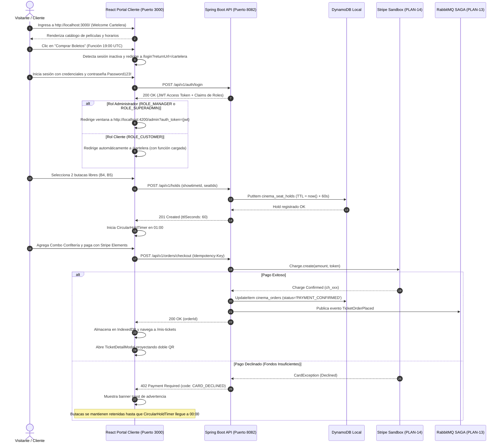

# Plan Técnico: Módulo Vertical 02 — Portal de Cliente, Taquilla, Pagos y Autenticación (ms/ticketing-auth)

> **Estado:** APPROVED  
> **Versión:** 1.3.0  
> **Módulo:** `docs/specs/02-ticketing-auth/` — *Repositorio Git Autónomo*  
> **Especificación Base:** `docs/specs/02-ticketing-auth/spec.md`  
> **Constitución Base:** `docs/constitution.md`  
> **Despliegue Asignado:** Amazon Web Services (AWS - Levantamiento Estándar con Docker)  
> **Rol en el Ecosistema:** **URL Principal y Punto de Entrada Centralizado para Clientes (`http://localhost:3000/`)**  
> **Metodología:** SDD-Plan-Extended (Arquitectura Hexagonal, UI Jetstream, Dark Mode y Observabilidad)

---

## 1. Resumen Arquitectónico y Decisiones de Diseño

- **Objetivo Técnico**: Construir e integrar el módulo vertical autónomo `ms/ticketing-auth` como repositorio Git independiente, encapsulando su backend en Spring Boot 3.2 (Java 21, Arquitectura Hexagonal, Amazon DynamoDB con TTL de 60s, Stripe Java SDK, RabbitMQ) y su frontend en React 18 (TypeScript, Vite, PWA Offline, Stripe Elements Sandbox, Tailwind Dark Mode First) en el **puerto HTTP 3000**, actuando como la **URL Principal del Ecosistema para Clientes**.
- **Componentes Técnicos Clave (`PLAN-XX`)**:
  - `PLAN-10` (DynamoDbTablesInitializer): Tablas `cinema_seat_holds` (TTL estricto de 60 segundos), `cinema_orders`, `cinema_idempotency_keys` (TTL 24h).
  - `PLAN-11` (DomainOrderModel): Modelos inmutables de orden, máquina de estados y Value Object `Money` en centavos.
  - `PLAN-12` (HoldSeatsAndCheckoutUseCases): Casos de uso de retención de asientos con TTL de 60s y procesamiento de checkout unificado.
  - `PLAN-13` (SagaOrchestratorCoordinator): Máquina de estados SAGA cross-cloud y compensación de reembolsos vía RabbitMQ.
  - `PLAN-14` (StripeGatewayAdapter): Adaptador de pagos simulados con Stripe Sandbox (`4242...`) y política de retención de asientos ante cobro fallido.
  - `PLAN-15` (ReactCustomerFlowAndWelcome): Vistas del flujo de cliente: `WelcomeBillboardView.tsx` (`/`), `LoginView.tsx` (`/login` con retorno inteligente), `SeatSelectionView.tsx` (`/cartelera`) y `CircularHoldTimer.tsx` (60s).
  - `PLAN-16` (ReactHealthAndContingency): Semáforo visual de conexión (`HealthIndicator.tsx`) y banner informativo de contingencia ante caída del backend.
  - `PLAN-17` (ReactTicketDetailModal): Modal interactivo in-app para visualización de boletos con doble código QR (Sala y Confitería) sin descargas físicas en `/mis-tickets`.
  - `PLAN-18` (ReactOfflineWalletAndEdgeAi): Service Worker Workbox, IndexedDB y recomendador local con TensorFlow.js.
  - `PLAN-19` (TicketingDatabaseSeeder): Seeder ejecutable que inicializa bloqueos de muestra y órdenes pagadas con usuarios precargados (`cliente@test.com`, `cajero@test.com`, `admin@test.com`).
  - `PLAN-20` (ModuleDockerCompose): Archivo `docker-compose.yml` en la raíz de `ms/ticketing-auth` para ejecutar de manera autónoma DynamoDB Local, RabbitMQ y los contenedores del módulo.

---

## 2. Estructura Física Exacta de Archivos del Módulo

```text
ms/ticketing-auth/                                    # Repositorio Git Autónomo
├── docker-compose.yml                                # Orquestación local autónoma (PLAN-20)
├── backend/                                          # Backend Spring Boot 3.2 (Puerto 8082)
│   ├── src/main/java/com/cinecenter/ticketing/
│   │   ├── domain/
│   │   │   ├── model/                                # TicketOrder, SeatHold (TTL 60s), Money (PLAN-11)
│   │   │   └── ports/                                # DynamoDbPort, StripePort, SagaPort
│   │   ├── application/
│   │   │   ├── usecase/                              # HoldSeatsUseCase (60s), CheckoutUseCase (PLAN-12)
│   │   │   └── saga/                                 # SagaOrchestrator.java (PLAN-13)
│   │   └── infrastructure/
│   │       ├── adapters/
│   │       │   ├── dynamodb/                         # DynamoDbAdapter, DynamoSchemaInit (PLAN-10)
│   │       │   ├── stripe/                           # StripeAdapter (PLAN-14)
│   │       │   └── messaging/                        # RabbitMqSagaProducer (PLAN-13)
│   │       ├── seeder/                               # TicketingDatabaseSeeder.java (PLAN-19)
│   │       └── web/
│   │           ├── HealthController.java             # Endpoint /api/v1/health (PLAN-16)
│   │           ├── OrderController.java              # Checkout idempotente
│   │           └── AuthController.java               # SSO Tokens
│   ├── .env.example                                  # Variables de entorno preconfiguradas (INV-ARCH-09)
│   ├── Dockerfile
│   └── build.gradle
│
├── frontend/                                         # Frontend React 18 PWA - URL PRINCIPAL (Puerto 3000)
│   ├── src/
│   │   ├── components/
│   │   │   ├── ActiveModuleBadge.tsx                 # Indicador de módulo en layout
│   │   │   ├── HealthIndicator.tsx                   # Semáforo verde/rojo (PLAN-16)
│   │   │   ├── ContingencyBanner.tsx                 # Banner informativo superior (PLAN-16)
│   │   │   └── ToastContainer.tsx                    # Toasts temáticos
│   │   ├── features/
│   │   │   ├── welcome/
│   │   │   │   └── WelcomeBillboardView.tsx          # Vista '/' Welcome con cartelera pública (PLAN-15)
│   │   │   ├── auth/
│   │   │   │   └── LoginView.tsx                     # Vista '/login' con redirección inteligente (PLAN-15)
│   │   │   ├── seating/
│   │   │   │   ├── SeatMapGrid.tsx                   # Plano interactivo 2D en '/cartelera'
│   │   │   │   └── CircularHoldTimer.tsx             # Temporizador circular 60s (PLAN-15)
│   │   │   ├── checkout/
│   │   │   │   ├── CartView.tsx                      # Resumen entradas + confitería fija
│   │   │   │   └── StripePaymentForm.tsx             # Stripe Elements Sandbox
│   │   │   └── wallet/
│   │   │       ├── OfflineTicketWallet.tsx           # Vista '/mis-tickets' con lista de entradas
│   │   │       └── TicketDetailModal.tsx             # Modal in-app con doble QR (PLAN-17)
│   │   ├── edge_ai/
│   │   │   └── tfjs-recommender.ts                   # Recomendador TensorFlow.js (PLAN-18)
│   │   └── pwa/
│   │       ├── service-worker.ts                     # Estrategias Workbox
│   │       └── indexed-db.ts                         # Persistencia de boletos
│   ├── .env.example                                  # Variables frontend preconfiguradas (INV-ARCH-09)
│   ├── Dockerfile
│   └── package.json
│
└── docs/
    └── README.md                                     # Guía técnica interna del módulo
```

---

## 3. Diagrama de Secuencia Técnico Integrado (Flujo Completo de Cliente)



---

## 4. Vertical Slices de Implementación

- **Slice 1 (URL Principal, Welcome y Redirección a Login)**: `WelcomeBillboardView.tsx` en `/`, `LoginView.tsx` en `/login` con redirección inteligente y semáforo de conexión (`PLAN-15`, `PLAN-16`).
- **Slice 2 (DynamoDB y Retención de 60 Segundos)**: `DynamoSchemaInit` (`PLAN-10`), `HoldSeatsUseCase` (`PLAN-12`), plano de sala y `CircularHoldTimer` (`PLAN-15`).
- **Slice 3 (Checkout Unificado y Resiliencia Stripe)**: `StripeAdapter` (`PLAN-14`), persistencia de `Idempotency-Key` y retención de butacas ante fallo de cobro.
- **Slice 4 (Billetera Web Mis Boletos e In-App QR)**: Vista `/mis-tickets`, componente `TicketDetailModal` (`PLAN-17`) con doble QR en pantalla y persistencia en IndexedDB (`PLAN-18`).
- **Slice 5 (Orquestación SAGA, Seeders y Docker Compose)**: Coordinador SAGA en RabbitMQ (`PLAN-13`), `TicketingDatabaseSeeder` (`PLAN-19`) y `docker-compose.yml` (`PLAN-20`).

---

## 5. Estrategia de Testing y Comandos

| Capa | Archivo de Prueba | Comportamiento que Verifica |
| :--- | :--- | :--- |
| **Backend Unit** | `src/test/java/com/cinecenter/ticketing/domain/SeatHoldTest.java` | Expiración exacta de TTL a 60 segundos y cálculo de timestamp. |
| **Backend Integration** | `src/test/java/com/cinecenter/ticketing/infrastructure/adapters/DynamoDbHoldIntegrationTest.java` | Escritura y purga de asientos retenidos en DynamoDB Local. |
| **Backend Integration** | `src/test/java/com/cinecenter/ticketing/application/CheckoutSagaTest.java` | Idempotencia transaccional y compensación ante fallo de emisión. |
| **Frontend Unit** | `src/features/welcome/WelcomeBillboardView.test.tsx` | Renderizado de cartelera pública y redirección a login al presionar comprar. |
| **Frontend Unit** | `src/features/seating/CircularHoldTimer.test.tsx` | Renderizado del temporizador circular y emisión de toast a los 15s. |
| **Frontend Unit** | `src/components/ContingencyBanner.test.tsx` | Activación del banner informativo al cambiar estado de salud a offline. |

- **Comandos de Verificación**:
  - `cd ms/ticketing-auth && docker compose up -d`
  - `cd ms/ticketing-auth/backend && ./gradlew test` (en Windows: `cmd /c gradlew.bat test`)
  - `cd ms/ticketing-auth/frontend && npm test`
