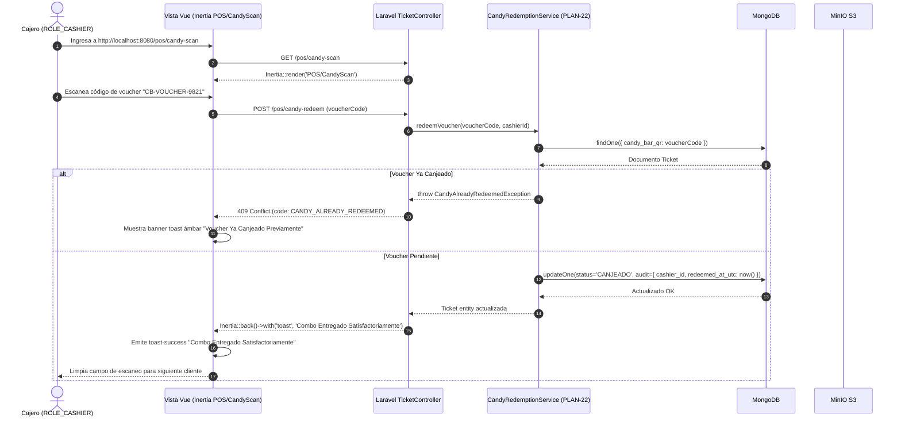

# Plan Técnico: Módulo Vertical 03 — Multimedia y Boletos Digitales (ms/media-hub)

> **Estado:** APPROVED  
> **Versión:** 1.4.0  
> **Módulo:** `docs/specs/03-media-hub/` — *Repositorio Git Autónomo (Monolito Fullstack Unificado)*  
> **Especificación Base:** `docs/specs/03-media-hub/spec.md`  
> **Constitución Base:** `docs/constitution.md`  
> **Despliegue Asignado:** Google Cloud Platform (GCP - Levantamiento Estándar con Docker)  
> **Arquitectura:** Monolito Modular Fullstack Unificado (Laravel 11 + Inertia.js + Vue.js 3 Jetstream Stack)  
> **Metodología:** SDD-Plan-Extended (Arquitectura Limpia N-Capas, UI Jetstream, Dark Mode y Observabilidad)

---

## 1. Resumen Arquitectónico y Decisiones de Diseño

- **Objetivo Técnico**: Construir e integrar el módulo vertical autónomo `ms/media-hub` como un **proyecto monolítico fullstack unificado en Laravel 11** (PHP 8.3/8.4, Inertia.js, Vue.js 3, MinIO S3 Presigned URLs, MongoDB, RabbitMQ) en el **puerto HTTP 8080**, eliminando la duplicidad de carpetas backend/frontend y consolidando toda la lógica de servidor y vistas reactivas en un único repositorio Git autónomo.
- **Componentes Técnicos Clave (`PLAN-XX`)**:
  - `PLAN-20` (MongoCollectionsSetup): Modelos MongoDB (`DigitalTicket.php`, `MediaAsset.php`) con índices de unicidad y auditoría.
  - `PLAN-21` (CryptoSignatureService): Algoritmo de firma HMAC-SHA256 del token autónomo del **QR Llave**.
  - `PLAN-22` (CandyRedemptionService): Servicio atómico de canje de confitería con bloqueo de duplicidad y persistencia de traza de auditoría (`cashier_id`, fecha UTC).
  - `PLAN-23` (MinioStorageAndThumbnailService): Cliente S3 para Presigned URLs, validación de peso (< 5 MB) y generación reactiva de miniaturas de 300x450px con biblioteca GD/Imagick.
  - `PLAN-24` (InertiaVueUploadMediaModal): Componente Vue 3 modal de subida *drag & drop* con barra de progreso y bloqueo ante archivos > 5 MB en `resources/js/Components/UploadMediaModal.vue`.
  - `PLAN-25` (InertiaVueCandyScanTerminal): Página Inertia `resources/js/Pages/POS/CandyScan.vue` para cajero (`ROLE_CASHIER`) con lectura de código y feedback visual de canje exitoso o advertencia de duplicidad.
  - `PLAN-26` (InertiaVueTicketViewerModal): Modal interactivo in-app para visualización de boletos con doble código QR (Sala y Confitería) sin descargas a disco local.
  - `PLAN-27` (MediaDatabaseSeeder): Seeder ejecutable en `database/seeders/MediaHubDatabaseSeeder.php` que inicializa afiches en MinIO, miniaturas y boletos precargados con usuarios (`cajero@test.com`, `operador@test.com`, `admin@test.com`).
  - `PLAN-28` (SagaTicketGenerationJob): Consumidor RabbitMQ del evento `order.paid.event` para persistir los boletos inmutables.
  - `PLAN-29` (ModuleDockerCompose): Archivo `docker-compose.yml` en la raíz de `ms/media-hub` para levantar de manera autónoma MongoDB, MinIO y el contenedor monolítico de Laravel en el puerto 8080.

---

## 2. Estructura Física Exacta de Archivos del Módulo

```text
ms/media-hub/                                         # Repositorio Git Autónomo (Monolito Fullstack)
├── docker-compose.yml                                # Orquestación local autónoma (PLAN-29)
├── Dockerfile                                        # Multi-stage: PHP 8.3 + Node 20 para compilar assets Vite
├── composer.json                                     # Dependencias backend PHP (Laravel 11, MongoDB, RabbitMQ)
├── package.json                                      # Dependencias frontend JS (Vue 3, Inertia.js, Tailwind, Lucide)
├── vite.config.js                                    # Configuración Vite con plugin de Laravel y Vue 3
├── .env.example                                      # Variables de entorno preconfiguradas (INV-ARCH-09)
│
├── app/
│   ├── Http/
│   │   └── Controllers/
│   │       ├── HealthController.php                  # Endpoint /api/health para semáforo visual
│   │       ├── MediaAssetController.php              # Inertia::render('Media/Index') y carga < 5MB
│   │       └── TicketController.php                  # Inertia::render('POS/CandyScan') y canje
│   ├── Models/
│   │   ├── DigitalTicket.php                         # Modelo MongoDB de boletos y auditoría (PLAN-20)
│   │   └── MediaAsset.php                            # Modelo MongoDB de afiches y miniaturas (PLAN-20)
│   ├── Services/
│   │   ├── CryptoSignatureService.php                # Firma HMAC QR Llave (PLAN-21)
│   │   ├── CandyRedemptionService.php                # Canje y auditoría atómica (PLAN-22)
│   │   └── MinioStorageService.php                   # Presigned URLs y Thumbnails (PLAN-23)
│   └── Jobs/
│       └── GenerateTicketSagaJob.php                 # Consumidor RabbitMQ SAGA (PLAN-28)
│
├── database/
│   └── seeders/
│       └── MediaHubDatabaseSeeder.php                # Seeder de pósters y tickets (PLAN-27)
│
├── resources/
│   ├── views/
│   │   └── app.blade.php                             # Layout raíz HTML con directiva @inertia
│   └── js/
│       ├── app.js                                    # Entrypoint de Inertia.js y Vue 3
│       ├── Pages/
│       │   ├── Media/
│       │   │   └── Index.vue                         # Consola multimedia con tabla cebra (PLAN-24)
│       │   └── POS/
│       │       └── CandyScan.vue                     # Terminal de canje rápido de confitería (PLAN-25)
│       └── Components/
│           ├── ActiveModuleBadge.vue                 # Indicador de módulo en layout
│           ├── HealthBadge.vue                       # Semáforo verde/rojo
│           ├── ToastContainer.vue                    # Toasts temáticos
│           ├── ConfirmationModal.vue                 # Diálogo modal de confirmación
│           ├── UploadMediaModal.vue                  # Modal de subida < 5MB (PLAN-24)
│           └── TicketViewerModal.vue                 # Visor in-app doble QR (PLAN-26)
│
├── routes/
│   ├── web.php                                       # Rutas Inertia (/admin/media, /pos/candy-scan)
│   └── api.php                                       # Endpoints REST (/api/health)
│
├── tests/
│   ├── Feature/
│   │   ├── CandyRedemptionAuditTest.php              # Test de canje atómico y bloqueo de doble canje
│   │   └── MediaUploadLimitTest.php                  # Test de límite de 5 MB y miniaturas
│   └── Unit/
│       └── CryptoSignatureTest.php                   # Test de firma y verificación HMAC-SHA256
│
└── docs/
    └── README.md                                     # Guía técnica interna del módulo
```

---

## 3. Diagrama de Secuencia Técnico Integrado (Inertia.js Fullstack)



---

## 4. Vertical Slices de Implementación

- **Slice 1 (Persistencia MongoDB y Firma HMAC)**: Modelos `DigitalTicket`, `MediaAsset` (`PLAN-20`) y servicio de firma criptográfica de QR Llave (`PLAN-21`).
- **Slice 2 (Subida de Pósters < 5MB y Miniaturas)**: `MinioStorageService` (`PLAN-23`), controlador `MediaAssetController`, vista `Index.vue` y modal interactivo `UploadMediaModal.vue` (`PLAN-24`).
- **Slice 3 (Terminal de Canje de Confitería con Auditoría)**: Servicio atómico `CandyRedemptionService` (`PLAN-22`) y página Inertia `CandyScan.vue` (`PLAN-25`).
- **Slice 4 (Visor In-App Doble QR y Semáforo de Salud)**: Componente `TicketViewerModal.vue` (`PLAN-26`), `HealthBadge.vue` y endpoint `/api/health`.
- **Slice 5 (Integración SAGA, Seeders y Docker Compose)**: Consumidor `GenerateTicketSagaJob` (`PLAN-28`), `MediaHubDatabaseSeeder` (`PLAN-27`) y `docker-compose.yml` (`PLAN-29`).

---

## 5. Estrategia de Testing y Comandos

| Capa | Archivo de Prueba | Comportamiento que Verifica |
| :--- | :--- | :--- |
| **Backend Unit** | `tests/Unit/CryptoSignatureTest.php` | Generación y verificación de firma HMAC-SHA256 del QR Llave. |
| **Backend Feature** | `tests/Feature/CandyRedemptionAuditTest.php` | Canje atómico de vouchers, registro de auditoría y bloqueo de doble canje. |
| **Backend Feature** | `tests/Feature/MediaUploadLimitTest.php` | Rechazo estricto de archivos mayores a 5 MB y generación de thumbnail. |
| **Frontend/E2E** | `tests/Feature/InertiaMediaPagesTest.php` | Renderizado de vistas Inertia `Media/Index` y `POS/CandyScan` con props validadas. |

- **Comandos de Verificación**:
  - `cd ms/media-hub && docker compose up -d`
  - `cd ms/media-hub && composer install && npm install`
  - `cd ms/media-hub && php artisan test`
  - `cd ms/media-hub && npm run build`
