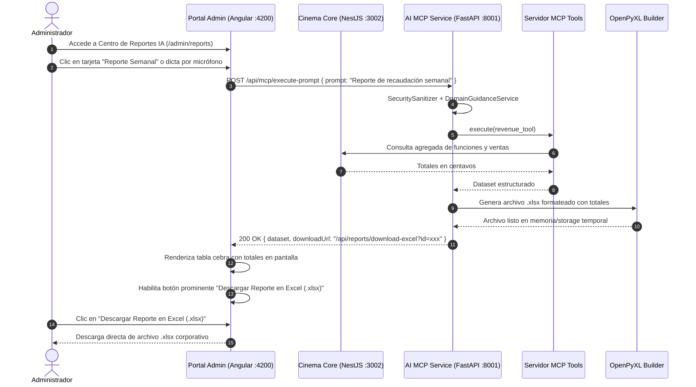

# Plan Técnico: Módulo Vertical 04 — Servicio de Inteligencia Artificial y Servidor MCP (ms/ai-mcp)

> **Estado:** APPROVED  
> **Versión:** 1.4.0  
> **Módulo:** `docs/specs/04-ai-mcp/` — *Repositorio Git Autónomo (Servicio Backend Headless)*  
> **Especificación Base:** `docs/specs/04-ai-mcp/spec.md`  
> **Constitución Base:** `docs/constitution.md`  
> **Despliegue Asignado:** Google Cloud Platform (GCP - Cloud Run / Vertex AI Container Estándar)  
> **Metodología:** SDD-Plan-Extended (Protocolo MCP, Arquitectura Limpia en Python y Observabilidad)

---

## 1. Resumen Arquitectónico y Estrategia Técnica

- **Objetivo Técnico**: Implementar un microservicio cognitivo headless en Python 3.11 (FastAPI, Puerto `8001`), protegido por `SecuritySanitizer`, enrutador de dominio con mensajes orientativos (`DomainGuidanceService`), pipeline Deep Learning con TensorFlow para análisis de afiches JPEG sin descarte por resolución, algoritmos Machine Learning (Scikit-Learn) y ensamblador OpenPyXL para reportes en texto tabular formateado en `.xlsx`.
- **Patrones de Diseño Aplicados**:
  - *Tool-Use Pattern* (Model Context Protocol): Capacidades de negocio tipadas con esquemas Pydantic v2 inmutables.
  - *Pipeline Pattern*: Sanitización $\rightarrow$ Detección de Dominio $\rightarrow$ Ejecución de Tool MCP $\rightarrow$ Generación Excel / Inferencia.
  - *Builder Pattern*: Construcción de archivos `.xlsx` formateados profesionalmente con totales calculados sin gráficos nativos pesados.
- **Consumo**: El servicio no posee frontend propio; expone endpoints REST consumidos de forma transparente por el Portal de Administración Unificado en Angular (`ms/cinema-core/frontend`).

---

## 2. Estructura Física Oficial del Módulo

```text
ms/ai-mcp/                                            # Repositorio Git Autónomo (Servicio Headless)
├── docker-compose.yml                                # Orquestación local autónoma (Puerto 8001)
├── Dockerfile                                        # Contenedor Python 3.11-slim con dependencias ML
├── pyproject.toml / requirements.txt                 # Dependencias (FastAPI, Pydantic, TensorFlow, OpenPyXL, Scikit-Learn)
├── .env.example                                      # Variables de entorno preconfiguradas (INV-ARCH-09)
│
├── app/
│   ├── core/
│   │   ├── config.py                                 # Configuración y variables de entorno
│   │   ├── security_sanitizer.py                     # Validador anti-prompt injection y anti-SQLi
│   │   └── domain_guidance_service.py                # Detección y guía ante consultas fuera de dominio
│   ├── mcp/
│   │   ├── server.py                                 # Instancia y registro del servidor MCP
│   │   ├── tools/
│   │   │   ├── occupancy_tool.py                     # Tool: Cálculo de ocupación
│   │   │   ├── revenue_tool.py                       # Tool: Desglose de ingresos
│   │   │   ├── demand_predictor_tool.py              # Tool: Inferencia Scikit-Learn
│   │   │   └── poster_classifier_tool.py             # Tool: Inferencia TensorFlow JPEG
│   │   └── schemas/
│   │       ├── occupancy_schema.py                   # Schemas Pydantic v2
│   │       ├── revenue_schema.py
│   │       └── prediction_schema.py
│   ├── ml/
│   │   ├── tf_poster_pipeline.py                     # TensorFlow decode_jpeg + CNN Inference
│   │   └── demand_model.py                           # Random Forest Scikit-Learn
│   ├── services/
│   │   ├── stt_service.py                            # Transcripción de audio a texto
│   │   └── excel_builder.py                          # Ensamblador OpenPyXL tabular (.xlsx)
│   ├── api/
│   │   ├── router.py                                 # Enrutador principal de endpoints REST
│   │   └── routes/
│   │       ├── health.py                             # Endpoint /health para semáforo visual
│   │       ├── prompt_execution.py                   # Endpoint /api/mcp/execute-prompt
│   │       ├── vision_routes.py                      # Endpoint /api/vision/classify-poster
│   │       └── reports_routes.py                     # Endpoint /api/reports/download-excel
│   └── seed.py                                       # Seeder de prompts de prueba y pesos de modelos
│
├── tests/
│   ├── test_security_sanitizer.py                    # Pruebas de bloqueo de inyecciones
│   ├── test_domain_guidance.py                       # Pruebas de orientación fuera de dominio
│   ├── test_mcp_tools.py                             # Pruebas de ejecución de Tools MCP
│   ├── test_excel_builder.py                         # Pruebas de formato y totales en .xlsx
│   └── test_vision_pipeline.py                       # Pruebas de inferencia visual con imágenes JPEG
│
└── docs/
    └── README.md                                     # Guía técnica interna del servicio
```

---

## 3. Diagrama de Secuencia de Integración con el Portal de Admin



---

## 4. Vertical Slices de Implementación

- **Slice 1 (Servidor MCP Base y Seguridad)**: Instancia FastAPI, `SecuritySanitizer`, `DomainGuidanceService` y esquemas Pydantic v2.
- **Slice 2 (Herramientas Analíticas y Generador Excel)**: `occupancy_tool.py`, `revenue_tool.py` y `excel_builder.py` con OpenPyXL sin gráficos pesados.
- **Slice 3 (Inferencia Visual TensorFlow JPEG)**: Pipeline `tf_poster_pipeline.py` para análisis y clasificación de afiches desde MinIO sin descartes por resolución.
- **Slice 4 (Servicio STT y Rutas de Reportes)**: Endpoints `/api/mcp/execute-prompt`, `/api/reports/download-excel` y `/health`.
- **Slice 5 (Seeders y Verificación Docker)**: `seed.py` con pesos y prompts precargados, `Dockerfile` y `docker-compose.yml`.

---

## 5. Estrategia de Testing y Comandos

| Capa | Archivo de Prueba | Comportamiento que Verifica |
| :--- | :--- | :--- |
| **Backend Unit** | `tests/test_security_sanitizer.py` | Bloqueo estricto de jailbreaks e inyecciones SQL/NoSQL. |
| **Backend Unit** | `tests/test_domain_guidance.py` | Emisión de mensaje orientativo ante consultas fuera de dominio. |
| **Backend Integration** | `tests/test_mcp_tools.py` | Ejecución y tipado de herramientas MCP de recaudación y ocupación. |
| **Backend Unit** | `tests/test_excel_builder.py` | Generación de archivo `.xlsx` estructurado en texto tabular con totales. |
| **Backend Integration** | `tests/test_vision_pipeline.py` | Inferencia TensorFlow sobre JPEG de diferentes resoluciones. |

- **Comandos de Verificación**:
  - `cd ms/ai-mcp && docker compose up -d`
  - `cd ms/ai-mcp && pytest`
