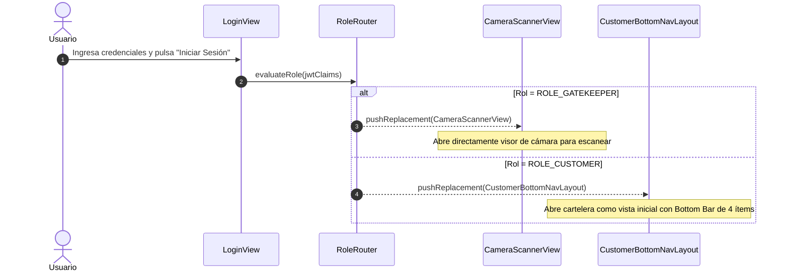
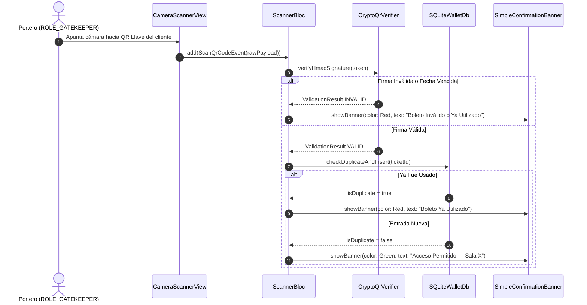

# Plan Técnico: Proyecto Móvil 05 — Aplicación Móvil Independiente (ms/mobile-app)

> **Estado:** APPROVED  
> **Versión:** 1.3.0  
> **Módulo:** `docs/specs/05-mobile-app/` — *Repositorio Git Autónomo*  
> **Especificación Base:** `docs/specs/05-mobile-app/spec.md`  
> **Constitución Base:** `docs/constitution.md`  
> **Naturaleza:** Proyecto Móvil Autónomo Multiplataforma (Compilable a Android / iOS / Web) al 100% dentro de `ms/`  
> **Metodología:** SDD-Plan-Extended (Clean Architecture, BLoC, UI Jetstream & Mobile, Dark Mode y Observabilidad)

---

## 1. Resumen Arquitectónico y Estrategia Técnica

- **Objetivo Técnico**: Implementar la aplicación móvil en Flutter 3.x (Dart 3.x) en `ms/mobile-app` como repositorio Git independiente, estructurada bajo los principios de **Clean Architecture** y gestión de estado con **BLoC**, con tema oscuro por defecto (Dark Mode First), enrutamiento condicional según rol excluyente (`ROLE_CUSTOMER` vs `ROLE_GATEKEEPER`), barra de navegación inferior fija de 4 ítems para clientes, y validación instantánea offline del QR Llave con notificación simple.
- **Patrones de Diseño Clave**:
  - *Role Router Pattern*: Decodificación de claims del token JWT al autenticar para enrutar directamente al escáner de cámara o al layout de cliente.
  - *Repository Pattern*: Abstracción unificada de persistencia en SQLite local (`LocalTicketRepository`, `GateScanRepository`).
  - *BLoC Pattern*: Separación estricta entre flujos de eventos de entrada y estados inmutables para la UI de Flutter.
  - *Offline Queue Pattern*: Cola de sincronización resiliente que acumula validaciones en SQLite y las transmite en batch al recuperar conexión.

---

## 2. Estructura Física Oficial del Proyecto Móvil

```text
ms/mobile-app/                                        # Repositorio Git Autónomo
├── lib/
│   ├── core/
│   │   ├── crypto/
│   │   │   ├── crypto_qr_verifier.dart               # Validador HMAC-SHA256 en Dart puro
│   │   │   └── key_storage_service.dart              # Gestor Flutter Secure Storage
│   │   ├── database/
│   │   │   ├── sqlite_wallet_db.dart                 # Repositorio SQLite (tickets y scans)
│   │   │   ├── migrations.dart                       # Esquemas DDL locales
│   │   │   └── local_seeder.dart                     # Semilla SQLite con boletos de prueba
│   │   ├── network/
│   │   │   ├── connectivity_service.dart             # Detector reactivo online/offline
│   │   │   ├── api_health_service.dart               # Monitoreo de endpoint de salud (badge verde/rojo)
│   │   │   └── sync_queue_worker.dart                # Despachador en background hacia el backend
│   │   └── theme/
│   │       └── app_theme.dart                        # Paleta Slate Dark Mode First con acento #E50914
│   ├── shared/
│   │   ├── widgets/
│   │   │   ├── active_module_badge.dart              # Chip indicador de módulo en AppBar
│   │   │   ├── health_indicator_chip.dart            # Semáforo verde/rojo
│   │   │   └── simple_confirmation_banner.dart       # Notificación simple para escáner
│   │   └── router/
│   │       └── role_router.dart                      # Enrutamiento condicional según rol
│   ├── features/
│   │   ├── auth/
│   │   │   └── presentation/
│   │   │       └── login_view.dart                   # Login con semáforo y credenciales semilla
│   │   ├── customer_navigation/                      # Layout principal para ROLE_CUSTOMER
│   │   │   └── presentation/
│   │   │       └── customer_bottom_nav_layout.dart   # Bottom Navigation Bar fija (4 destinos)
│   │   ├── billboard/
│   │   │   └── presentation/
│   │   │       └── billboard_view.dart               # Vista primaria obligatoria (online/offline)
│   │   ├── wallet/                                   # Billetera de Boletos
│   │   │   ├── bloc/
│   │   │   │   ├── wallet_bloc.dart
│   │   │   │   ├── wallet_event.dart
│   │   │   │   └── wallet_state.dart
│   │   │   └── presentation/
│   │   │       ├── wallet_home_view.dart             # Listado de boletos adquiridos
│   │   │       ├── ticket_detail_view.dart           # Visor in-app en pantalla con doble QR
│   │   │       └── qr_display_widget.dart            # Renderizador del QR Llave y Confitería
│   │   ├── candy_bar/
│   │   │   └── presentation/
│   │   │       └── candy_catalog_view.dart           # Catálogo fijo de confitería
│   │   ├── settings/
│   │   │   └── presentation/
│   │   │       └── settings_view.dart                # Mi Perfil, Tema Dark/Light, Cerrar Sesión
│   │   └── gatekeeper/                               # Control de Acceso (ROLE_GATEKEEPER)
│   │       ├── bloc/
│   │       │   ├── scanner_bloc.dart
│   │       │   ├── scanner_event.dart
│   │       │   └── scanner_state.dart
│   │       └── presentation/
│   │           ├── camera_scanner_view.dart          # Apertura directa de cámara
│   │           └── attendance_counter_badge.dart     # Contador de aforo de sala
│   └── main.dart                                     # Entrada principal
├── assets/
│   └── config/
│       └── env.json                                  # Variables locales preconfiguradas
├── .env.example                                      # Variables de entorno preconfiguradas (INV-ARCH-09)
├── test/
│   ├── crypto_qr_verifier_test.dart                  # Pruebas unitarias de firmas HMAC offline
│   ├── role_router_test.dart                         # Enrutamiento condicional por rol
│   └── sqlite_wallet_test.dart                       # Pruebas de persistencia y duplicidad
├── pubspec.yaml
└── README.md
```

---

## 3. Diagramas de Secuencia Técnicos Integrados

### 3.1 Enrutamiento por Rol al Iniciar Sesión


### 3.2 Validación de QR Llave por Portero


---

## 4. Vertical Slices de Implementación

- **Slice 1 (Lógica Criptográfica y Persistencia SQLite)**: `CryptoQrVerifier`, `SqliteWalletDb` y seeder local con boletos de prueba.
- **Slice 2 (Enrutamiento por Rol y Autenticación)**: `LoginView` con semáforo de conexión y `RoleRouter` condicional.
- **Slice 3 (Experiencia del Portero con Notificación Simple)**: `CameraScannerView` directa con cámara nativa y `SimpleConfirmationBanner`.
- **Slice 4 (Navegación del Cliente y Cartelera Primaria)**: `CustomerBottomNavLayout` con 4 destinos (`Cartelera`, `Mis Boletos`, `Confitería`, `Configuración`) y `BillboardView`.
- **Slice 5 (Billetera In-App sin Descargas)**: `WalletHomeView` y `TicketDetailView` desplegando en alto brillo el QR Llave y Confitería.

---

## 5. Estrategia de Testing y Comandos

| Capa | Archivo de Prueba | Comportamiento que Verifica |
| :--- | :--- | :--- |
| **Dart Unit** | `test/crypto_qr_verifier_test.dart` | Verificación matemática de la firma HMAC offline y vigencia temporal. |
| **Dart Unit** | `test/role_router_test.dart` | Redirección estricta al escáner para portero y a la cartelera para cliente. |
| **Dart Integration** | `test/sqlite_wallet_test.dart` | Inserción en SQLite y rechazo de escaneos duplicados en puerta. |

- **Comandos de Verificación**:
  - `cd ms/mobile-app && flutter test`
  - `cd ms/mobile-app && flutter run -d chrome` (para pruebas web rápidas)
