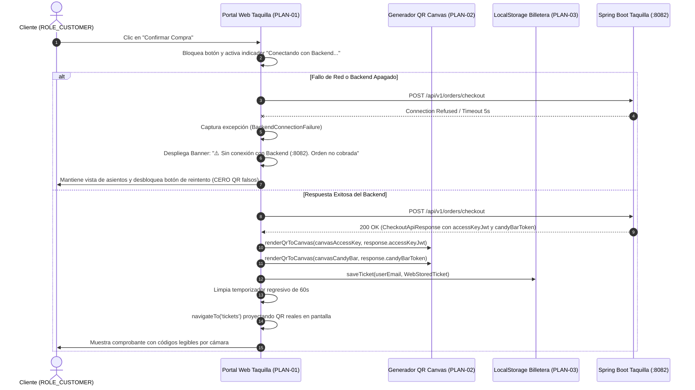
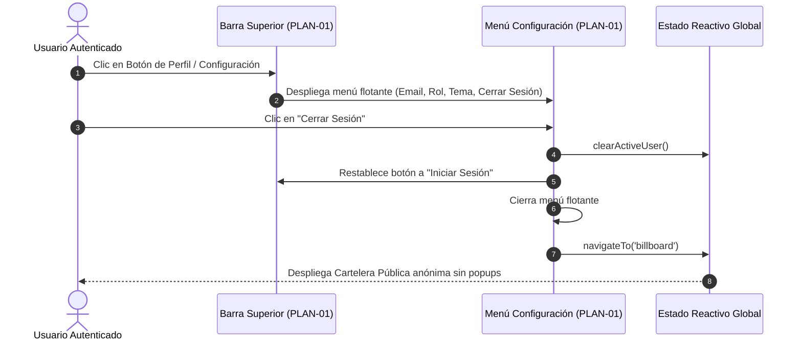

# Plan Técnico: Mejoras de Taquilla Web, Billetera Digital, Gestión de Sesión y Terminal POS (Fixes & Enhancements)

> **Estado:** APPROVED  
> **Versión:** 1.0.0  
> **Módulo:** `docs/specs/06-fixes-tickets-auth/`  
> **Especificación Base:** [docs/specs/06-fixes-tickets-auth/spec.md](docs/specs/06-fixes-tickets-auth/spec.md)  
> **Constitución Base:** [docs/constitution.md](docs/constitution.md)  
> **Metodología:** SDD-Planning  

---

## 1. Resumen Arquitectónico y Decisiones de Diseño

- **Objetivo Técnico**: Implementar un conjunto cohesivo de correcciones de interfaz y experiencia de usuario sobre el portal web de cliente (`ms/ticketing-auth/frontend`), erradicando bloqueos emergentes, integrando gestión reactiva de sesión con menú de configuración y cierre de sesión, garantizando la generación client-side de códigos QR ópticamente legibles a partir de tokens criptográficos (bloqueando de raíz la simulación con caracteres estáticos ante pérdida de conectividad), desplegando una billetera web permanente en `/mis-tickets` con persistencia híbrida (`localStorage` + API), y dotando a la terminal POS de cajero (`ms/media-hub/resources/js/Pages/POS/CandyScan.vue`) de un sistema de diseño profesional con Tailwind CSS y PostCSS compilados.
- **Estilo y Patrón Arquitectónico**:
  - **Portal Web de Cliente (`ms/ticketing-auth/frontend`)**: Arquitectura Single-Page Application (SPA) orientada a vistas dinámicas basadas en State/History API, diseño *Dark Mode First* (paleta Slate / Rojo Carmesí `#E50914` y acento ámbar `#f59e0b`), generador vectorial autónomo de códigos QR (`QRCode` Canvas/SVG) y gestor de sesión local.
  - **Terminal POS de Mostrador (`ms/media-hub`)**: Monolito fullstack en Laravel 11 + Inertia.js + Vue.js 3, con pipeline de empaquetado Vite + Tailwind CSS 3.4 + PostCSS, soporte para teclado numérico táctil y escaneo de hardware.
  - **Aplicación Móvil (`ms/mobile-app`)**: Arquitectura Offline-First con Flutter BLoC, SQLite local y verificador criptográfico HMAC (validación de compatibilidad y trazabilidad).
- **Decisiones Arquitectónicas Clave**:
  - **Generación Vectorial de Códigos QR (Client-Side)**: Se incorpora una biblioteca ligera y autónoma de generación QR en cliente (Canvas/SVG de alta densidad). Si la petición de checkout al microservicio `:8082` responde con éxito, se extraen los tokens del payload (`accessKeyJwt` y `candyBarQrToken`) y se dibujan los códigos reales. Si ocurre un fallo HTTP o un timeout de red, se aborta la transición de pantalla y se visualiza un panel de error de conexión en la misma vista de compra sin emitir boletos falsos.
  - **Persistencia Híbrida de Billetera Web**: Las compras confirmadas se almacenan de inmediato en `localStorage` bajo la clave `cinecenter_tickets_<user_email>`, permitiendo que el cliente acceda a sus boletos incluso si el microservicio se reinicia o está temporalmente inaccesible.
  - **Gestión de Sesión Desacoplada y Logout**: La sesión se gobierna mediante un objeto reactivo `currentUser` en el ámbito de aplicación. El componente de navegación superior renderiza condicionalmente un menú desplegable de Configuración con botón explícito de Cierre de Sesión que purga `currentUser`, limpia credenciales temporales y devuelve al usuario a la Cartelera Pública (`#billboard`).
  - **Pipeline Completo de Estilos en Media Hub**: Se crea la configuración de `tailwind.config.js`, `postcss.config.js` y `resources/css/app.css` en `ms/media-hub`, permitiendo que Vite compile todas las clases utilitarias requeridas por `CandyScan.vue` y `Index.vue`, superando la apariencia de HTML sin formato.

---

### 1.1 Matriz de Componentes Técnicos (`PLAN-XX`)

| ID Componente | Nombre / Artefacto Técnico | Capa Arquitectónica | Responsabilidad Técnica | Requisitos que Cubre (`spec.md`) |
| :--- | :--- | :--- | :--- | :--- |
| **`PLAN-01`** | `SessionManager & HeaderConfigWidget` | Presentación Web (`ticketing-auth`) | Gestión de estado de sesión, eliminación de alerts y menú dropdown de Configuración con subbotón de Logout | `HU-01`, `RF-01.1`, `RF-01.2`, `RF-01.3`, `RB-06.1`, `RB-06.2` |
| **`PLAN-02`** | `ClientQrGenerator & CheckoutResilience` | Presentación / Integración Web (`ticketing-auth`) | Renderizado dinámico de QR reales en canvas/SVG y bloqueo fail-fast ante caída del backend sin placeholders | `HU-02`, `RF-02.1`, `RF-02.2`, `RB-06.3`, `RB-06.4` |
| **`PLAN-03`** | `WebWalletView & TicketStore` | Presentación / Persistencia Local Web (`ticketing-auth`) | Módulo permanente "Mis Boletos" (`/mis-tickets`), persistencia en `localStorage`, Zero-State y visor modal | `HU-03`, `RF-03.1`, `RF-03.2`, `RF-03.3`, `RF-03.4`, `RB-06.5` |
| **`PLAN-04`** | `TailwindPipelineSetup` | Infraestructura / Build (`media-hub`) | Configuración de Tailwind CSS, PostCSS y entrada CSS en Vite para compilar estilos completos | `HU-04`, `RF-04.1`, `RB-06.6` |
| **`PLAN-05`** | `PosCandyScanController & ViewEnhancement` | Aplicación / Presentación (`media-hub`) | Renderizado Inertia en controlador y rediseño ergonómico de la terminal POS táctil con auditoría en vivo | `HU-04`, `RF-04.1`, `RF-04.2`, `RF-04.3`, `RF-04.4`, `RB-06.6` |
| **`PLAN-06`** | `MobileWalletCompatibilityAudit` | Verificación / Trazabilidad (`mobile-app`) | Auditoría y confirmación de compatibilidad de esquemas entre la billetera móvil Flutter y la billetera web | `HU-03`, `RB-06.5`, `INV-BIZ-04` |

---

## 2. Estructura Física de Archivos del Proyecto / Módulo

```text
/
├── ms/
│   ├── ticketing-auth/
│   │   └── frontend/
│   │       ├── [MODIFY] index.html                       # (PLAN-01, PLAN-02, PLAN-03) Modificación integral: Header, Dropdown, QR real, Wallet view
│   │       └── [CREATE] js/qr-code-renderer.js            # (PLAN-02) Generador modular autónomo de códigos QR en Canvas/SVG
│   │
│   ├── media-hub/
│   │   ├── [CREATE] tailwind.config.js                   # (PLAN-04) Configuración de Tailwind para templates Blade y componentes Vue
│   │   ├── [CREATE] postcss.config.js                    # (PLAN-04) Configuración de PostCSS con Tailwind y Autoprefixer
│   │   ├── [CREATE] resources/css/app.css                # (PLAN-04) Directivas base, components y utilities de Tailwind
│   │   ├── [MODIFY] vite.config.js                       # (PLAN-04) Inclusión de resources/css/app.css en el input de rollup
│   │   ├── [MODIFY] resources/js/app.js                  # (PLAN-04) Importación de ../css/app.css en el runtime de Inertia
│   │   ├── [MODIFY] app/Http/Controllers/TicketController.php # (PLAN-05) Renderizado Inertia::render en método scanner()
│   │   └── [MODIFY] resources/js/Pages/POS/CandyScan.vue # (PLAN-05) UI renovada de terminal POS táctil con teclado numérico y feedback
│   │
│   └── mobile-app/
│       └── lib/features/wallet/presentation/
│           └── [EXTEND] wallet_home_view.dart            # (PLAN-06) Trazabilidad verificada y confirmación de esquema
│
└── docs/
    └── specs/
        └── 06-fixes-tickets-auth/
            ├── spec.md                                   # Especificación funcional aprobada
            ├── plan.md                                   # Este plan técnico aprobado
            └── tasks.md                                  # Backlog de tareas atómicas ejecutables
```

---

## 3. Modelo Físico de Persistencia y Esquemas de Datos

### 3.1 Estructura en `localStorage` Web (`PLAN-03`)

* **Clave de Persistencia**: `cinecenter_tickets_<user_email>`
* **Formato**: Array JSON serializado conteniendo objetos `WebStoredTicket`:

| Atributo | Tipo Físico | Nulabilidad | Restricción / Propósito | Requisito Asociado |
| :--- | :--- | :--- | :--- | :--- |
| `ticketId` | `string` | NOT NULL | Identificador único de orden/boleto (ej. `TCK-BOL-9923`) | `RF-03.2` |
| `movieTitle` | `string` | NOT NULL | Título de la película | `RF-03.3` |
| `hallName` | `string` | NOT NULL | Nombre de la sala y formato de proyección | `RF-03.3` |
| `showtime` | `string` | NOT NULL | Horario o sesión de la función (ej. `17:00`) | `RF-03.3` |
| `seats` | `string[]` | NOT NULL | Array de códigos de butaca (ej. `["A3", "A4"]`) | `RF-03.3` |
| `amountPaid` | `number` | NOT NULL | Total abonado en moneda local (Bs.) | `RF-03.3` |
| `qrAccessKey` | `string` | NOT NULL | Payload firmado criptográfico para QR Llave de Sala | `RF-02.1`, `RF-03.3` |
| `qrCandyToken` | `string` | NOT NULL | Token de voucher para QR de Confitería | `RF-02.1`, `RF-03.3` |
| `purchasedAtUtc`| `string` | NOT NULL | Timestamp ISO-8601 UTC de la compra | Auditoría |

### 3.2 Esquema de Canje en Mostrador (`PLAN-05` — `ms/media-hub`)

* **Modelo en Memoria / MongoDB**:
  - `ticketCode`: String indexado (ej. `TCK-BOL-8841`).
  - `qrCandyToken`: String indexado único.
  - `candyRedeemed`: Booleano (`true` / `false`).
  - `redeemedAt`: ISO Timestamp o `null`.
  - `redeemedBy`: String identificador del cajero.
  - `counterId`: Identificador de terminal (ej. `CAJA-01`).

---

## 4. Contratos de Código, Interfaces Tipadas y Jerarquía de Errores

### 4.1 Definiciones TypeScript para Portal Web (`ms/ticketing-auth/frontend`)

```typescript
// Contrato de Sesión de Usuario
export interface UserSession {
  email: string;
  role: 'ROLE_CUSTOMER' | 'ROLE_CASHIER' | 'ROLE_MANAGER' | 'ROLE_SUPERADMIN';
  token?: string;
  authenticatedAt: string;
}

// Contrato de Entrada Almacenada en Billetera Web
export interface WebStoredTicket {
  ticketId: string;
  movieTitle: string;
  hallName: string;
  showtime: string;
  seats: string[];
  amountPaid: number;
  qrAccessKey: string;
  qrCandyToken: string;
  purchasedAtUtc: string;
}

// Payload de Respuesta del Backend de Taquilla (:8082)
export interface CheckoutApiResponse {
  orderId: string;
  ticketCode: string;
  movieTitle: string;
  hallName: string;
  seatCodes: string[];
  totalAmount: number;
  accessKeyJwt: string;
  candyBarToken: string;
  status: 'PAYMENT_CONFIRMED' | 'COMPLETED';
}
```

### 4.2 Jerarquía de Errores Tipados de Frontend

| Error Técnico | Condición que lo Dispara | Manejo en UI | Escenario BDD |
| :--- | :--- | :--- | :--- |
| `BackendConnectionFailure` | `fetch` rechaza la promesa (red caída, ERR_CONNECTION_REFUSED en `:8082`) | Despliega alerta roja en la vista de compra, desactiva spinner, mantiene butacas y no emite boleto | `SC-03` |
| `InvalidSessionFailure` | Intento de acceso a `/mis-tickets` sin sesión activa | Redirige suavemente a `/login` preservando el hash `#mis-tickets` como redirección posterior | `RF-03.5` |
| `DuplicateRedemptionFailure` | Código de confitería ya marcado como `candyRedeemed: true` | Despliega banner rojo en terminal POS con hora y cajero del canje previo | `SC-05` |

---

## 5. Diagramas Técnicos de Secuencia

### 5.1 Flujo de Compra Resistente a Fallos y Renderizado de QR Reales



### 5.2 Flujo de Cierre de Sesión Limpio y Cambio de Rol



---

## 6. Garantías de Runtime y Ciclo de Vida Operativo

1. **Garantía Anti-Placeholders**:
   - Se erradican del DOM los elementos con caracteres Unicode `⬛⬜⬛`.
   - El renderizado de QR se delega a elementos `<canvas>` o `<svg>` dinámicos alimentados exclusivamente por los datos de la orden.
   - Si no hay datos válidos de token, el canvas permanece vacío o se oculta, y el contenedor proyecta el mensaje de estado de error.
2. **Ciclo de Vida de Menús Desplegables**:
   - El menú de configuración escucha eventos de clic externo (`document.addEventListener('click')`) para cerrarse automáticamente si el usuario hace clic fuera de su contenedor.
3. **Ergonomía de Mostrador para Cajeros POS**:
   - Los botones numéricos y de acción en `CandyScan.vue` tienen un tamaño táctil mínimo de `48px x 48px`, espaciado suficiente para evitar pulsaciones erróneas y soporte para atajos de teclado (`ENTER` para canje, `ESC` para limpiar entrada).

---

## 7. Arquitectura de Vertical Slices (Hoja de Ruta para `/sdd-task`)

* **Vertical Slice 1: Autenticación Natural y Control de Sesión Web**
  - Componentes: `PLAN-01`.
  - Alcance: Erradicación de `alert` al loguear, integración del botón de Configuración con dropdown y subbotón "Cerrar Sesión".
  - Verificación: Navegación de login/logout sin bloqueos emergentes.

* **Vertical Slice 2: Compra Segura, Resiliencia y QR Reales**
  - Componentes: `PLAN-02`.
  - Alcance: Generador client-side de QR dinámico, sustitución de placeholders `⬛⬜⬛` por canvas real, y manejo estricto de desconexión del backend.
  - Verificación: Prueba de renderizado de QR con datos válidos y prueba de caída controlada ante backend offline.

* **Vertical Slice 3: Billetera Web Permanente "Mis Boletos"**
  - Componentes: `PLAN-03`, `PLAN-06`.
  - Alcance: Creación de la vista permanente `/mis-tickets`, persistencia local en `localStorage`, visor modal interactivo de entradas y manejo de estado vacío (*Zero-State*).
  - Verificación: Consulta de compras guardadas y apertura de detalle con QR.

* **Vertical Slice 4: Pipeline de Estilos y Rediseño de Terminal POS Cajero**
  - Componentes: `PLAN-04`, `PLAN-05`.
  - Alcance: Creación de `tailwind.config.js`, `postcss.config.js`, `resources/css/app.css`, actualización de `vite.config.js`, controlador `TicketController` con Inertia y modernización de `CandyScan.vue`.
  - Verificación: Compilación de Vite sin errores y renderizado estilizado de `/pos/candy-scan`.

---

## 8. Estrategia de Testing y Verificación Técnica

| Nivel de Prueba | Tipo | Archivo / Comando | Qué Valida |
| :--- | :--- | :--- | :--- |
| **1. Verificación Web** | Inspección y BDD | Navegador `http://localhost:3000/` | Login sin popup, menú de configuración, logout, compra con QR real y vista "Mis Boletos" |
| **2. Verificación POS** | Build & Visual | `cd ms/media-hub && npm run build` | Compilación exitosa de Tailwind + Vite y vista de mostrador en `http://localhost:8080/pos/candy-scan` |
| **3. Compatibilidad Móvil** | Unit Test | `cd ms/mobile-app && flutter test` | Verificación de que la app móvil mantiene la suite de billetera en verde sin regresiones |

---

## 9. Matriz de Trazabilidad Técnica (`Spec` ↔ `Plan`)

| Requisito / Regla / Escenario (`spec.md`) | Componente del Plan (`PLAN-XX`) | Archivo Físico Asociado | Verificación |
| :--- | :--- | :--- | :--- |
| `HU-01`, `RF-01.1`, `RB-06.1`, `SC-01` | `PLAN-01` | `ms/ticketing-auth/frontend/index.html` | Verificación en navegador |
| `RF-01.2`, `RF-01.3`, `RB-06.2`, `SC-01` | `PLAN-01` | `ms/ticketing-auth/frontend/index.html` | Prueba de cierre de sesión |
| `HU-02`, `RF-02.1`, `RB-06.3`, `SC-02` | `PLAN-02` | `ms/ticketing-auth/frontend/index.html`, `js/qr-code-renderer.js` | Renderizado óptico de QR |
| `RF-02.2`, `RB-06.4`, `SC-03` | `PLAN-02` | `ms/ticketing-auth/frontend/index.html` | Simulación de backend offline |
| `HU-03`, `RF-03.1` a `RF-03.5`, `RB-06.5`, `SC-04` | `PLAN-03` | `ms/ticketing-auth/frontend/index.html` | Navegación a `/mis-tickets` y Zero-State |
| `HU-04`, `RF-04.1` a `RF-04.4`, `RB-06.6`, `SC-05` | `PLAN-04`, `PLAN-05` | `ms/media-hub/resources/css/app.css`, `CandyScan.vue` | Build de Vite y prueba de canje |
| Invariante Móvil Billetera | `PLAN-06` | `ms/mobile-app/lib/features/wallet/` | `flutter test` en móvil |

