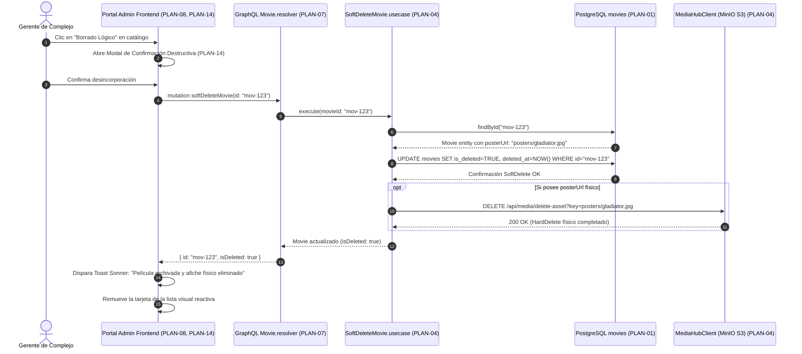
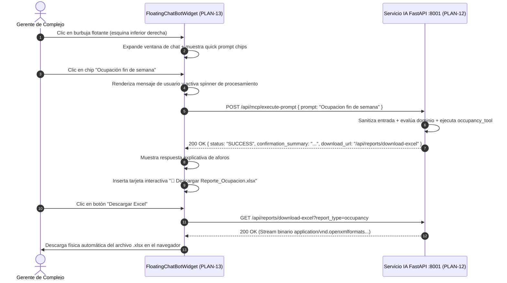

# Plan Técnico: Rediseño Integral, Operaciones Reales y Asistente Cognitivo en Portal Admin

> **Estado:** APPROVED  
> **Versión:** 1.0.0  
> **Módulo:** `docs/specs/07-admin-erp-redesign/`  
> **Especificación Base:** `docs/specs/07-admin-erp-redesign/spec.md`  
> **Constitución Base:** `docs/constitution.md`  
> **Metodología:** SDD-Planning  

---

## 1. Resumen Arquitectónico y Decisiones de Diseño

### 1.1 Objetivo Técnico
Materializar la especificación funcional `07-admin-erp-redesign` transformando el Portal de Administración Unificado (`ms/cinema-core/frontend` en puerto 4200) y su backend NestJS 10 con GraphQL Apollo (`ms/cinema-core/backend` en puerto 3002) en un sistema completamente operativo, desacoplado y reactivo, conectado a PostgreSQL 16 y comunicándose directamente con el microservicio cognitivo `ms/ai-mcp` (puerto 8001) y el almacenamiento de medios en `ms/media-hub` (puerto 8080/9000).

### 1.2 Patrón Arquitectónico
- **Backend (`ms/cinema-core/backend`)**: Arquitectura Hexagonal / Clean Architecture modular en NestJS 10 y TypeScript.
  - *Domain*: Entidades ricas e invariantes puras (`CinemaHall`, `Seat`, `Movie`, `Showtime`, `CinemaComplex`).
  - *Application*: Casos de uso atómicos orquestados con inyección de dependencias.
  - *Infrastructure*: Repositorios implementados con PostgreSQL (`pg-pool`) y clientes HTTP/S3.
  - *Presentation*: Resolvers tipados de GraphQL Apollo bajo el paradigma Code-First/Schema-First.
- **Frontend (`ms/cinema-core/frontend`)**: Single Page Application (SPA) construida en HTML5 semántico, CSS3 moderno (paleta oscura con variables CSS) y JavaScript Vanilla puro modularizado mediante funciones reactivas y el patrón MVI/Component-Light, sin añadir bundlers externos, servido por Nginx en puerto 4200.

### 1.3 Decisiones Arquitectónicas Clave Tomadas
1. **Persistencia e Integridad Referencial**:
   - Las entidades maestras (`cinema_halls`, `movies`, `showtimes`) mantienen claves foráneas estrictas en PostgreSQL.
   - Para películas se implementa la política híbrida `RB-07.3`: SoftDelete lógico en base de datos (`is_deleted = TRUE, deleted_at = NOW()`) para mantener la integridad histórica contable, acoplado con la invocación síncrona/transaccional a la eliminación física (**HardDelete**) del archivo del póster en MinIO/S3.
   - Las salas con funciones vigentes o futuras tienen restricción `RESTRICT` de borrado; solo se permite conmutar su estado a `is_active = FALSE`.
2. **Concurrencia y Detección de Colisiones**:
   - La programación de funciones (`ScheduleShowtime`) aplica un bloqueo o verificación atómica evaluando la condición de no solapamiento:
     $$\text{NuevoInicio} < \text{ExistenteFin} + 20\text{ min} \quad \land \quad \text{NuevoFin} + 20\text{ min} > \text{ExistenteInicio}$$
     Si existe intersección en la misma sala, se emite una excepción de dominio tipada `ScheduleCollisionError`.
3. **Resiliencia, Timeouts y Degradación Elegante**:
   - Todas las llamadas `fetch()` al backend GraphQL (`:3002`) y al motor MCP (`:8001`) se envuelven en un `AbortController` con timeout estricto de 3500ms para evitar bloqueos del hilo principal de UI.
   - Si el microservicio de IA `:8001` está offline, el semáforo dual del dashboard refleja el indicador rojo sin interrumpir la operación local de salas o cartelera.
4. **Chat Bot Flotante y Entrega de Archivos**:
   - Widget flotante desacoplado en el DOM con persistencia de estado de sesión en memoria.
   - Al invocar `POST /api/mcp/execute-prompt`, el frontend procesa la respuesta JSON; si contiene `download_url`, renderiza una tarjeta de descarga que invoca directamente el endpoint binario `GET /api/reports/download-excel` desencadenando la descarga en el navegador.

### 1.4 Matriz de Componentes Técnicos (`PLAN-XX`)

| ID Componente | Nombre / Artefacto Técnico | Capa Arquitectónica | Responsabilidad Técnica | Requisitos que Cubre |
| :--- | :--- | :--- | :--- | :--- |
| **`PLAN-01`** | `CinemaDatabaseSchema` / PostgreSQL | Infraestructura / Datos | Esquemas, tablas, índices y migraciones para salas, butacas, películas y funciones | `HU-02`, `HU-03`, `HU-04`, `RB-07.2` |
| **`PLAN-02`** | `DomainEntities` & `DomainErrors` | Dominio | Entidades (`CinemaHall`, `Movie`, `Showtime`, `Seat`) y excepciones de dominio | `RB-07.2`, `RB-07.3`, `RB-07.4` |
| **`PLAN-03`** | `HallUseCases` (`UpdateHall`, `ToggleHall`) | Aplicación | Orquestación de alta, edición y desactivación de salas de proyección | `HU-02`, `RF-02.1`, `RF-02.3` |
| **`PLAN-04`** | `MovieUseCases` (`UpdateMovie`, `DeleteMovieHybrid`) | Aplicación | Modificación de películas, SoftDelete en PostgreSQL y HardDelete de afiche en S3 | `HU-03`, `RF-03.3`, `RF-03.4`, `RB-07.3` |
| **`PLAN-05`** | `ShowtimeUseCases` (`CancelShowtime`, `GetSchedule`) | Aplicación | Cancelación de funciones y cálculo de colisiones con buffer de 20 minutos | `HU-04`, `RF-04.1`, `RF-04.2`, `RF-04.3` |
| **`PLAN-06`** | `DashboardKpiUseCase` & `HealthCheck` | Aplicación / Presentación | Cálculo en tiempo real de métricas ejecutivas y semáforo dual de salud | `HU-05`, `RF-05.1`, `RF-05.2`, `RF-05.3` |
| **`PLAN-07`** | `GraphQLResolvers` & `SchemaDefinitions` | Presentación Backend | Resolvers GraphQL Apollo para queries y mutaciones de Salas, Películas, Cartelera y KPIs | `HU-02`, `HU-03`, `HU-04`, `HU-05` |
| **`PLAN-08`** | `AdminLayoutEngine` & `Navigation` | Presentación Frontend | Breadcrumbs, botón "← Volver", Sidebar conciso de 1 palabra y Logout formal | `HU-01`, `RF-01.1`, `RF-01.2`, `RF-01.3` |
| **`PLAN-09`** | `SeatGridModalComponent` | Presentación Frontend | Modal interactivo para renderizar la cuadrícula de butacas (filas $\times$ columnas) | `HU-02`, `RF-02.2` |
| **`PLAN-10`** | `PosterUploadAndPreviewComponent` | Presentación Frontend | Drag & drop, validación de peso ($<5\text{ MB}$), formato y previsualización de afiche | `HU-03`, `RF-03.1`, `RF-03.2` |
| **`PLAN-11`** | `ScheduleCollisionVisualizer` | Presentación Frontend | Selector de funciones con advertencia reactiva de colisión y buffer de limpieza | `HU-04`, `RF-04.1`, `RF-04.2` |
| **`PLAN-12`** | `McpReportsAndVoiceConnector` | Presentación Frontend | Consumo de endpoints de reporte Excel y captura de voz Web Audio API/MediaRecorder | `HU-06`, `RF-06.1`, `RF-06.2` |
| **`PLAN-13`** | `FloatingChatBotWidget` | Presentación Frontend | Burbuja flotante fija, quick prompts, comunicación con `:8001` y descarga de Excel | `HU-07`, `RF-07.1` a `RF-07.5` |
| **`PLAN-14`** | `ToastAndDestructiveModalManager` | Presentación Frontend | Sistema de notificaciones no intrusivas (toasts 3.5s) y modal de confirmación destructiva | `HU-08`, `RF-08.1`, `RF-08.2`, `RB-07.5` |

---

## 2. Estructura Física de Archivos del Proyecto / Módulo

```text
ms/cinema-core/
├── backend/
│   ├── src/
│   │   ├── domain/
│   │   │   ├── entities/
│   │   │   │   ├── [EXTEND] CinemaHall.entity.ts         # Métodos toggleStatus(), updateDetails() (PLAN-02)
│   │   │   │   ├── [EXTEND] Movie.entity.ts              # Métodos updateMetadata(), clearPoster() (PLAN-02)
│   │   │   │   ├── [EXTEND] Showtime.entity.ts           # Método cancelShowtime() (PLAN-02)
│   │   │   │   └── [EXTEND] Seat.entity.ts               # Propiedades de categoría e inactividad (PLAN-02)
│   │   │   └── errors/
│   │   │       ├── [CREATE] DomainErrors.ts              # ScheduleCollisionError, HallInUseError, etc. (PLAN-02)
│   │   ├── application/
│   │   │   └── use-cases/
│   │   │       ├── [CREATE] UpdateHall.usecase.ts        # Edición de salas y aforos (PLAN-03)
│   │   │       ├── [CREATE] DeleteHall.usecase.ts        # Inactivación / borrado seguro (PLAN-03)
│   │   │       ├── [CREATE] UpdateMovie.usecase.ts       # Edición de metadatos de película (PLAN-04)
│   │   │       ├── [MODIFY] SoftDeleteMovie.usecase.ts   # Integración con borrado físico de imagen (PLAN-04)
│   │   │       ├── [CREATE] CancelShowtime.usecase.ts    # Cancelación de función (PLAN-05)
│   │   │       ├── [CREATE] GetDashboardKpis.usecase.ts  # Consulta dinámica de métricas ejecutivas (PLAN-06)
│   │   ├── infrastructure/
│   │   │   ├── database/
│   │   │   │   ├── [MODIFY] pg-pool.ts                   # Adaptador con queries para actualización y KPIs (PLAN-01)
│   │   │   │   └── seeders/
│   │   │   │       └── [EXTEND] CinemaDatabaseSeeder.ts  # Datos de prueba para verificación (PLAN-01)
│   │   │   └── external/
│   │   │       └── [CREATE] MediaHubClient.ts            # Cliente HTTP para eliminación de afiches en S3 (PLAN-04)
│   │   └── presentation/
│   │       ├── graphql/
│   │       │   ├── resolvers/
│   │       │   │   ├── [MODIFY] Hall.resolver.ts         # Mutaciones updateHall, deleteHall (PLAN-07)
│   │       │   │   ├── [MODIFY] Movie.resolver.ts        # Mutaciones updateMovie, softDeleteMovie (PLAN-07)
│   │       │   │   ├── [MODIFY] Showtime.resolver.ts     # Mutación cancelShowtime, query getShowtimes (PLAN-07)
│   │       │   │   └── [CREATE] Dashboard.resolver.ts    # Query dashboardKpis (PLAN-07)
│   │       │   └── types/
│   │       │       ├── [MODIFY] Hall.type.ts             # Input types para update (PLAN-07)
│   │       │       ├── [MODIFY] Movie.type.ts            # Input types para update (PLAN-07)
│   │       │       ├── [MODIFY] Showtime.type.ts         # Input types para cancelación (PLAN-07)
│   │       │       └── [CREATE] DashboardKpi.type.ts     # Type para métricas ejecutivas (PLAN-07)
│   │       └── controllers/
│   │           └── [EXTEND] Health.controller.ts         # Endpoint /health enriquecido (PLAN-06)
│   └── tests/
│       ├── [CREATE] HallUseCases.spec.ts                 # Tests unitarios de salas y butacas
│       ├── [CREATE] MovieHybridDelete.spec.ts            # Tests unitarios de SoftDelete + HardDelete afiche
│       └── [CREATE] ShowtimeCollision.spec.ts            # Tests unitarios de buffer +20m de limpieza
│
└── frontend/
    ├── index.html                                        # [MODIFY] Consola SPA rediseñada completa (PLAN-08 a PLAN-14)
    ├── nginx.conf                                        # [MODIFY] Servidor web Nginx con cabeceras de proxy SPA
    └── Dockerfile                                        # [MODIFY] Despliegue en contenedor con configuración Nginx
```

---

## 3. Modelo Físico de Persistencia y Esquema de Datos

### 3.1 Tablas Físicas en PostgreSQL (`ms/cinema-core/backend`)

* **Tabla `cinema_halls`**:
| Columna | Tipo Físico | Nulabilidad | Restricciones / Índices | Regla Funcional |
| :--- | :--- | :--- | :--- | :--- |
| `id` | `VARCHAR(36)` | `NOT NULL` | `PRIMARY KEY` | Identificador UUID |
| `complex_id` | `VARCHAR(36)` | `NOT NULL` | `INDEX`, `REFERENCES cinema_complexes(id)` | Complejo asociado |
| `name` | `VARCHAR(100)` | `NOT NULL` | `INDEX` | Nombre de sala (`RB-07.2`) |
| `projection_type` | `VARCHAR(50)` | `NOT NULL` | Formatos válidos: `2D`, `3D`, `IMAX`, `CXC`, `VIP` | Formato visual |
| `total_capacity` | `INTEGER` | `NOT NULL` | `CHECK (total_capacity >= 10 AND total_capacity <= 500)` | Límite de aforo (`RB-07.2`) |
| `rows_count` | `INTEGER` | `NOT NULL` | `DEFAULT 8` | Cantidad de filas |
| `columns_count` | `INTEGER` | `NOT NULL` | `DEFAULT 10` | Cantidad de columnas |
| `is_active` | `BOOLEAN` | `NOT NULL` | `DEFAULT TRUE`, `INDEX` | Estado de operación |
| `created_at` | `TIMESTAMP` | `NOT NULL` | `DEFAULT CURRENT_TIMESTAMP` | Trazabilidad |
| `updated_at` | `TIMESTAMP` | `NOT NULL` | `DEFAULT CURRENT_TIMESTAMP` | Trazabilidad |

* **Tabla `seats`**:
| Columna | Tipo Físico | Nulabilidad | Restricciones / Índices | Regla Funcional |
| :--- | :--- | :--- | :--- | :--- |
| `id` | `VARCHAR(36)` | `NOT NULL` | `PRIMARY KEY` | Identificador UUID |
| `hall_id` | `VARCHAR(36)` | `NOT NULL` | `INDEX`, `REFERENCES cinema_halls(id) ON DELETE CASCADE` | Sala a la que pertenece |
| `row_label` | `VARCHAR(2)` | `NOT NULL` | Letras `A` a `Z` | Fila física |
| `column_number` | `INTEGER` | `NOT NULL` | Número `1` a `30` | Columna física |
| `seat_type` | `VARCHAR(20)` | `NOT NULL` | `DEFAULT 'STANDARD'`, valores: `STANDARD`, `VIP`, `DISABLED` | Categoría de butaca |
| `is_active` | `BOOLEAN` | `NOT NULL` | `DEFAULT TRUE` | Habilitada / Mantenimiento |
| `code` | `VARCHAR(10)` | `NOT NULL` | Combinación `row_label || column_number` | Código legible |

* **Tabla `movies`**:
| Columna | Tipo Físico | Nulabilidad | Restricciones / Índices | Regla Funcional |
| :--- | :--- | :--- | :--- | :--- |
| `id` | `VARCHAR(36)` | `NOT NULL` | `PRIMARY KEY` | Identificador UUID |
| `title` | `VARCHAR(200)` | `NOT NULL` | `INDEX` | Título oficial |
| `synopsis` | `TEXT` | `NULL` | Longitud máxima 500 chars | Resumen |
| `duration_minutes`| `INTEGER` | `NOT NULL` | `CHECK (duration_minutes >= 1 AND duration_minutes <= 360)` | Tiempo de película |
| `genre` | `VARCHAR(100)` | `NOT NULL` | Género cinematográfico | Clasificación de género |
| `classification` | `VARCHAR(20)` | `NOT NULL` | `TE`, `P-14`, `P-18` | Censura por edad |
| `poster_url` | `VARCHAR(500)` | `NULL` | URL o clave en MinIO S3 | Ubicación de afiche |
| `is_deleted` | `BOOLEAN` | `NOT NULL` | `DEFAULT FALSE`, `INDEX` | Borrado lógico (`RB-07.3`) |
| `deleted_at` | `TIMESTAMP` | `NULL` | Marca de tiempo de desincorporación | Auditoría SoftDelete |
| `created_at` | `TIMESTAMP` | `NOT NULL` | `DEFAULT CURRENT_TIMESTAMP` | Trazabilidad |
| `updated_at` | `TIMESTAMP` | `NOT NULL` | `DEFAULT CURRENT_TIMESTAMP` | Trazabilidad |

* **Tabla `showtimes`**:
| Columna | Tipo Físico | Nulabilidad | Restricciones / Índices | Regla Funcional |
| :--- | :--- | :--- | :--- | :--- |
| `id` | `VARCHAR(36)` | `NOT NULL` | `PRIMARY KEY` | Identificador UUID |
| `hall_id` | `VARCHAR(36)` | `NOT NULL` | `INDEX`, `REFERENCES cinema_halls(id)` | Sala de la función |
| `movie_id` | `VARCHAR(36)` | `NOT NULL` | `INDEX`, `REFERENCES movies(id)` | Película programada |
| `start_time` | `TIMESTAMP` | `NOT NULL` | `INDEX` | Inicio de proyección |
| `end_time` | `TIMESTAMP` | `NOT NULL` | Calculado: `start_time + duration` | Fin estimado |
| `clean_buffer_until`| `TIMESTAMP`| `NOT NULL` | Calculado: `end_time + 20 min` | Límite higienización (`RB-07.4`)|
| `price_cents` | `INTEGER` | `NOT NULL` | `CHECK (price_cents > 0)` | Precio base en centavos |
| `is_active` | `BOOLEAN` | `NOT NULL` | `DEFAULT TRUE`, `INDEX` | Confirmada / Cancelada |
| `created_at` | `TIMESTAMP` | `NOT NULL` | `DEFAULT CURRENT_TIMESTAMP` | Trazabilidad |

---

## 4. Contratos de Código, Interfaces Tipadas y Jerarquía de Errores

### 4.1 Entidades de Dominio en TypeScript (`PLAN-02`)

```typescript
// ms/cinema-core/backend/src/domain/entities/CinemaHall.entity.ts
export class CinemaHall {
  constructor(
    public readonly id: string,
    public readonly complexId: string,
    public name: string,
    public projectionType: '2D' | '3D' | 'IMAX' | 'CXC' | 'VIP',
    public totalCapacity: number,
    public rowsCount: number,
    public columnsCount: number,
    public isActive: boolean = true,
    public readonly createdAt: Date = new Date(),
    public updatedAt: Date = new Date()
  ) {
    if (totalCapacity < 10 || totalCapacity > 500) {
      throw new Error('La capacidad de la sala debe situarse entre 10 y 500 butacas (RB-07.2).');
    }
  }

  updateDetails(name: string, projectionType: any): void {
    this.name = name;
    this.projectionType = projectionType;
    this.updatedAt = new Date();
  }

  toggleActive(status?: boolean): void {
    this.isActive = status !== undefined ? status : !this.isActive;
    this.updatedAt = new Date();
  }
}
```

```typescript
// ms/cinema-core/backend/src/domain/entities/Movie.entity.ts
export class Movie {
  constructor(
    public readonly id: string,
    public title: string,
    public synopsis: string,
    public durationMinutes: number,
    public genre: string,
    public classification: 'TE' | 'P-14' | 'P-18',
    public posterUrl: string | null = null,
    public isDeleted: boolean = false,
    public deletedAt: Date | null = null,
    public readonly createdAt: Date = new Date(),
    public updatedAt: Date = new Date()
  ) {}

  markAsDeleted(): void {
    this.isDeleted = true;
    this.deletedAt = new Date();
    this.updatedAt = new Date();
  }

  updateMetadata(title: string, duration: number, genre: string, classification: any, synopsis: string, newPosterUrl?: string): void {
    this.title = title;
    this.durationMinutes = duration;
    this.genre = genre;
    this.classification = classification;
    this.synopsis = synopsis;
    if (newPosterUrl) this.posterUrl = newPosterUrl;
    this.updatedAt = new Date();
  }
}
```

### 4.2 DTOs de Entrada y Salida GraphQL (`PLAN-07`)

```typescript
// ms/cinema-core/backend/src/presentation/graphql/types/Hall.type.ts
export interface UpdateHallInput {
  id: string;
  name: string;
  projectionType: '2D' | '3D' | 'IMAX' | 'CXC' | 'VIP';
  isActive?: boolean;
}

export interface DashboardKpisOutput {
  totalComplexes: number;
  activeHalls: number;
  scheduledMovies: number;
  projectedRevenueBs: number;
}
```

### 4.3 Jerarquía de Errores Tipados de Dominio (`PLAN-02`)

```typescript
// ms/cinema-core/backend/src/domain/errors/DomainErrors.ts
export class ScheduleCollisionError extends Error {
  constructor(public readonly hallName: string, public readonly cleanUntil: string) {
    super(`Colisión de horario: La sala "${hallName}" requiere higienización obligatoria de 20 min hasta ${cleanUntil} (RB-07.4).`);
    this.name = 'ScheduleCollisionError';
  }
}

export class HallInUseError extends Error {
  constructor(public readonly hallName: string) {
    super(`No es posible eliminar o alterar la estructura de la sala "${hallName}" porque posee funciones activas programadas.`);
    this.name = 'HallInUseError';
  }
}

export class PosterPayloadTooLargeError extends Error {
  constructor(public readonly sizeBytes: number) {
    super(`El archivo de imagen (${(sizeBytes / (1024 * 1024)).toFixed(2)} MB) excede el límite máximo de 5 MB.`);
    this.name = 'PosterPayloadTooLargeError';
  }
}
```

---

## 5. Diagramas Técnicos de Secuencia

### 5.1 Flujo de Borrado Híbrido de Película (`RB-07.3`, `SC-03`)



### 5.2 Flujo del Asistente Cognitivo Flotante con Descarga de Excel (`HU-07`, `SC-06`)



---

## 6. Garantías de Runtime, Resiliencia y Experiencia de Usuario

1. **Gestión de Sesión y Logout Seguro (`RB-07.1`)**:
   - En el frontend, la función `logoutAdmin()` ejecuta:
     ```javascript
     localStorage.removeItem('cinecenter_token');
     sessionStorage.clear();
     window.location.replace('http://localhost:3000/#login');
     ```
   - Al usar `location.replace()`, se purga la entrada del historial, impidiendo que el botón "Atrás" del navegador reactive el panel sin credenciales.

2. **Sistema de Toasts No Intrusivos (`PLAN-14`, `RF-08.1`)**:
   - Contenedor fijo `#toast-container` en `position: fixed; top: 1.5rem; right: 1.5rem; z-index: 9999;`.
   - Inyección de tarjetas animadas con CSS `@keyframes slideInRight` y temporizador `setTimeout(() => el.remove(), 3500)`.

3. **Semáforo Dual con Timeout Fail-Fast (`PLAN-06`, `RF-05.1`, `RF-05.2`)**:
   - Comprobación paralela mediante `Promise.allSettled()`:
     ```javascript
     async function checkServicesHealth() {
       const checkEndpoint = async (url) => {
         const controller = new AbortController();
         const timeoutId = setTimeout(() => controller.abort(), 3000);
         try {
           const res = await fetch(url, { signal: controller.signal });
           clearTimeout(timeoutId);
           return res.ok;
         } catch { return false; }
       };
       const [coreUp, mcpUp] = await Promise.all([
         checkEndpoint('http://localhost:3002/health'),
         checkEndpoint('http://localhost:8001/health')
       ]);
       updateHealthDots(coreUp, mcpUp);
     }
     ```

4. **Validación Inline y Drag & Drop de Afiches (`PLAN-10`, `RF-03.1`, `RF-03.2`)**:
   - Zona de drop con eventos `dragover`, `dragleave`, `drop`.
   - Control estricto de tamaño en cliente:
     ```javascript
     if (file.size > 5 * 1024 * 1024) {
       showToast('El archivo supera el límite de 5 MB', 'error');
       return;
     }
     ```
   - Conversión con `FileReader.readAsDataURL()` para previsualización inmediata.

---

## 7. Arquitectura de Vertical Slices (Hoja de Ruta para `/sdd-task`)

* **Vertical Slice 1: Navegación, Layout y Sesión Segura**
  - Componentes: `PLAN-08`, `PLAN-14`.
  - Entregable: Botón formal de Cerrar Sesión, control "← Volver", breadcrumbs dinámicos, sidebar conciso de 1 palabra y sistema de notificaciones toast.
  - Escenarios: `SC-01`.

* **Vertical Slice 2: Dashboard Ejecutivo, KPIs Dinámicos y Semáforo Dual**
  - Componentes: `PLAN-01`, `PLAN-06`, `PLAN-07`.
  - Entregable: Query GraphQL `dashboardKpis` conectado a PostgreSQL y comprobación reactiva de salud con semáforo dual (3002 y 8001).
  - Escenarios: `SC-05`.

* **Vertical Slice 3: CRUD Completo de Salas y Modal de Matriz de Butacas**
  - Componentes: `PLAN-01`, `PLAN-02`, `PLAN-03`, `PLAN-07`, `PLAN-09`.
  - Entregable: Creación, listado y edición de salas vía GraphQL, con modal interactivo que renderiza la cuadrícula de butacas por categoría.
  - Escenarios: `SC-02`.

* **Vertical Slice 4: Catálogo de Películas, Afiche Drag & Drop y Borrado Híbrido**
  - Componentes: `PLAN-01`, `PLAN-02`, `PLAN-04`, `PLAN-07`, `PLAN-10`, `PLAN-14`.
  - Entregable: Alta y edición de títulos con previsualización de afiche ($<5\text{ MB}$), modal de confirmación destructiva y borrado híbrido (SoftDelete en BD + HardDelete en S3).
  - Escenarios: `SC-03`.

* **Vertical Slice 5: Programación de Cartelera y Prevención de Colisión (+20m Buffer)**
  - Componentes: `PLAN-01`, `PLAN-02`, `PLAN-05`, `PLAN-07`, `PLAN-11`.
  - Entregable: Asignación de funciones con cálculo de fin, buffer de 20 minutos de limpieza, validación de traslape y cancelación segura.
  - Escenarios: `SC-04`.

* **Vertical Slice 6: Centro de Reportes MCP y Transcripción por Voz**
  - Componentes: `PLAN-12`.
  - Entregable: Descarga física real de archivos `.xlsx` desde el backend `:8001` y comandos por voz con `MediaRecorder`.
  - Requisitos: `HU-06`.

* **Vertical Slice 7: Asistente Cognitivo Flotante (Chat Bot Burbuja)**
  - Componentes: `PLAN-13`.
  - Entregable: Widget flotante reactivo con chips de consulta rápida, comunicación con `POST :8001/api/mcp/execute-prompt` y tarjeta de descarga directa de reportes.
  - Escenarios: `SC-06`, `SC-07`.

* **Fase Final: Verificación Consolidada y Empaquetado Docker**
  - Componentes: Actualización de `Dockerfile` y `nginx.conf`, pruebas de regresión e integración de extremo a extremo.

---

## 8. Estrategia de Testing y Verificación Técnica

| Nivel de Prueba | Archivo de Prueba Físico | Comprobación Exacta | Escenarios Asociados |
| :--- | :--- | :--- | :--- |
| **Caja Blanca (NestJS)** | `ms/cinema-core/backend/tests/HallUseCases.spec.ts` | Creación de salas, límites de capacidad (10-500) y conmutación de estado | `RB-07.2`, `SC-02` |
| **Caja Blanca (NestJS)** | `ms/cinema-core/backend/tests/MovieHybridDelete.spec.ts` | SoftDelete de película en BD y llamada de borrado físico del archivo gráfico | `RB-07.3`, `SC-03` |
| **Caja Blanca (NestJS)** | `ms/cinema-core/backend/tests/ShowtimeCollision.spec.ts` | Bloqueo estricto de funciones que colisionan con el buffer de 20 min | `RB-07.4`, `SC-04` |
| **Integración E2E Frontend** | `scratch/verify-spec07.cjs` | Verificación DOM de Logout, Breadcrumbs, Modal de Butacas, Chat Bot y Semáforo Dual | `SC-01`, `SC-05`, `SC-06` |

* **Comandos de Verificación**:
  - Backend Tests: `cd ms/cinema-core/backend && npm test`
  - Verificación Integral Scratch: `node scratch/verify-spec07.cjs`
  - Verificación HTTP en vivo: `Invoke-WebRequest -Uri "http://localhost:4200/admin" -UseBasicParsing`

---

## 9. Matriz de Trazabilidad Técnica (`Spec` ↔ `Plan`)

| Requisito / Escenario (`spec.md`) | Componentes (`plan.md`) | Artefactos Físicos de Implementación | Suite de Verificación |
| :--- | :--- | :--- | :--- |
| `HU-01` / `RF-01.1`, `RF-01.2`, `SC-01` | `PLAN-08`, `PLAN-14` | `ms/cinema-core/frontend/index.html` | `scratch/verify-spec07.cjs` |
| `HU-02` / `RF-02.1` a `RF-02.4`, `SC-02` | `PLAN-01`, `PLAN-02`, `PLAN-03`, `PLAN-07`, `PLAN-09` | `Hall.resolver.ts`, `UpdateHall.usecase.ts`, `index.html` | `HallUseCases.spec.ts` |
| `HU-03` / `RF-03.1` a `RF-03.4`, `SC-03` | `PLAN-01`, `PLAN-02`, `PLAN-04`, `PLAN-07`, `PLAN-10` | `Movie.resolver.ts`, `SoftDeleteMovie.usecase.ts`, `index.html`| `MovieHybridDelete.spec.ts` |
| `HU-04` / `RF-04.1` a `RF-04.3`, `SC-04` | `PLAN-01`, `PLAN-02`, `PLAN-05`, `PLAN-07`, `PLAN-11` | `Showtime.resolver.ts`, `Showtime.entity.ts`, `index.html` | `ShowtimeCollision.spec.ts` |
| `HU-05` / `RF-05.1` a `RF-05.4`, `SC-05` | `PLAN-06`, `PLAN-07` | `Dashboard.resolver.ts`, `Health.controller.ts`, `index.html` | `scratch/verify-spec07.cjs` |
| `HU-06` / `RF-06.1` a `RF-06.3` | `PLAN-12` | `ms/cinema-core/frontend/index.html` | `scratch/verify-spec07.cjs` |
| `HU-07` / `RF-07.1` a `RF-07.5`, `SC-06`, `SC-07` | `PLAN-13` | `ms/cinema-core/frontend/index.html` | `scratch/verify-spec07.cjs` |
| `HU-08` / `RF-08.1`, `RF-08.2`, `RB-07.5` | `PLAN-14` | `ms/cinema-core/frontend/index.html` | `scratch/verify-spec07.cjs` |

