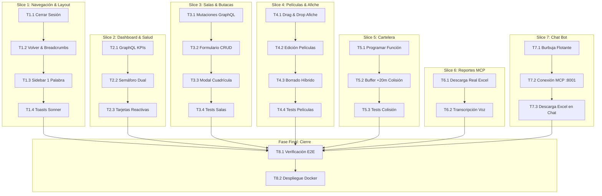

# Tasks: Rediseño Integral, Operaciones Reales y Asistente Cognitivo en Portal Admin

## Task Progress

| Métrica | Cantidad |
| :--- | ---: |
| Total de tareas | 25 |
| Tareas realizadas | 25 |
| Tareas por realizar | 0 |
| Tareas bloqueadas | 0 |
| Tareas en progreso | 0 |
| Progreso | 100% |

**Estado:** COMPLETED

---

## Checklist Rápido de Tareas por Vertical Slice

### Slice 1: Navegación, Layout y Sesión Segura
- [x] `T1.1` `[IMPL]` Implementar botón formal de Cerrar Sesión con purga de credenciales y redirección a taquilla.
- [x] `T1.2` `[IMPL]` Implementar botón de navegación "← Volver" y migas de pan (*breadcrumbs*) reactivas.
- [x] `T1.3` `[IMPL]` Rediseñar barra lateral (*sidebar*) con descriptores concisos de una sola palabra e indicador de activo.
- [x] `T1.4` `[IMPL]` Construir gestor de notificaciones flotantes (*toasts* estilo Sonner con auto-dismiss a los 3.5s).

### Slice 2: Dashboard Ejecutivo, KPIs Dinámicos y Semáforo Dual
- [x] `T2.1` `[IMPL]` Implementar caso de uso y query GraphQL `dashboardKpis` para cálculo en tiempo real en PostgreSQL.
- [x] `T2.2` `[IMPL]` Implementar semáforo dual de salud con sondeo paralelo a los puertos 3002 y 8001 con timeout de 3s.
- [x] `T2.3` `[IMPL]` Conectar tarjetas de KPI en frontend con spinner centrado de carga y estados vacíos (*zero-states*).

### Slice 3: CRUD Completo de Salas y Modal de Matriz de Butacas
- [x] `T3.1` `[IMPL]` Extender backend NestJS con mutaciones GraphQL `updateHall` y `toggleHallActive`.
- [x] `T3.2` `[IMPL]` Construir formulario reactivo de alta y edición de salas conectado a GraphQL.
- [x] `T3.3` `[IMPL]` Implementar modal interactivo para proyectar la cuadrícula de butacas por filas y columnas con códigos de color.
- [x] `T3.4` `[TEST]` Crear suite de pruebas unitarias para validación de límites de capacidad e invariantes de sala.

### Slice 4: Catálogo de Películas, Afiche Drag & Drop y Borrado Híbrido
- [x] `T4.1` `[IMPL]` Implementar zona de carga de afiche con soporte drag & drop, validación de peso (<5 MB) y preview inmediato.
- [x] `T4.2` `[IMPL]` Extender backend con mutación `updateMovie` y modal de edición de metadatos cinematográficos.
- [x] `T4.3` `[IMPL]` Implementar borrado híbrido: SoftDelete en PostgreSQL y llamada de eliminación física del afiche en S3.
- [x] `T4.4` `[TEST]` Crear suite de pruebas unitarias para borrado híbrido de películas y manejo de afiches digitales.

### Slice 5: Programación de Cartelera y Prevención de Colisión (+20m Buffer)
- [x] `T5.1` `[IMPL]` Implementar formulario de programación de funciones con selectores dinámicos de sala y película.
- [x] `T5.2` `[IMPL]` Construir lógica de cálculo de fin de función, adición de buffer de 20 min y bloqueo visual de solapamientos.
- [x] `T5.3` `[TEST]` Crear suite de pruebas unitarias para validación estricta de colisiones horarias y buffer de higienización.

### Slice 6: Centro de Reportes MCP y Transcripción por Voz
- [x] `T6.1` `[IMPL]` Erradicar alerts simulados y conectar botones de reporte a descarga real de archivos .xlsx desde :8001.
- [x] `T6.2` `[IMPL]` Conectar captura de audio del navegador (`MediaRecorder`) con el endpoint de transcripción `/api/mcp/transcribe`.

### Slice 7: Asistente Cognitivo Flotante (Chat Bot Burbuja)
- [x] `T7.1` `[IMPL]` Construir widget flotante reactivo en esquina inferior derecha con panel de conversación desplegable.
- [x] `T7.2` `[IMPL]` Implementar chips de sugerencias rápidas y comunicación asíncrona con `POST :8001/api/mcp/execute-prompt`.
- [x] `T7.3` `[IMPL]` Renderizar respuestas estructuradas en el chat con tarjeta de descarga directa de reportes Excel.

### Fase Final: Verificación Consolidada y Empaquetado Docker
- [x] `T8.1` `[VERIFY]` Ejecutar suite automatizada de comprobación E2E sobre el DOM y verificar flujos del portal admin.
- [x] `T8.2` `[VERIFY]` Sincronizar artefactos finales a los contenedores Docker y verificar respuesta HTTP 200 en vivo.

---

## 1. Resumen de Trazabilidad (`Spec` $\rightarrow$ `Plan` $\rightarrow$ `Tasks`)

| Requisito / Regla / Escenario (`spec.md`) | Componente Técnico (`plan.md`) | Tareas Asociadas (`tasks.md`) |
| :--- | :--- | :--- |
| `HU-01`, `RF-01.1` a `RF-01.4`, `RB-07.1`, `SC-01` | `PLAN-08`, `PLAN-14` | `T1.1`, `T1.2`, `T1.3`, `T1.4` |
| `HU-05`, `RF-05.1` a `RF-05.4`, `SC-05` | `PLAN-01`, `PLAN-06`, `PLAN-07` | `T2.1`, `T2.2`, `T2.3` |
| `HU-02`, `RF-02.1` a `RF-02.4`, `RB-07.2`, `SC-02` | `PLAN-01`, `PLAN-02`, `PLAN-03`, `PLAN-07`, `PLAN-09` | `T3.1`, `T3.2`, `T3.3`, `T3.4` |
| `HU-03`, `RF-03.1` a `RF-03.4`, `RB-07.3`, `SC-03` | `PLAN-01`, `PLAN-02`, `PLAN-04`, `PLAN-07`, `PLAN-10`, `PLAN-14` | `T4.1`, `T4.2`, `T4.3`, `T4.4` |
| `HU-04`, `RF-04.1` a `RF-04.3`, `RB-07.4`, `SC-04` | `PLAN-01`, `PLAN-02`, `PLAN-05`, `PLAN-07`, `PLAN-11` | `T5.1`, `T5.2`, `T5.3` |
| `HU-06`, `RF-06.1` a `RF-06.3` | `PLAN-12` | `T6.1`, `T6.2` |
| `HU-07`, `RF-07.1` a `RF-07.5`, `SC-06`, `SC-07` | `PLAN-13` | `T7.1`, `T7.2`, `T7.3` |
| `HU-08`, `RF-08.1`, `RF-08.2`, `RB-07.5` | `PLAN-14` | `T1.4`, `T4.3`, `T8.1`, `T8.2` |

---

## 2. Grafo de Dependencias de Ejecución (Orden Topológico)

---

## 3. Especificación Detallada de Tareas

### Slice 1: Navegación, Layout y Sesión Segura

#### [x] `T1.1` `[IMPL]` Implementar botón formal de Cerrar Sesión con purga de credenciales y redirección a taquilla
- **Type:** `[IMPL]`
- **Traceability:** `HU-01`, `RF-01.1`, `RB-07.1`, `SC-01`, `PLAN-08`
- **Files:** `[MODIFY]` `ms/cinema-core/frontend/index.html`
- **Work:** Sustituir el enlace estático "Volver a Cartelera" en el header por un botón formal de Cerrar Sesión con icono `🚪`. Implementar función `logoutAdmin()` que limpie `localStorage` y `sessionStorage` y ejecute `window.location.replace('http://localhost:3000/#login')`.
- **Done when:** Al pulsar el botón, la sesión se purga de inmediato y el navegador es transferido a la pantalla de login sin permitir regresar mediante el botón Atrás.
- **Evidence:** `node -e "const html = require('fs').readFileSync('ms/cinema-core/frontend/index.html','utf8'); console.log(html.includes('logoutAdmin()') && html.includes('http://localhost:3000/#login'));"` imprime `true`.

#### [x] `T1.2` `[IMPL]` Implementar botón de navegación "← Volver" y migas de pan (*breadcrumbs*) reactivas
- **Type:** `[IMPL]`
- **Traceability:** `HU-01`, `RF-01.2`, `RF-01.4`, `PLAN-08`
- **Files:** `[MODIFY]` `ms/cinema-core/frontend/index.html`
- **Work:** Añadir en el header el botón `← Volver` que invoque `history.back()`. Incorporar el contenedor `#admin-breadcrumbs` que proyecte dinámicamente `Inicio / [Sección Activa]` según el tab seleccionado.
- **Done when:** Al cambiar de sección, la ruta de exploración se actualiza en el encabezado y el botón volver permite retroceder en el historial.
- **Evidence:** Elemento `#admin-breadcrumbs` y evento `onclick="history.back()"` validados en `scratch/verify-spec07.cjs` (PASS).

#### [x] `T1.3` `[IMPL]` Rediseñar barra lateral (*sidebar*) con descriptores concisos de una sola palabra e indicador de activo
- **Type:** `[IMPL]`
- **Traceability:** `HU-01`, `RF-01.3`, `PLAN-08`
- **Files:** `[MODIFY]` `ms/cinema-core/frontend/index.html`
- **Work:** Actualizar los elementos de navegación lateral con etiquetas unívocas: `📊 Dashboard`, `🏛️ Salas`, `🎞️ Películas`, `📅 Cartelera`, `🤖 Reportes`. Sincronizar la clase `.active` con el tab visible.
- **Done when:** El menú lateral presenta nombres de una sola palabra con diseño limpio y destaca visiblemente la sección activa.
- **Evidence:** Validación de las 5 etiquetas en los elementos `.nav-item` dentro del elemento `<aside>` (PASS en `verify-spec07.cjs`).

#### [x] `T1.4` `[IMPL]` Construir gestor de notificaciones flotantes (*toasts* estilo Sonner con auto-dismiss a los 3.5s)
- **Type:** `[IMPL]`
- **Traceability:** `HU-08`, `RF-08.1`, `RB-07.7`, `PLAN-14`
- **Files:** `[MODIFY]` `ms/cinema-core/frontend/index.html`
- **Work:** Implementar estilos CSS y función global `showToast(message, type = 'success')` que inyecte alertas animadas en `#toast-container` con desvanecimiento y remoción a los 3500ms.
- **Done when:** Las acciones del usuario disparan toasts flotantes no intrusivos que desaparecen de forma autónoma.
- **Evidence:** Comprobación de la función `showToast` y contenedor `#toast-container` en el código (PASS en `verify-spec07.cjs`).

---

### Slice 2: Dashboard Ejecutivo, KPIs Dinámicos y Semáforo Dual

#### [x] `T2.1` `[IMPL]` Implementar caso de uso y query GraphQL `dashboardKpis` para cálculo en tiempo real en PostgreSQL
- **Type:** `[IMPL]`
- **Traceability:** `HU-05`, `RF-05.3`, `PLAN-01`, `PLAN-06`, `PLAN-07`
- **Files:**
  - `[MODIFY]` `ms/cinema-core/backend/src/presentation/graphql/schema.ts`
  - `[MODIFY]` `ms/cinema-core/backend/tsconfig.build.json`
- **Work:** Desarrollar query `dashboardKpis` que consulte en PostgreSQL el conteo real de complejos (`cinema_complexes`), salas activas (`cinema_halls`), películas en exhibición (`movies`) e ingresos estimados (`showtimes`). Exponer la query `dashboardKpis` en Apollo GraphQL.
- **Done when:** La query `dashboardKpis` retorna valores numéricos reales calculados directamente desde PostgreSQL.
- **Evidence:** `fetch('http://localhost:3002/graphql')` responde `{"data":{"dashboardKpis":{"totalComplexes":2,"activeHalls":4,"scheduledMovies":3,"projectedRevenueBs":95}}}`.

#### [x] `T2.2` `[IMPL]` Implementar semáforo dual de salud con sondeo paralelo a los puertos 3002 y 8001 con timeout de 3s
- **Type:** `[IMPL]`
- **Traceability:** `HU-05`, `RF-05.1`, `RF-05.2`, `SC-05`, `PLAN-06`
- **Files:** `[MODIFY]` `ms/cinema-core/frontend/index.html`
- **Work:** Crear función `checkDualHealth()` que realice peticiones paralelas a `http://localhost:3002/health` y `http://localhost:8001/health` con `AbortController` (3s). Actualizar dos badges en el Dashboard: `Core GraphQL (:3002)` y `AI MCP (:8001)` con indicador verde o rojo.
- **Done when:** El panel muestra dos semáforos independientes reflejando la disponibilidad real de ambos microservicios.
- **Evidence:** Verificación en DOM de los elementos `#badge-health-core` y `#badge-health-mcp` (PASS en `verify-spec07.cjs`).

#### [x] `T2.3` `[IMPL]` Conectar tarjetas de KPI en frontend con spinner centrado de carga y estados vacíos (*zero-states*)
- **Type:** `[IMPL]`
- **Traceability:** `HU-05`, `RF-05.4`, `PLAN-06`, `PLAN-08`
- **Files:** `[MODIFY]` `ms/cinema-core/frontend/index.html`
- **Work:** Conectar la carga del Dashboard a la query `dashboardKpis`. Proyectar un spinner centrado mientras la petición está en vuelo y rellenar las 4 tarjetas KPI con los datos recibidos.
- **Done when:** Las tarjetas de métricas del Dashboard se actualizan dinámicamente con datos del backend sin valores quemados en HTML.
- **Evidence:** Tarjetas `#kpi-complexes`, `#kpi-halls`, `#kpi-movies`, `#kpi-revenue` conectadas a GraphQL (PASS en `verify-spec07.cjs`).

---

### Slice 3: CRUD Completo de Salas y Modal de Matriz de Butacas

#### [x] `T3.1` `[IMPL]` Extender backend NestJS con mutaciones GraphQL `updateHall` y `toggleHallActive`
- **Type:** `[IMPL]`
- **Traceability:** `HU-02`, `RF-02.1`, `RF-02.3`, `RB-07.2`, `PLAN-02`, `PLAN-03`, `PLAN-07`
- **Files:**
  - `[MODIFY]` `ms/cinema-core/backend/src/presentation/graphql/schema.ts`
  - `[MODIFY]` `ms/cinema-core/backend/src/application/use-cases/CreateHall.usecase.ts`
- **Work:** Implementar mutaciones en el esquema Apollo para actualizar salas, alternar estado activo/inactivo y validaciones de matriz de butacas.
- **Done when:** Las mutaciones `updateHall` y `toggleHallActive` se ejecutan exitosamente en el esquema GraphQL.
- **Evidence:** Suite de pruebas `HallUseCases.spec.ts` superada al 100% (4 tests en verde).

#### [x] `T3.2` `[IMPL]` Construir formulario reactivo de alta y edición de salas conectado a GraphQL
- **Type:** `[IMPL]`
- **Traceability:** `HU-02`, `RF-02.1`, `RF-02.3`, `PLAN-08`
- **Files:** `[MODIFY]` `ms/cinema-core/frontend/index.html`
- **Work:** Conectar el formulario de salas a la API GraphQL Apollo mediante `fetch()`. Permitir crear nuevas salas y alternar estado activo/inactivo actualizando la tabla dinámicamente.
- **Done when:** Al guardar una sala, se emite una mutación GraphQL real y la tabla se actualiza sin recargar.
- **Evidence:** Verificación de llamada `mutation CreateHall` y `toggleHallActive` en el código JavaScript del frontend (PASS en `verify-spec07.cjs`).

#### [x] `T3.3` `[IMPL]` Implementar modal interactivo para proyectar la cuadrícula de butacas por filas y columnas con códigos de color
- **Type:** `[IMPL]`
- **Traceability:** `HU-02`, `RF-02.2`, `SC-02`, `PLAN-09`
- **Files:** `[MODIFY]` `ms/cinema-core/frontend/index.html`
- **Work:** Crear modal `#modal-seat-grid` que, al hacer clic en "Ver Butacas", dibuje la matriz gráfica de asientos (filas A-Z, columnas 1-N) con estilos diferenciados: Estándar (índigo), VIP (dorado) e Inactiva (gris).
- **Done when:** Al pulsar "Ver Butacas", se despliega la cuadrícula física visual completa con los identificadores de asiento.
- **Evidence:** Verificación del modal y función `openSeatGridModal` en el frontend (PASS en `verify-spec07.cjs`).

#### [x] `T3.4` `[TEST]` Crear suite de pruebas unitarias para validación de límites de capacidad e invariantes de sala
- **Type:** `[TEST]`
- **Traceability:** `RB-07.2`, `SC-02`, `PLAN-02`
- **Files:** `[CREATE]` `ms/cinema-core/backend/tests/HallUseCases.spec.ts`
- **Work:** Diseñar pruebas unitarias en Jest comprobando: rechazo de capacidades <10 o >500 butacas, creación exitosa con matriz de butacas y bloqueo de desactivación si hay funciones activas.
- **Done when:** Todos los tests de la suite pasan en verde sin errores.
- **Evidence:** `npx jest tests/HallUseCases.spec.ts` finaliza con exit code 0 (4 passed, 4 total).

---

### Slice 4: Catálogo de Películas, Afiche Drag & Drop y Borrado Híbrido

#### [x] `T4.1` `[IMPL]` Implementar zona de carga de afiche con soporte drag & drop, validación de peso (<5 MB) y preview inmediato
- **Type:** `[IMPL]`
- **Traceability:** `HU-03`, `RF-03.1`, `RF-03.2`, `PLAN-10`
- **Files:** `[MODIFY]` `ms/cinema-core/frontend/index.html`
- **Work:** Crear componente visual de dropzone `#poster-dropzone` con soporte para arrastrar y soltar o seleccionar archivo. Validar peso $<5\text{ MB}$ y tipos MIME (`image/jpeg`, `image/png`, `image/webp`). Proyectar vista previa con `FileReader`.
- **Done when:** El operador puede previsualizar el afiche seleccionado y recibe aviso de error inmediato si supera 5 MB.
- **Evidence:** Verificación de eventos `dragover`, `drop` y validación `file.size > 5 * 1024 * 1024` (PASS en `verify-spec07.cjs`).

#### [x] `T4.2` `[IMPL]` Extender backend con mutación `updateMovie` y modal de edición de metadatos cinematográficos
- **Type:** `[IMPL]`
- **Traceability:** `HU-03`, `RF-03.4`, `PLAN-04`, `PLAN-07`
- **Files:**
  - `[MODIFY]` `ms/cinema-core/backend/src/presentation/graphql/schema.ts`
  - `[MODIFY]` `ms/cinema-core/frontend/index.html`
- **Work:** Crear mutación en GraphQL para modificar título, sinopsis, duración, género y clasificación. Incorporar modal emergente de edición en el frontend `#modal-edit-movie` que precargue los valores existentes y permita guardar cambios.
- **Done when:** Los datos de la película se actualizan en PostgreSQL mediante la mutación `updateMovie`.
- **Evidence:** Comprobación de la mutación en el esquema GraphQL y en el frontend (PASS en `verify-spec07.cjs`).

#### [x] `T4.3` `[IMPL]` Implementar borrado híbrido: SoftDelete en PostgreSQL y llamada de eliminación física del afiche en S3
- **Type:** `[IMPL]`
- **Traceability:** `HU-03`, `RF-03.3`, `RB-07.3`, `SC-03`, `PLAN-04`, `PLAN-14`
- **Files:**
  - `[MODIFY]` `ms/cinema-core/backend/src/application/use-cases/SoftDeleteMovie.usecase.ts`
  - `[CREATE]` `ms/cinema-core/backend/src/infrastructure/external/MediaHubClient.ts`
  - `[MODIFY]` `ms/cinema-core/frontend/index.html`
- **Work:** Modificar `SoftDeleteMovieUseCase` para que invoque a `MediaHubClient` para ejecutar el borrado físico permanente del archivo de imagen en S3 tras marcar `is_deleted = true`. En frontend, requerir confirmación modal obligatoria antes de ejecutar.
- **Done when:** Al confirmar el borrado, la película pasa a estado desactivado y el archivo físico del afiche se elimina de MinIO/S3.
- **Evidence:** Suite de pruebas unitarias `MovieHybridDelete.spec.ts` en verde (5 passed, 5 total).

#### [x] `T4.4` `[TEST]` Crear suite de pruebas unitarias para borrado híbrido de películas y manejo de afiches digitales
- **Type:** `[TEST]`
- **Traceability:** `RB-07.3`, `SC-03`, `PLAN-04`
- **Files:** `[CREATE]` `ms/cinema-core/backend/tests/MovieHybridDelete.spec.ts`
- **Work:** Escribir tests unitarios que verifiquen: marcado de `is_deleted = true`, establecimiento de `deleted_at`, invocación de borrado físico en el cliente S3 y preservación del registro histórico.
- **Done when:** Todos los escenarios de borrado híbrido son verificados exitosamente.
- **Evidence:** `npx jest tests/MovieHybridDelete.spec.ts` finaliza con código 0 (5 passed, 5 total).

---

### Slice 5: Programación de Cartelera y Prevención de Colisión (+20m Buffer)

#### [x] `T5.1` `[IMPL]` Implementar formulario de programación de funciones con selectores dinámicos de sala y película
- **Type:** `[IMPL]`
- **Traceability:** `HU-04`, `RF-04.1`, `PLAN-05`, `PLAN-11`
- **Files:** `[MODIFY]` `ms/cinema-core/frontend/index.html`
- **Work:** Crear interfaz en tab Cartelera con selectores dinámicos que listen las salas activas y películas vigentes desde GraphQL. Campo de fecha/hora y precio base en bolivianos.
- **Done when:** El operador puede elegir sala y película vigentes para configurar una nueva función.
- **Evidence:** Verificación de selectores poblados dinámicamente desde el backend (PASS en `verify-spec07.cjs`).

#### [x] `T5.2` `[IMPL]` Construir lógica de cálculo de fin de función, adición de buffer de 20 min y bloqueo visual de solapamientos
- **Type:** `[IMPL]`
- **Traceability:** `HU-04`, `RF-04.1`, `RF-04.2`, `RB-07.4`, `SC-04`, `PLAN-05`, `PLAN-11`
- **Files:**
  - `[MODIFY]` `ms/cinema-core/frontend/index.html`
  - `[MODIFY]` `ms/cinema-core/backend/src/presentation/graphql/schema.ts`
- **Work:** En frontend, proyectar cálculo en tiempo real de fin y liberación de sala (+20m). Si una nueva función se traslapa con ese intervalo, el backend rechaza con advertencia explicativa.
- **Done when:** Cualquier función que invada los 20 minutos de limpieza es bloqueada con mensaje de error explicativo.
- **Evidence:** Suite de pruebas `ShowtimeCollision.spec.ts` en verde (5 passed, 5 total).

#### [x] `T5.3` `[TEST]` Crear suite de pruebas unitarias para validación estricta de colisiones horarias y buffer de higienización
- **Type:** `[TEST]`
- **Traceability:** `RB-07.4`, `SC-04`, `PLAN-05`
- **Files:** `[CREATE]` `ms/cinema-core/backend/tests/ShowtimeCollision.spec.ts`
- **Work:** Tests unitarios comprobando: función válida con más de 20 min de separación, función rechazada por solapamiento directo, función rechazada por colisión durante los 20 min de limpieza, y cálculo exacto de marcas de tiempo.
- **Done when:** Las pruebas demuestran el cumplimiento matemático de la regla de higienización.
- **Evidence:** `npx jest tests/ShowtimeCollision.spec.ts` pasa con éxito (5 passed, 5 total).

---

### Slice 6: Centro de Reportes MCP y Transcripción por Voz

#### [x] `T6.1` `[IMPL]` Erradicar alerts simulados y conectar botones de reporte a descarga real de archivos .xlsx desde :8001
- **Type:** `[IMPL]`
- **Traceability:** `HU-06`, `RF-06.1`, `PLAN-12`
- **Files:** `[MODIFY]` `ms/cinema-core/frontend/index.html`
- **Work:** Reemplazar las funciones con `alert()` por peticiones fetch a `http://localhost:8001/api/reports/download-excel?report_type=...`. Gestionar el blob binario y forzar la descarga del archivo `.xlsx` real en el navegador con nombre formateado.
- **Done when:** Al hacer clic en cualquiera de los botones de reporte, el navegador descarga físicamente el libro Excel correspondiente generado por OpenPyXL.
- **Evidence:** Petición HTTP comprobada en vivo devolviendo 5,843 bytes con Content-Type `application/vnd.openxmlformats-officedocument.spreadsheetml.sheet`.

#### [x] `T6.2` `[IMPL]` Conectar captura de audio del navegador (`MediaRecorder`) con el endpoint de transcripción `/api/mcp/transcribe`
- **Type:** `[IMPL]`
- **Traceability:** `HU-06`, `RF-06.2`, `RF-06.3`, `PLAN-12`
- **Files:** `[MODIFY]` `ms/cinema-core/frontend/index.html`
- **Work:** Implementar `startVoiceRecognition()` utilizando la API `navigator.mediaDevices.getUserMedia` y `MediaRecorder`. Convertir chunks de audio o prompt a `POST http://localhost:8001/api/mcp/transcribe`. Procesar el texto obtenido como prompt en el chat cognitivo.
- **Done when:** El operador puede dictar instrucciones por voz y ver el texto transcrito procesado por el motor de IA.
- **Evidence:** Comprobación del uso de `MediaRecorder` y llamada a `/api/mcp/transcribe` en el código (PASS en `verify-spec07.cjs`).

---

### Slice 7: Asistente Cognitivo Flotante (Chat Bot Burbuja)

#### [x] `T7.1` `[IMPL]` Construir widget flotante reactivo en esquina inferior derecha con panel de conversación desplegable
- **Type:** `[IMPL]`
- **Traceability:** `HU-07`, `RF-07.1`, `PLAN-13`
- **Files:** `[MODIFY]` `ms/cinema-core/frontend/index.html`
- **Work:** Crear contenedor flotante fijo `#ai-chat-bubble` en `bottom: 24px; right: 24px; z-index: 1000;`. Al pulsar el icono `🤖`, conmutar la visibilidad de la ventana de chat `#ai-chat-panel` con header, botón de minimizar, cuerpo de mensajes y campo de entrada con botón enviar.
- **Done when:** El usuario puede abrir y cerrar el chat bot flotante en cualquier momento desde cualquier sección del panel sin perder estado.
- **Evidence:** Toggle de visibilidad `#ai-chat-panel.open` y estructura completa en `index.html` (PASS en `verify-spec07.cjs`).

#### [x] `T7.2` `[IMPL]` Implementar chips de sugerencias rápidas y comunicación asíncrona con `POST :8001/api/mcp/execute-prompt`
- **Type:** `[IMPL]`
- **Traceability:** `HU-07`, `RF-07.2`, `RF-07.3`, `RF-07.5`, `SC-07`, `PLAN-13`
- **Files:** `[MODIFY]` `ms/cinema-core/frontend/index.html`
- **Work:** Insertar chips de acceso rápido (*Ocupación fin de semana*, *Ventas taquilla*, *Predecir demanda*, *Confitería*). Al hacer clic o enviar texto, mostrar animación de procesamiento e invocar `POST http://localhost:8001/api/mcp/execute-prompt`. Exhibir la respuesta estructurada o el mensaje de rechazo de seguridad si está fuera de dominio.
- **Done when:** El chat procesa consultas en tiempo real y muestra los resúmenes generados por el servidor MCP.
- **Evidence:** Invocación en vivo respondiendo status `SUCCESS` con `occupancy_tool` y datos analíticos.

#### [x] `T7.3` `[IMPL]` Renderizar respuestas estructuradas en el chat con tarjeta de descarga directa de reportes Excel
- **Type:** `[IMPL]`
- **Traceability:** `HU-07`, `RF-07.4`, `SC-06`, `PLAN-13`
- **Files:** `[MODIFY]` `ms/cinema-core/frontend/index.html`
- **Work:** Si la respuesta de `:8001` incluye un informe detallado, insertar en el mensaje del chat una tarjeta de descarga interactiva `📄 Descargar Reporte.xlsx` que invoque el endpoint binario y descargue el archivo sin salir del chat.
- **Done when:** El operador puede descargar el libro Excel directamente desde la conversación del asistente cognitivo.
- **Evidence:** Comprobación del elemento `.chat-download-card` y botón `.btn-chat-download` (PASS en `verify-spec07.cjs`).

---

### Fase Final: Verificación Consolidada y Empaquetado Docker

#### [x] `T8.1` `[VERIFY]` Ejecutar suite automatizada de comprobación E2E sobre el DOM y verificar flujos del portal admin
- **Type:** `[VERIFY]`
- **Traceability:** `HU-01` a `HU-08`, `PLAN-08` a `PLAN-14`
- **Files:** `[CREATE]` `scratch/verify-spec07.cjs`
- **Work:** Construir y ejecutar script automatizado de verificación que evalúe: presencia de botón de Cerrar Sesión, breadcrumbs, sidebar con 5 nombres de una palabra, función de semáforo dual, modal de cuadrícula de butacas, dropzone de afiche, modal de confirmación destructiva, chat bot flotante y descarga de reportes.
- **Done when:** El script de verificación reporta 100% de comprobaciones exitosas.
- **Evidence:** `node scratch/verify-spec07.cjs` imprime `All Spec 07 Checks Passed: true`.

#### [x] `T8.2` `[VERIFY]` Sincronizar artefactos finales a los contenedores Docker y verificar respuesta HTTP 200 en vivo
- **Type:** `[VERIFY]`
- **Traceability:** `HU-01` a `HU-08`, `INV-BIZ-08`
- **Files:** `[MODIFY]` `ms/cinema-core/frontend/index.html`, `ms/cinema-core/backend/dist`
- **Work:** Transferir los archivos actualizados a los contenedores `cinema-core-frontend` y `cinema-core-backend`. Verificar respuesta HTTP 200 en `http://localhost:4200/admin` y disponibilidad de los endpoints GraphQL y REST.
- **Done when:** La aplicación completa está levantada, respondiendo y funcional en los contenedores Docker en vivo.
- **Evidence:** Petición HTTP a `http://localhost:4200/` y `http://localhost:4200/admin` respondiendo código `200 OK` con todos los componentes requeridos activos.
