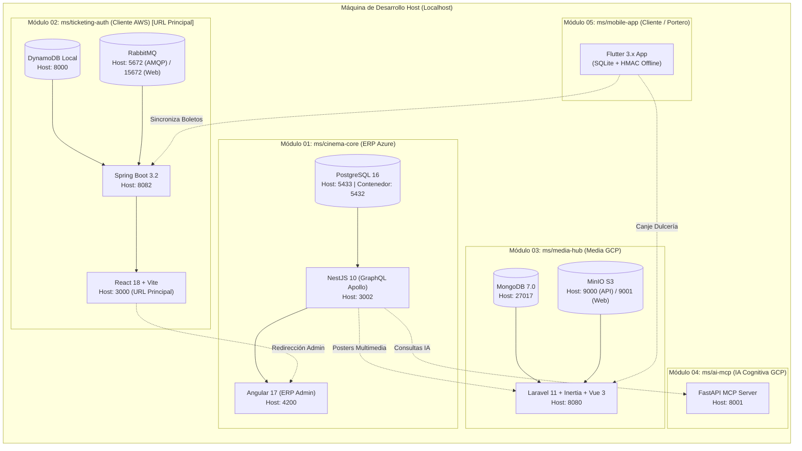

# Guía de Levantamiento en Desarrollo con Docker (ms/docs/levantar_x_dockers/README.md)

> **Estado:** APPROVED  
> **Versión:** 1.4.0  
> **Entorno:** Desarrollo Local (`development`)  
> **Estrategia:** Descentralización Contenerizada Soberana con Docker Compose  
> **Gobernanza:** Subordinado a [`docs/constitution.md`](../../../docs/constitution.md) y [`ms/README.md`](../../README.md)  
> **Metodología:** Spec-Driven Development (Formato Step Cards `/doc-deploy`)

---

## 🗺️ 1. Arquitectura del Ecosistema en Desarrollo Local

El sistema Cine Center se compone de 5 módulos verticales autónomos en `ms/`. Cada subsistema (del 01 al 04) cuenta con su propio `docker-compose.yml`, bases de datos dedicadas y redes bridge independientes para simular el aislamiento Multi-Cloud sin interferencias:



---

## 📊 2. Matriz de Puertos, Contenedores y Credenciales de Prueba

### Puertos y Servicios Expuestos en Localhost:
| Módulo | Contenedor | Puerto Host | Puerto Docker | Servicio y Endpoint Local |
| :--- | :--- | :---: | :---: | :--- |
| **01 Cinema Core** | `cinema-core-postgres` | `5433` | `5432` | PostgreSQL (`cinema_db`, user: `postgres`, pass: `postgres`) |
| **01 Cinema Core** | `cinema-core-backend` | `3002` | `3002` | NestJS GraphQL (`/graphql`) & Health (`/health`) |
| **01 Cinema Core** | `cinema-core-frontend` | `4200` | `80` | Portal ERP Angular (`http://localhost:4200/admin`) |
| **02 Ticketing** | `cine_ticketing_dynamodb` | `8000` | `8000` | DynamoDB Local Shell (`http://localhost:8000/shell`) |
| **02 Ticketing** | `cine_ticketing_rabbitmq` | `5672`<br>`15672` | `5672`<br>`15672` | AMQP & Consola RabbitMQ (`http://localhost:15672`) |
| **02 Ticketing** | `cine_ticketing_backend` | `8082` | `8082` | Spring Boot API (`http://localhost:8082/api/v1/health`) |
| **02 Ticketing** | `cine_ticketing_frontend` | `3000` | `3000` | **URL Principal Cliente (`http://localhost:3000/`)** |
| **03 Media Hub** | `cine_media_hub_mongodb` | `27017` | `27017` | MongoDB (`media_hub`) |
| **03 Media Hub** | `cine_media_hub_minio` | `9000`<br>`9001` | `9000`<br>`9001` | S3 API (`:9000`) & Consola Web MinIO (`http://localhost:9001`) |
| **03 Media Hub** | `cine_media_hub_service` | `8080` | `8080` | Monolito Laravel (`http://localhost:8080/pos/candy-scan`) |
| **04 AI MCP** | `cine_ai_mcp_service` | `8001` | `8001` | FastAPI MCP Swagger (`http://localhost:8001/docs`) |
| **05 Mobile App** | *Ejecución Local* | *Variable* | *Nativo* | Flutter App (`flutter run -d chrome`) |

### Matriz de Credenciales Canónicas de Desarrollo:
> Contraseña universal para todos los roles: **`Password123!`**

| Rol Canónico | Correo | Password | Interfaz de Acceso |
| :--- | :--- | :--- | :--- |
| **Cliente (`ROLE_CUSTOMER`)** | `cliente@test.com` | `Password123!` | Portal Cliente `http://localhost:3000/` y Billetera |
| **Gerente (`ROLE_MANAGER`)** | `operador@test.com` | `Password123!` | ERP Administrativo `http://localhost:4200/admin` |
| **Cajero Taquilla / Bar (`ROLE_CASHIER`)** | `cajero@test.com` | `Password123!` | Terminal POS Dulcería `http://localhost:8080/pos/candy-scan` |
| **Portero Acceso (`ROLE_GATEKEEPER`)** | `portero@test.com` | `Password123!` | Escáner Cámara App Móvil (`ms/mobile-app`) |
| **Superadministrador (`ROLE_SUPERADMIN`)** | `admin@test.com` | `Password123!` | Panel Global de Administración `http://localhost:4200/admin` |

---

## ⚡ 3. Secuencia de Pasos Estructurados para el Levantamiento (Step Cards)

---

### 🚀 Paso 1: Prerrequisitos de Docker y Recursos de Memoria

> [!NOTE]
> **Propósito:** Verificar que Docker Engine esté activo y asignar los recursos mínimos necesarios para correr los 4 módulos simultáneamente sin caídas por Out-Of-Memory (OOM).  
> **Contexto de Ejecución:** `[PC LOCAL]` (Terminal del Host)  
> **Ruta de Trabajo:** Cualquier ubicación

```bash
# Comprobar versiones instaladas
docker --version
docker compose version
```

> [!TIP]
> **Verificación Observable & Salida Esperada:**
> - Docker Engine: `>= 24.0.0`
> - Docker Compose: `>= v2.20.0`
> - En Docker Desktop: Asegúrate de tener al menos **6 a 8 GB de RAM** asignada en *Settings > Resources*.

---

### 🚀 Paso 2: Preparar Archivos de Variables de Entorno (`.env`)

> [!NOTE]
> **Propósito:** Generar los archivos `.env` a partir de sus respectivas plantillas `.env.example` en cada módulo para el entorno de desarrollo local.  
> **Contexto de Ejecución:** `[PC LOCAL]`  
> **Ruta de Trabajo:** Raíz del proyecto

```bash
# 1. Módulo 01: Cinema Core
cp ms/cinema-core/backend/.env.example ms/cinema-core/backend/.env
cp ms/cinema-core/frontend/.env.example ms/cinema-core/frontend/.env

# 2. Módulo 02: Ticketing & Auth
cp ms/ticketing-auth/backend/.env.example ms/ticketing-auth/backend/.env
cp ms/ticketing-auth/frontend/.env.example ms/ticketing-auth/frontend/.env

# 3. Módulo 03: Media Hub
cp ms/media-hub/.env.example ms/media-hub/.env

# 4. Módulo 04: AI MCP
cp ms/ai-mcp/.env.example ms/ai-mcp/.env

# 5. Módulo 05: Mobile App
cp ms/mobile-app/.env.example ms/mobile-app/.env
```

> [!TIP]
> **Verificación Observable & Salida Esperada:**
> Comprueba que los archivos `.env` existan con:
> ```bash
> ls -la ms/cinema-core/backend/.env ms/ticketing-auth/backend/.env ms/media-hub/.env ms/ai-mcp/.env
> ```

---

### 🚀 Paso 3: Levantar Módulo 01 — Cinema Core ERP (`ms/cinema-core`)

> [!NOTE]
> **Propósito:** Iniciar la base de datos PostgreSQL en el puerto 5433, el backend NestJS GraphQL en el 3002 y el Portal de Administración ERP Angular en el 4200.  
> **Contexto de Ejecución:** `[PC LOCAL]`  
> **Ruta de Trabajo:** `ms/cinema-core`

```bash
cd ms/cinema-core
docker compose up -d --build
```

> [!TIP]
> **Verificación Observable & Salida Esperada:**
> ```bash
> docker compose ps
> # Comprueba que cinema-core-postgres reporte "(healthy)"
> curl -I http://localhost:3002/health
> # Salida esperada: HTTP/1.1 200 OK
> ```
> *Acceso Web ERP:* Abre `http://localhost:4200/admin` en el navegador.

---

### 🚀 Paso 4: Levantar Módulo 03 — Media Hub & POS Dulcería (`ms/media-hub`)

> [!NOTE]
> **Propósito:** Iniciar MongoDB en el puerto 27017, MinIO S3 en los puertos 9000/9001 y el monolito modular Laravel 11 en el puerto 8080.  
> **Contexto de Ejecución:** `[PC LOCAL]`  
> **Ruta de Trabajo:** `ms/media-hub`

```bash
cd ../media-hub
docker compose up -d --build
```

> [!TIP]
> **Verificación Observable & Salida Esperada:**
> ```bash
> curl -I http://localhost:8080/api/health
> # Salida esperada: HTTP/1.1 200 OK
> ```
> *Acceso Web POS:* Abre `http://localhost:8080/pos/candy-scan`  
> *Consola MinIO S3:* Abre `http://localhost:9001` (Usuario: `cinecenter_admin` / Password: `cinecenter_secret_2026`).

---

### 🚀 Paso 5: Levantar Módulo 04 — AI MCP Service (`ms/ai-mcp`)

> [!NOTE]
> **Propósito:** Levantar el microservicio headless FastAPI MCP en el puerto 8001 para soportar los reportes analíticos e inferencia de demanda.  
> **Contexto de Ejecución:** `[PC LOCAL]`  
> **Ruta de Trabajo:** `ms/ai-mcp`

```bash
cd ../ai-mcp
docker compose up -d --build
```

> [!TIP]
> **Verificación Observable & Salida Esperada:**
> ```bash
> curl -s http://localhost:8001/health
> # Salida esperada: {"status":"healthy"}
> ```
> *Documentación Interactiva Swagger:* `http://localhost:8001/docs`

---

### 🚀 Paso 6: Levantar Módulo 02 — Ticketing & Auth (`ms/ticketing-auth`) [URL Principal]

> [!NOTE]
> **Propósito:** Levantar DynamoDB Local (8000), RabbitMQ (5672/15672), Spring Boot API (8082) y el Portal de Cliente React (3000), que es la **URL principal de entrada del ecosistema**.  
> **Contexto de Ejecución:** `[PC LOCAL]`  
> **Ruta de Trabajo:** `ms/ticketing-auth`

```bash
cd ../ticketing-auth
docker compose up -d --build
```

> [!TIP]
> **Verificación Observable & Salida Esperada:**
> ```bash
> curl -I http://localhost:8082/api/v1/health
> # Salida esperada: HTTP/1.1 200 OK
> ```
> *Portal Principal de Cliente:* Abre `http://localhost:3000/`. Debes ver la Cartelera Pública interactiva y el semáforo de conexión en verde.  
> *Consola RabbitMQ:* `http://localhost:15672` (Usuario: `cinecenter_guest` / Password: `cinecenter_rabbit_2026`).

---

### 🚀 Paso 7: Ejecutar Módulo 05 — Aplicación Móvil (`ms/mobile-app`)

> [!NOTE]
> **Propósito:** Iniciar la app móvil cliente/validador en modo local apuntando a los contenedores ya levantados.  
> **Contexto de Ejecución:** `[PC LOCAL]`  
> **Ruta de Trabajo:** `ms/mobile-app`

```bash
cd ../mobile-app
flutter pub get
flutter run -d chrome
```

---

## 🛠️ 4. Operaciones de Mantenimiento, Pausa y Reactivación

### Pausar Todos los Contenedores (Ahorro de CPU y RAM):
```bash
# Detiene los contenedores sin borrar datos ni configuraciones
cd ms/ticketing-auth && docker compose stop
cd ../ai-mcp && docker compose stop
cd ../media-hub && docker compose stop
cd ../cinema-core && docker compose stop
```

### Reactivar Todos los Contenedores al Día Siguiente (Arranque en < 10 segundos):
```bash
# Inicia de inmediato los contenedores previamente compilados
cd ms/cinema-core && docker compose start
cd ../media-hub && docker compose start
cd ../ai-mcp && docker compose start
cd ../ticketing-auth && docker compose start
```

### Reconstruir un Contenedor tras Modificar Código:
```bash
# Ejemplo: modificaste código en el frontend de ticketing-auth
cd ms/ticketing-auth
docker compose build --no-cache ticketing-frontend
docker compose up -d --no-deps ticketing-frontend
```

---

## ⚠️ 5. Guía de Solución de Problemas Frecuentes (Troubleshooting)

1. **Error: `bind: address already in use` en puerto 5433 o 3000**:
   - *Causa:* Hay otro servicio corriendo en ese puerto.
   - *Solución:* Identifica el proceso con `netstat -ano | findstr <PUERTO>` en Windows o `lsof -i :<PUERTO>` en Linux/WSL y finalízalo.
2. **Error: `Connection refused` entre Spring Boot y DynamoDB Local**:
   - *Causa:* Spring Boot arrancó antes de que DynamoDB completara su inicialización interna.
   - *Solución:* En `ms/ticketing-auth`, ejecuta `docker compose restart ticketing-backend`.
3. **Pérdida accidental de datos**:
   - *Causa:* Se ejecutó `docker compose down -v` (con bandera de borrado de volúmenes).
   - *Solución:* Usa siempre `docker compose stop` o `docker compose down` sin `-v`. Si necesitas regenerar datos de prueba, ejecuta `docker compose exec backend npm run seed` en `ms/cinema-core`.

